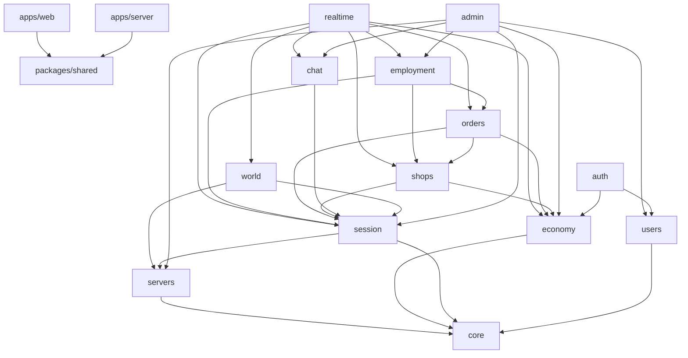
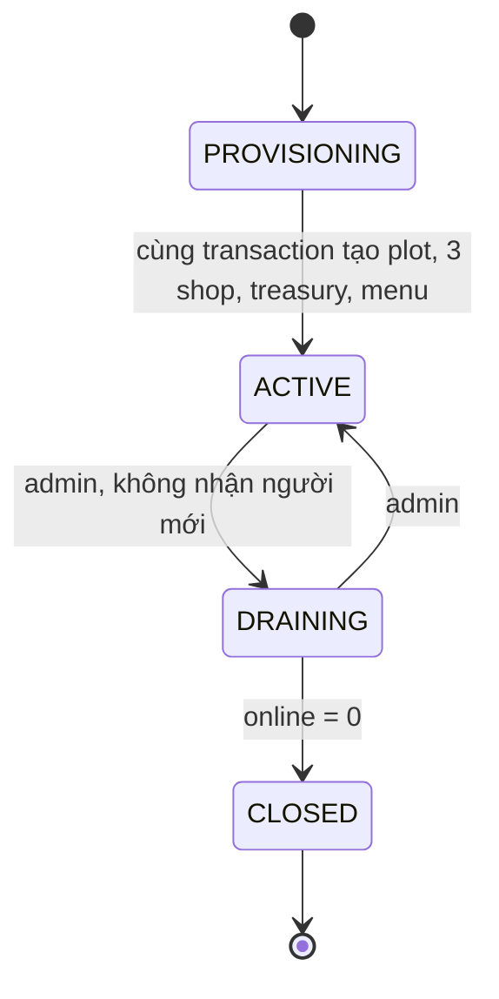
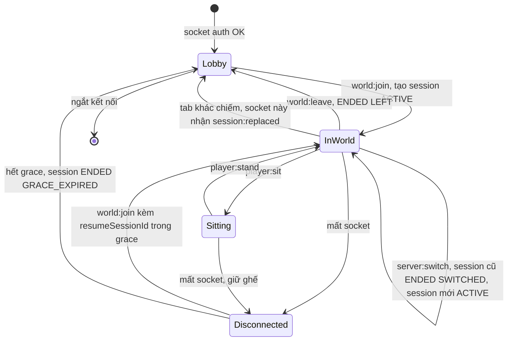
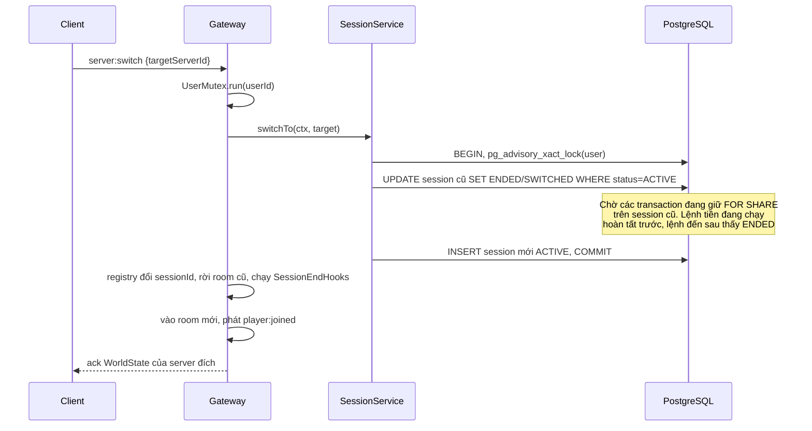
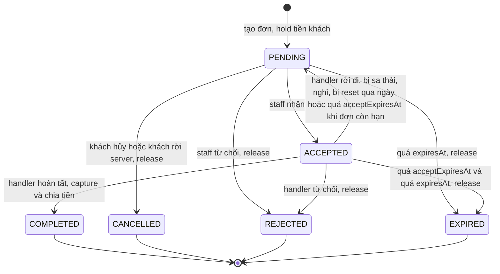
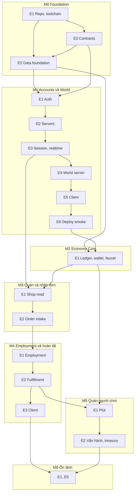

# TRÀ ĐÁ VỈA HÈ — Implementation Plan MVP

**Phiên bản:** 1.1 · **Ngày:** 05/11/2026 · **Đầu vào:** `TRA-DA-VIA-HE-MVP-TECHNICAL-PLAN.md` v1.2 và `assets/tra-da-via-he-concept.png`
**Trạng thái:** Product owner (PO) đã chốt các Blocker ngày 05/11/2026 (§5.1), kèm thay đổi về quán DEFAULT (B2) và deploy Render free (§3.10); B5 được thay bằng thiết kế tài khoản khách của người điều phối. Các mục Important ở §5.2 chưa chốt vẫn là đề xuất.
**Tiến độ:** M0-E1 (T1..T7) và M0-E3 (T1..T3) đã merge vào `main`. Việc tiếp theo: M0-E3-T4, rồi M0-E2. Từ M1 trở đi chưa bắt đầu.

---

## 1. Tóm tắt và hiện trạng

**Hiện trạng:** repo có toolchain, Docker Compose dev/test, CI, skeleton `apps/server` và `apps/web`, và contract `packages/shared` (`errors.ts`, `enums.ts`, `events.ts`, `rest.ts`). Chưa có Prisma schema, chưa có remote GitHub. Máy dev: Node 24.21.0, Docker 29.8.0, Windows.

**Plan này gồm:** 7 milestone, 22 epic, 97 task (50 high-risk), tổ chức theo dependency thực. Khác baseline chủ yếu ở chỗ Economy Core đứng trước Order, và luồng hoàn tất đơn chỉ xuất hiện sau Employment (xem §4.2).

**Sáu điểm đáng đọc trước:**

1. **Tiền hoa hồng là tiền của khách, không phải tiền mới.** Commission, lợi nhuận và chi phí đều tách từ số khách trả, nên thông đồng không in thêm Xu; mỗi đơn còn đốt tiền. Nguồn lạm phát duy nhất là faucet. Rủi ro thật của farm là **rửa faucet qua nhiều tài khoản** (§5.1 B1, B6).
2. **Baseline M2 không thể chạy trọn:** quán DEFAULT không có chủ, nhân viên chỉ có ở M3 baseline, nên đơn tạo ra không ai xử lý được. Quán còn "tạm ngừng" nếu không có nhân viên online, nên server mới không gọi được món cho tới khi có người vào làm. Đây là vấn đề cold-start (§5.1 B4).
3. **Quán DEFAULT cần cơ chế thay chủ:** duyệt đơn tự động theo luật, tối đa 2 nhân viên, và về 0 nhân viên khi qua ngày mới giờ Việt Nam (§5.1 B2).
4. **Giá bán cần sàn.** Chủ quán đặt giá thấp hơn chi phí + commission thì treasury âm và đơn không thể hoàn tất. Brief chưa nêu; plan chặn bằng `Product.minPrice` (§3.6.5).
5. **Khác giả định đầu vào:** Prisma nay **có** partial index, nhưng ở dạng Preview feature `partialIndexes`. Plan vẫn dùng raw SQL trong migration với lý do ở §3.2.3.
6. **Môi trường deploy là Render free:** 0.1 CPU, service ngủ sau 15 phút, mọi trạng thái trong bộ nhớ mất khi ngủ, và **DB hết hạn sau 30 ngày rồi bị xóa cùng dữ liệu nếu PO không xoay** (§3.10).

**Đã kiểm chứng bằng spike tạm trong scratchpad** (không nằm trong repo, đã xóa container): schema §3.2 chạy `prisma validate` và `migrate` được trên PostgreSQL 17; raw SQL §3.2.3 được áp dụng; `prisma migrate diff` báo không drift và `migrate dev` sau đó sinh migration rỗng; 20 hold song song trên ví 100 Xu chỉ thành công đúng 3 lần; `ON CONFLICT` trên partial index chỉ cho 1 employment; idempotency replay hoạt động; Nest 12 DI và Socket.IO gateway chạy dưới Vitest; `nest build` và `node dist/main.js` chạy được. **Chưa kiểm chứng:** mọi thứ trên Render (§3.10.1), và mọi thứ còn lại trong plan.

**Spike lại cho bản 1.1 (scratchpad, ngày 05/11/2026):** schema §3.2.2 và CHECK `User_kind_credentials` mới được chạy `prisma validate` và áp dụng cùng raw SQL trên PostgreSQL 17 với Prisma 7.10.1: GUEST có `username` hoặc `passwordHash` bị từ chối, REGISTERED thiếu một trong hai bị từ chối, `username` trùng bị từ chối, nhiều GUEST `username` null được chấp nhận. Luồng reset và nâng cấp chưa có code nên chưa kiểm chứng.

---

## 2. Gap analysis

"Existing" của mọi dòng là **không có** tại thời điểm lập bảng, nên bỏ cột để bảng gọn; tiến độ hiện tại ở đầu file. Task ID trỏ về §4.

| Requirement | Missing work | Dependencies | Risks | Proposed solution |
|---|---|---|---|---|
| Nền tảng repo, Docker, CI | Toàn bộ | Không | Toolchain mới, version trôi | pnpm workspace, version pin chính xác (M0-E1) |
| DB, constraint, migration | Toàn bộ | M0-E1 | Raw SQL bị bỏ sót hoặc mất | Một baseline migration; test đọc `pg_catalog` (M0-E2) |
| Auth, Profile | Toàn bộ | M0 | B5, lộ token, tài khoản phụ | Vào bằng tên và nhân vật (tài khoản khách); nâng cấp bằng username + mật khẩu argon2; JWT + refresh xoay vòng (M1-E1) |
| Server list, join, switch | Toàn bộ | Auth | R7 | Partial unique một session active + advisory lock (M1-E2, E3) |
| Map 2D, movement, presence | Toàn bộ | Session, asset | R6, map | Map sinh bằng script; server kiểm tra tốc độ và ô đi được (M1-E4, E5) |
| Chat | Toàn bộ | Session | Spam, I2 | Chat cấp server, rate limit, lọc từ (M1-E4-T5, M6-E2) |
| 3 quán DEFAULT/server | Toàn bộ | Schema | Sai số lượng | Provision trong 1 transaction; CHECK + partial unique (M1-E2-T1) |
| Wallet, Treasury, Ledger | Toàn bộ | M0-E2 | R2, R3, R8 | Một điểm ghi số dư duy nhất `LedgerService` (M2) |
| Faucet | **Brief chưa định nghĩa** | Ledger, B1, B5 | Không ai có Xu; R8, R11 | Khách 300 Xu, nâng cấp thêm 1.700 Xu, top-up khi cạn chỉ cho tài khoản đã đăng ký (M2-E1-T4) |
| Tạo đơn, hold, hủy, hết hạn | Toàn bộ | Economy, Shop | R2, B3 | Hold khi tạo, release khi đóng đơn (M3-E2) |
| Ứng tuyển, duyệt, nghỉ, sa thải | Toàn bộ | Shop, Session | R4, B2 | Partial unique + `ON CONFLICT` (M4-E1) |
| Nhận và hoàn tất đơn, commission | Toàn bộ | Employment, Economy | R1, R3 | CAS trạng thái + khóa ledger tất định (M4-E2) |
| Mở quán tại plot | Toàn bộ | Economy | R5, B8 | Khóa plot + partial unique (M5-E1) |
| Menu, giá, rút treasury | Toàn bộ | Mở quán | Giá dưới sàn, I4 | `minPrice`/`maxPrice`, phí rút (M5-E2) |
| Deploy Render free | Toàn bộ | M1 | R21, R22, R23 | Một web service phục vụ cả web và API; khởi động tự phục hồi; smoke sớm sau M1 (§3.10, M1-E6) |
| Vận hành, bảo mật, playtest | Toàn bộ | Tất cả | R6, R8, R9 | M6 |

---

## 3. Technical design

### 3.1 Monorepo và module boundaries

Repo root là `C:\Users\Admin\Desktop\ICTS`. Tài liệu giữ nguyên ở `TRA-DA-VIA-HE-MVP-DOCS/`.

```text
ICTS/
├─ TRA-DA-VIA-HE-MVP-DOCS/        # brief, ảnh, plan này
├─ apps/
│  ├─ server/                     # @tdvh/server — NestJS modular monolith
│  │  ├─ prisma/{schema.prisma,migrations/,seed.ts}
│  │  ├─ prisma.config.ts
│  │  ├─ src/
│  │  │  ├─ core/        # prisma, tx, clock, config, errors, logging, rate-limiter, boot-tasks, account-guard
│  │  │  ├─ auth/  users/
│  │  │  ├─ economy/     # ledger, wallet, treasury, idempotency, reconcile
│  │  │  ├─ servers/     # GameServer, provisioning, server list
│  │  │  ├─ session/     # ServerSession, ServerContext, switch, reconnect
│  │  │  ├─ realtime/    # gateway, event pipeline, publisher, rate limit
│  │  │  ├─ world/       # presence, movement, seats
│  │  │  ├─ chat/
│  │  │  ├─ shops/       # shop, plot, menu
│  │  │  ├─ employment/
│  │  │  ├─ orders/      # create, accept, complete, sweeper
│  │  │  └─ admin/
│  │  └─ test/{integration,concurrency,helpers}/
│  └─ web/                        # @tdvh/web — React + Phaser
│     ├─ public/assets/           # manifest.json, tileset, sprite
│     └─ src/{api,socket,store,ui,game,theme}/
├─ packages/shared/               # @tdvh/shared — zod schema, event map, ErrorCode, money, map
├─ scripts/                       # check-money-writes.mjs, gen-map.ts, gen-placeholder-art.ts, db-backup.mjs, db-restore.mjs
├─ deploy/RUNBOOK.md              # vận hành Render: xoay DB, script admin, kết quả smoke
├─ render.yaml                    # Render Blueprint, xem §3.10.3
├─ docker-compose.yml             # dev: postgres
└─ docker-compose.test.yml        # test: postgres tmpfs, port 5433
```

**Chiều phụ thuộc (A → B nghĩa là A được import B).** Mũi tên ngược là lỗi build do `dependency-cruiser` chặn (M0-E1-T7).



Quy tắc bổ sung:

- `packages/shared` không import gì từ `apps/*`, không dùng Node API; dùng được ở browser.
- Trong `apps/web`: `src/game/` (Phaser) không import `src/ui/` (React) và ngược lại; hai bên trao đổi qua `src/game/bridge.ts` và store.
- Service nghiệp vụ không import gateway. Service gọi interface `RealtimePublisher` (định nghĩa trong `core/`, cài đặt trong `realtime/`, inject qua token `REALTIME_PUBLISHER`). Interface `StaffPresence` và `OnlineCounter` cũng theo cách này: `orders`, `servers`, `session` cần biết ai online mà không được phụ thuộc `world`.
- `assertStaff` nằm trong `shops/`, nên `orders` không cần import `employment`. Ngược lại `employment` gọi `orders` để trả đơn khi nhân viên nghỉ.
- `assertRegistered` (`core/account-guard.ts`) và `RateLimiter` (`core/rate-limiter.ts`) nằm trong `core/`, vì `economy`, `shops`, `employment` không được import `users`, và `auth` không được import `realtime`.
- `BootTasks` (`core/boot-tasks.ts`): module đăng ký việc phải xong trước `listen` (§3.10.4), giống cách `SessionEndHooks` nhận hook.
- **Chỉ `economy/ledger.service.ts` được ghi `Wallet.balance/heldBalance` và `ShopTreasury.balance`.** `scripts/check-money-writes.mjs` fail nếu chuỗi `"Wallet"`, `"ShopTreasury"`, `.wallet.update`, `.shopTreasury.update` hoặc `.walletTransaction.create` xuất hiện ở ngoài `apps/server/src/economy/` (ngoại lệ: `test/`, `prisma/`).

**Khác §7.3 của brief:** gộp `WalletModule` và `TreasuryModule` vào `EconomyModule`; gộp `ProfilesModule` vào `UsersModule`; gộp `ShopPlotModule`, `MenuModule` vào `ShopModule`. Lý do: các phần này chung transaction và chung điểm ghi tiền, tách ra chỉ thêm module vòng. Không có `AI Runtime`, `Social Agent` hay `Shop Bot`.

#### Version pin

Exact version, không dùng `^`. Chọn bản phát hành ít nhất 14 ngày trước 05/11/2026.

| Package | Version | Đã chạy trong spike |
|---|---|---|
| pnpm (`packageManager`) | 12.15.0 | Có |
| prisma, @prisma/client, @prisma/adapter-pg | 7.10.1 | Có |
| pg / PostgreSQL image | 8.23.1 / `postgres:17-alpine` | Có |
| @nestjs/{common,core,platform-express,websockets,platform-socket.io,testing} | 12.2.0 | Có |
| @nestjs/cli | 12.0.10 | Có |
| socket.io, socket.io-client | 4.8.4 | Có |
| typescript | 6.0.3 | Có |
| vitest / vite | 4.1.12 / 8.3.5 | Có |
| phaser | 4.2.1 | Đã chạy ở M0-E1-T5: WebGL, Vite 8, chụp màn hình headless (dự phòng 3.90.0, xem I8) |
| react, react-dom / @vitejs/plugin-react | 19.3.1 / 6.1.2 | Không |
| zod / jose / @node-rs/argon2 | 4.6.7 / 6.2.13 / 2.2.2 | Không |
| zustand / pngjs / @playwright/test | 5.0.16 / 7.0.0 / 1.64.1 | Không |
| dependency-cruiser / oxlint / prettier | 18.7.0 / 1.89.0 / 3.9.10 | Không |
| tsx / dotenv | 4.23.15 / 18.0.8 | Không |
| @testing-library/react / user-event / jsdom | 16.3.3 / 14.6.8 / 30.1.3 | Không |
| pino / prom-client | 10.4.0 / 15.1.3 | Không |
| helmet / cookie-parser / supertest | 8.3.0 / 1.4.7 / 7.3.1 | Không |
| @types/react, @types/react-dom / @types/pg / @types/cookie-parser | 19.3.0 / 8.23.1 / 1.4.10 | Không |

§3.10 không thêm dependency: phục vụ static dùng `useStaticAssets` của `@nestjs/platform-express`, không dùng `@nestjs/serve-static`.

**Bẫy toolchain đã gặp thật; executor phải biết:**

| Bẫy | Cách xử lý |
|---|---|
| Dist-tag `latest` của `prisma` là `8.0.0-rc.30` trong khi `@prisma/client` là 7.10.1. `pnpm add prisma` sẽ lấy RC lệch version | Luôn ghi `7.10.1` |
| `typescript@latest` là 7.0.2; scaffold Nest 12 dùng TS 6, tương thích của Nest CLI với TS 7 chưa được xác nhận | Giữ 6.0.3 |
| pnpm 12 dừng với `ERR_PNPM_IGNORED_BUILDS` | `pnpm-workspace.yaml` có `allowBuilds: { prisma: true, "@prisma/engines": true }` và thêm các package native khi cần |
| Prisma 7 cần driver adapter; `url` không nằm trong `schema.prisma` | `new PrismaClient({ adapter: new PrismaPg({ connectionString, max }) })`; `url` ở `prisma.config.ts` |
| Generator `prisma-client` sinh code vào `src/generated/prisma` | Import `./generated/prisma/client.js`; thêm thư mục vào `.gitignore`; chạy `prisma generate` trước build và test |
| `nest new` sinh `AGENTS.md` quảng cáo dịch vụ telemetry trả phí, script `deploy` và dep `@nestjs/mau` | Xóa cả ba (M0-E1-T4). Không cài NestJS Observe |
| Nest 12 scaffold là ESM + `nodenext` | Import tương đối phải có đuôi `.js` |
| `docker run --tmpfs /path` trong Git Bash bị đổi đường dẫn | Dùng compose file, không gõ tay |
| Lỗi từ query raw là `P2010`; lỗi CHECK qua model API là `P2039`; deadlock **không** phải `P2034` | Luôn đọc `err.meta.driverAdapterError.cause.originalCode` (§3.6.2) |
| `JSON.stringify` ném lỗi với BigInt | Mọi tiền qua API/socket là chuỗi thập phân (§3.3) |
| Tên font có số hoặc dấu cách không có nháy, như `Baloo 2`, làm chuỗi font canvas không hợp lệ; chữ Phaser tụt về 10px mà không báo lỗi | Viết `'"Baloo 2", sans-serif'` |
| `pnpm install` hiện "Agent skills awaiting approval: phaser" | Không chạy `pnpm approve` cho mục này nếu người dùng chưa quyết định |
| `NODE_ENV=production` lúc `pnpm install` làm pnpm bỏ devDependencies, nên `nest`, `vite`, `prisma` không có để build | Lệnh build Render đặt `NODE_ENV=development` riêng cho bước install (§3.10.3) |
| Windows không chuyển tín hiệu: `child.kill('SIGTERM')` giết process ngay, không chạy hook tắt | Kiểm tra tắt gọn bằng `app.close()`; test tín hiệu thật dùng `describe.runIf(process.platform !== 'win32')` theo M1-E6-T3 |

### 3.2 Prisma schema

#### 3.2.1 Quy ước

- Tên bảng và cột trùng tên model/field (không `@map`). **Raw SQL phải đặt tên trong ngoặc kép:** `"ShopOrder"."customerId"`.
- Tham số raw SQL: UUID cần `::uuid`, enum cần `::"OrderStatus"`. BigInt truyền trực tiếp giá trị `bigint`.
- Không đưa vào MVP: `Friend`, `ShopUpgrade` (brief cho phép để sau). Lệnh thêm ở migration mới khi cần.
- Bổ sung so với §8 brief: `RefreshToken`, `IdempotencyRecord`, `ShopOrderEvent`, `AuditLog`, `ChatReport`.

#### 3.2.2 `apps/server/prisma/schema.prisma`

Đã qua `prisma validate` với Prisma 7.10.1. Executor chép nguyên văn; không tự đổi.

```prisma
generator client {
  provider = "prisma-client"
  output   = "../src/generated/prisma"
}

datasource db {
  provider = "postgresql"
}

enum UserRole {
  PLAYER
  ADMIN
}

enum UserKind {
  GUEST
  REGISTERED
}

enum GameServerStatus {
  PROVISIONING
  ACTIVE
  DRAINING
  CLOSED
}

enum SessionStatus {
  ACTIVE
  ENDED
}

enum SessionEndReason {
  LEFT
  SWITCHED
  REPLACED
  GRACE_EXPIRED
  SERVER_RESTART
  KICKED
}

enum PlotKind {
  RESERVED_DEFAULT
  PURCHASABLE
}

enum ShopType {
  DEFAULT
  PLAYER_OWNED
}

enum ShopStatus {
  OPEN
  PAUSED
  CLOSED
}

enum EmploymentStatus {
  ACTIVE
  RESIGNED
  TERMINATED
  DAILY_RESET
}

enum ApplicationStatus {
  PENDING
  ACCEPTED
  REJECTED
  WITHDRAWN
  EXPIRED
}

enum OrderStatus {
  PENDING
  ACCEPTED
  COMPLETED
  CANCELLED
  REJECTED
  EXPIRED
}

enum WalletTxType {
  STARTER_GRANT
  DAILY_TOPUP
  ORDER_HOLD
  ORDER_HOLD_RELEASE
  ORDER_CAPTURE
  COMMISSION_EARNED
  SHOP_OPEN_FEE
  TREASURY_WITHDRAWAL
  ADMIN_ADJUST
}

enum ShopTxType {
  ORDER_REVENUE
  SUPPLY_COST
  COMMISSION_PAID
  WITHDRAWAL
  WITHDRAWAL_FEE
}

// ---------- Global ----------
model User {
  id           String    @id @default(uuid()) @db.Uuid
  kind         UserKind  @default(GUEST)
  username     String?   @unique // luôn lưu lowercase; null với GUEST
  passwordHash String? // null với GUEST
  role         UserRole  @default(PLAYER)
  mutedUntil   DateTime?
  bannedAt     DateTime?
  createdAt    DateTime  @default(now())

  profile       PlayerProfile?
  wallet        Wallet?
  refreshTokens RefreshToken[]
  sessions      ServerSession[]
  ownedShops    Shop[]                @relation("ShopOwner")
  employments   ShopEmployee[]
  applications  EmployeeApplication[]
  ordersPlaced  ShopOrder[]           @relation("OrderCustomer")
  ordersHandled ShopOrder[]           @relation("OrderHandler")
}

model RefreshToken {
  id         String    @id @default(uuid()) @db.Uuid
  userId     String    @db.Uuid
  tokenHash  String    @unique // sha256 của token, không lưu token thô
  expiresAt  DateTime
  revokedAt  DateTime?
  replacedBy String?   @db.Uuid
  createdAt  DateTime  @default(now())
  user       User      @relation(fields: [userId], references: [id], onDelete: Cascade)

  @@index([userId])
}

model PlayerProfile {
  userId         String   @id @db.Uuid
  displayName    String   @db.VarChar(20)
  displayNameKey String   @unique // NFC + lowercase + bỏ dấu + bỏ khoảng trắng; chống trùng/giả mạo tên
  avatarId       String   @default("avatar_01")
  updatedAt      DateTime @updatedAt
  user           User     @relation(fields: [userId], references: [id], onDelete: Restrict)
}

model Wallet {
  id          String   @id @default(uuid()) @db.Uuid
  userId      String   @unique @db.Uuid
  balance     BigInt   @default(0)
  heldBalance BigInt   @default(0)
  version     Int      @default(0) // tăng mỗi lần ghi; client bỏ wallet:updated cũ hơn
  updatedAt   DateTime @updatedAt
  user        User     @relation(fields: [userId], references: [id], onDelete: Restrict)
  entries     WalletTransaction[]
}

model WalletTransaction {
  id             BigInt       @id @default(autoincrement())
  walletId       String       @db.Uuid
  type           WalletTxType
  amountDelta    BigInt // có dấu, thay đổi balance
  heldDelta      BigInt       @default(0) // có dấu, thay đổi heldBalance
  balanceAfter   BigInt
  heldAfter      BigInt
  idempotencyKey String       @unique // khóa tất định, xem §3.6
  txGroupId      String       @db.Uuid // gom các bút toán cùng một thao tác
  refType        String
  refId          String
  serverId       String?      @db.Uuid
  shopId         String?      @db.Uuid
  createdAt      DateTime     @default(now())
  wallet         Wallet       @relation(fields: [walletId], references: [id], onDelete: Restrict)

  @@index([walletId, id(sort: Desc)])
  @@index([refType, refId])
  @@index([type, createdAt])
}

model IdempotencyRecord {
  id           String   @id @default(uuid()) @db.Uuid
  userId       String   @db.Uuid
  scope        String // "order:create" | "plot:purchase" | "treasury:withdraw"
  key          String   @db.Uuid // clientOpId do client sinh
  requestHash  String // sha256 payload đã chuẩn hóa
  responseJson Json?
  createdAt    DateTime @default(now())

  @@unique([userId, scope, key])
  @@index([createdAt])
}

model AuditLog {
  id          BigInt   @id @default(autoincrement())
  actorUserId String?  @db.Uuid // null = hệ thống
  action      String
  targetType  String
  targetId    String
  serverId    String?  @db.Uuid
  metadata    Json?
  createdAt   DateTime @default(now())

  @@index([targetType, targetId])
  @@index([action, createdAt])
}

model ChatReport {
  id             String    @id @default(uuid()) @db.Uuid
  reporterId     String    @db.Uuid
  reportedUserId String    @db.Uuid
  serverId       String    @db.Uuid
  messageId      String    @db.Uuid
  messageText    String    @db.VarChar(200) // chat không lưu DB nên snapshot từ ring buffer server
  reason         String    @db.VarChar(200)
  resolvedAt     DateTime?
  createdAt      DateTime  @default(now())

  @@unique([reporterId, messageId])
  @@index([resolvedAt, createdAt])
}

// ---------- Server / world ----------
model WorldMap {
  id        String       @id // "street-01"
  version   Int
  servers   GameServer[]
}

model GameServer {
  id         String           @id @default(uuid()) @db.Uuid
  slug       String           @unique
  name       String
  status     GameServerStatus @default(PROVISIONING)
  softCap    Int              @default(15)
  hardCap    Int              @default(25)
  worldMapId String
  createdAt  DateTime         @default(now())
  worldMap   WorldMap         @relation(fields: [worldMapId], references: [id], onDelete: Restrict)
  sessions   ServerSession[]
  plots      ShopPlot[]
  shops      Shop[]

  @@index([status])
}

model ServerSession {
  id        String            @id @default(uuid()) @db.Uuid
  userId    String            @db.Uuid
  serverId  String            @db.Uuid
  status    SessionStatus     @default(ACTIVE)
  endReason SessionEndReason?
  lastX     Int?
  lastY     Int?
  startedAt DateTime          @default(now())
  endedAt   DateTime?
  user      User              @relation(fields: [userId], references: [id], onDelete: Restrict)
  server    GameServer        @relation(fields: [serverId], references: [id], onDelete: Restrict)

  @@index([serverId, status])
  @@index([userId, startedAt(sort: Desc)])
}

model ShopPlot {
  id       String     @id @default(uuid()) @db.Uuid
  serverId String     @db.Uuid
  mapSlot  String // khớp object "plot" trong map JSON: "D1".."D3", "P1".."P5"
  kind     PlotKind
  openFee  BigInt // 0 với RESERVED_DEFAULT
  server   GameServer @relation(fields: [serverId], references: [id], onDelete: Restrict)
  shops    Shop[]

  @@unique([id, serverId])
  @@unique([serverId, mapSlot])
}

// ---------- Business ----------
model Shop {
  id           String                @id @default(uuid()) @db.Uuid
  serverId     String                @db.Uuid
  plotId       String                @db.Uuid
  type         ShopType
  defaultSlot  Int?
  ownerId      String?               @db.Uuid
  name         String                @db.VarChar(30)
  status       ShopStatus            @default(OPEN)
  isHiring     Boolean               @default(true)
  closedAt     DateTime?
  createdAt    DateTime              @default(now())
  server       GameServer            @relation(fields: [serverId], references: [id], onDelete: Restrict)
  plot         ShopPlot              @relation(fields: [plotId, serverId], references: [id, serverId], onDelete: Restrict)
  owner        User?                 @relation("ShopOwner", fields: [ownerId], references: [id], onDelete: Restrict)
  treasury     ShopTreasury?
  menu         ShopMenu[]
  employees    ShopEmployee[]
  applications EmployeeApplication[]
  orders       ShopOrder[]

  @@unique([id, serverId])
  @@index([serverId, status])
}

model ShopTreasury {
  id        String            @id @default(uuid()) @db.Uuid
  shopId    String            @unique @db.Uuid
  balance   BigInt            @default(0)
  version   Int               @default(0)
  updatedAt DateTime          @updatedAt
  shop      Shop              @relation(fields: [shopId], references: [id], onDelete: Restrict)
  entries   ShopTransaction[]
}

model ShopTransaction {
  id             BigInt       @id @default(autoincrement())
  treasuryId     String       @db.Uuid
  type           ShopTxType
  amountDelta    BigInt
  balanceAfter   BigInt
  idempotencyKey String       @unique
  txGroupId      String       @db.Uuid
  refType        String
  refId          String
  serverId       String       @db.Uuid
  createdAt      DateTime     @default(now())
  treasury       ShopTreasury @relation(fields: [treasuryId], references: [id], onDelete: Restrict)

  @@index([treasuryId, id(sort: Desc)])
  @@index([refType, refId])
  @@index([type, createdAt])
}

model ShopEmployee {
  id        String           @id @default(uuid()) @db.Uuid
  userId    String           @db.Uuid
  shopId    String           @db.Uuid
  serverId  String           @db.Uuid
  status    EmploymentStatus @default(ACTIVE)
  hiredAt   DateTime         @default(now())
  endedAt   DateTime?
  endedById String?          @db.Uuid
  endReason String?
  user      User             @relation(fields: [userId], references: [id], onDelete: Restrict)
  shop      Shop             @relation(fields: [shopId, serverId], references: [id, serverId], onDelete: Restrict)

  @@index([shopId, status])
  @@index([userId, hiredAt(sort: Desc)])
}

model EmployeeApplication {
  id          String            @id @default(uuid()) @db.Uuid
  userId      String            @db.Uuid
  shopId      String            @db.Uuid
  serverId    String            @db.Uuid
  status      ApplicationStatus @default(PENDING)
  message     String?           @db.VarChar(200)
  decidedById String?           @db.Uuid // null + decidedAt != null = hệ thống tự duyệt
  decidedAt   DateTime?
  createdAt   DateTime          @default(now())
  user        User              @relation(fields: [userId], references: [id], onDelete: Restrict)
  shop        Shop              @relation(fields: [shopId, serverId], references: [id, serverId], onDelete: Restrict)

  @@index([shopId, status])
  @@index([userId, status])
}

model Product {
  id           String          @id // "tra-da", "tra-chanh", ...
  name         String
  supplyCost   BigInt
  minPrice     BigInt
  maxPrice     BigInt
  defaultPrice BigInt
  menu         ShopMenu[]
  orderItems   ShopOrderItem[]
}

model ShopMenu {
  id        String   @id @default(uuid()) @db.Uuid
  shopId    String   @db.Uuid
  productId String
  price     BigInt
  isActive  Boolean  @default(true)
  updatedAt DateTime @updatedAt
  shop      Shop     @relation(fields: [shopId], references: [id], onDelete: Restrict)
  product   Product  @relation(fields: [productId], references: [id], onDelete: Restrict)

  @@unique([shopId, productId])
}

model ShopOrder {
  id                    String           @id @default(uuid()) @db.Uuid
  serverId              String           @db.Uuid
  shopId                String           @db.Uuid
  customerId            String           @db.Uuid
  handlerId             String?          @db.Uuid
  ownerIdSnapshot       String?          @db.Uuid // để CHECK chống tự mua; null với quán DEFAULT
  status                OrderStatus      @default(PENDING)
  totalAmount           BigInt
  supplyCostTotal       BigInt
  commissionBpsSnapshot Int
  commissionAmount      BigInt? // chỉ có khi COMPLETED
  profitAmount          BigInt? // chỉ có khi COMPLETED
  version               Int              @default(0)
  expiresAt             DateTime // hạn cứng của đơn
  acceptedAt            DateTime?
  acceptExpiresAt       DateTime?
  closedAt              DateTime?
  closeReason           String?
  createdAt             DateTime         @default(now())
  shop                  Shop             @relation(fields: [shopId, serverId], references: [id, serverId], onDelete: Restrict)
  customer              User             @relation("OrderCustomer", fields: [customerId], references: [id], onDelete: Restrict)
  handler               User?            @relation("OrderHandler", fields: [handlerId], references: [id], onDelete: Restrict)
  items                 ShopOrderItem[]
  events                ShopOrderEvent[]

  @@index([customerId, status])
  @@index([customerId, handlerId, closedAt])
}

model ShopOrderItem {
  id                     String    @id @default(uuid()) @db.Uuid
  orderId                String    @db.Uuid
  productId              String
  productNameSnapshot    String
  unitPriceSnapshot      BigInt
  unitSupplyCostSnapshot BigInt
  quantity               Int
  order                  ShopOrder @relation(fields: [orderId], references: [id], onDelete: Restrict)
  product                Product   @relation(fields: [productId], references: [id], onDelete: Restrict)

  @@unique([orderId, productId])
}

model ShopOrderEvent {
  id          BigInt       @id @default(autoincrement())
  orderId     String       @db.Uuid
  fromStatus  OrderStatus?
  toStatus    OrderStatus
  actorUserId String?      @db.Uuid // null = hệ thống (sweeper)
  reason      String
  createdAt   DateTime     @default(now())
  order       ShopOrder    @relation(fields: [orderId], references: [id], onDelete: Restrict)

  @@index([orderId, id])
}
```

`apps/server/prisma.config.ts`:

```ts
import 'dotenv/config';
import { defineConfig } from 'prisma/config';
export default defineConfig({
  schema: 'prisma/schema.prisma',
  migrations: { path: 'prisma/migrations' },
  datasource: { url: process.env.DATABASE_URL! },
});
```

Ghi chú: `dotenv` là dev dependency; spike truyền `DATABASE_URL` qua biến môi trường, chưa chạy dòng `import 'dotenv/config'`.

#### 3.2.3 Raw SQL trong baseline migration

**Vì sao raw SQL.** Giả định "Prisma không biểu diễn được partial index" đã lỗi thời: Prisma có Preview feature `partialIndexes` với cú pháp `@@unique(..., where: raw("..."))` ([tài liệu Prisma](https://www.prisma.io/docs/orm/prisma-schema/data-model/indexes)). Plan vẫn dùng raw SQL vì:

1. Các index này bảo vệ tiền và tính duy nhất; không nên phụ thuộc vào tính năng Preview.
2. CHECK và trigger không có cú pháp Prisma nên vẫn cần raw SQL; để chung một chỗ dễ kiểm tra hơn.
3. Đã chạy thực tế: khi không bật preview, `migrate diff` không thấy drift và `migrate dev` tiếp theo sinh migration rỗng, tức không đề xuất xóa index.

Nếu sau này muốn chuyển sang cú pháp Prisma thì đây là thay đổi riêng, có migration riêng.

Quy trình: `pnpm exec prisma migrate dev --name baseline --create-only`, **nối đoạn dưới vào cuối** `migration.sql`, rồi `pnpm exec prisma migrate deploy`.

```sql
-- ===== RAW SQL: các ràng buộc Prisma schema không khai báo (xem §3.2.3) =====
-- Partial unique
CREATE UNIQUE INDEX "ServerSession_one_active_per_user" ON "ServerSession"("userId") WHERE "status" = 'ACTIVE';
CREATE UNIQUE INDEX "ShopEmployee_one_active_per_user"  ON "ShopEmployee"("userId")  WHERE "status" = 'ACTIVE';
CREATE UNIQUE INDEX "EmployeeApplication_one_pending"   ON "EmployeeApplication"("userId","shopId") WHERE "status" = 'PENDING';
CREATE UNIQUE INDEX "Shop_one_live_per_plot"            ON "Shop"("plotId")  WHERE "status" <> 'CLOSED';
CREATE UNIQUE INDEX "Shop_one_live_per_owner"           ON "Shop"("ownerId") WHERE "status" <> 'CLOSED' AND "ownerId" IS NOT NULL;
CREATE UNIQUE INDEX "Shop_default_slot_per_server"      ON "Shop"("serverId","defaultSlot") WHERE "type" = 'DEFAULT';
-- Partial index phục vụ truy vấn
CREATE INDEX "ShopOrder_open_by_shop"   ON "ShopOrder"("shopId","createdAt") WHERE "status" IN ('PENDING','ACCEPTED');
CREATE INDEX "ShopOrder_pending_expiry" ON "ShopOrder"("expiresAt")          WHERE "status" = 'PENDING';
CREATE INDEX "ShopOrder_accept_expiry"  ON "ShopOrder"("acceptExpiresAt")    WHERE "status" = 'ACCEPTED';
-- CHECK
ALTER TABLE "User"
  ADD CONSTRAINT "User_kind_credentials" CHECK (
    ("kind" = 'GUEST' AND "username" IS NULL AND "passwordHash" IS NULL)
    OR ("kind" = 'REGISTERED' AND "username" IS NOT NULL AND "passwordHash" IS NOT NULL));
ALTER TABLE "Wallet"
  ADD CONSTRAINT "Wallet_balance_nonneg" CHECK ("balance" >= 0),
  ADD CONSTRAINT "Wallet_held_valid"     CHECK ("heldBalance" >= 0 AND "heldBalance" <= "balance");
ALTER TABLE "ShopTreasury"
  ADD CONSTRAINT "ShopTreasury_balance_nonneg" CHECK ("balance" >= 0);
ALTER TABLE "Shop"
  ADD CONSTRAINT "Shop_type_owner_slot" CHECK (
    ("type" = 'DEFAULT' AND "ownerId" IS NULL AND "defaultSlot" BETWEEN 1 AND 3)
    OR ("type" = 'PLAYER_OWNED' AND "ownerId" IS NOT NULL AND "defaultSlot" IS NULL));
ALTER TABLE "ShopOrder"
  ADD CONSTRAINT "ShopOrder_no_self_purchase" CHECK ("customerId" <> "ownerIdSnapshot"),
  ADD CONSTRAINT "ShopOrder_no_self_handle"   CHECK ("handlerId" <> "customerId"),
  ADD CONSTRAINT "ShopOrder_handler_required" CHECK ("status" NOT IN ('ACCEPTED','COMPLETED') OR "handlerId" IS NOT NULL),
  ADD CONSTRAINT "ShopOrder_amounts_valid"    CHECK ("totalAmount" > 0 AND "supplyCostTotal" >= 0 AND "commissionBpsSnapshot" BETWEEN 0 AND 10000),
  ADD CONSTRAINT "ShopOrder_settlement_valid" CHECK ("status" <> 'COMPLETED' OR (
    "commissionAmount" IS NOT NULL AND "profitAmount" IS NOT NULL
    AND "commissionAmount" >= 0 AND "profitAmount" >= 0
    AND "supplyCostTotal" + "commissionAmount" + "profitAmount" = "totalAmount"));
ALTER TABLE "ShopOrderItem"
  ADD CONSTRAINT "ShopOrderItem_valid" CHECK ("quantity" BETWEEN 1 AND 10 AND "unitPriceSnapshot" > 0 AND "unitSupplyCostSnapshot" >= 0);
ALTER TABLE "Product"
  ADD CONSTRAINT "Product_price_valid" CHECK ("supplyCost" >= 0 AND "minPrice" > 0 AND "minPrice" <= "defaultPrice" AND "defaultPrice" <= "maxPrice");
ALTER TABLE "GameServer"
  ADD CONSTRAINT "GameServer_caps_valid" CHECK ("softCap" > 0 AND "softCap" <= "hardCap");
-- Ledger và log bất biến
CREATE FUNCTION forbid_mutation() RETURNS trigger LANGUAGE plpgsql AS $$
BEGIN RAISE EXCEPTION '% is append-only', TG_TABLE_NAME USING ERRCODE = 'restrict_violation'; END $$;
CREATE TRIGGER "WalletTransaction_immutable" BEFORE UPDATE OR DELETE ON "WalletTransaction" FOR EACH ROW EXECUTE FUNCTION forbid_mutation();
CREATE TRIGGER "ShopTransaction_immutable"   BEFORE UPDATE OR DELETE ON "ShopTransaction"   FOR EACH ROW EXECUTE FUNCTION forbid_mutation();
CREATE TRIGGER "ShopOrderEvent_immutable"    BEFORE UPDATE OR DELETE ON "ShopOrderEvent"    FOR EACH ROW EXECUTE FUNCTION forbid_mutation();
CREATE TRIGGER "AuditLog_immutable"          BEFORE UPDATE OR DELETE ON "AuditLog"          FOR EACH ROW EXECUTE FUNCTION forbid_mutation();
```

**Giới hạn phải chấp nhận:**

- "Đúng 3 quán" gồm hai phần: DB chặn **tối đa** 3 (slot 1..3 + partial unique); **tối thiểu** 3 do transaction provision và test `countDefaultShops = 3` đảm bảo. Không có CHECK liên bảng.
- `customerId ≠ shop.ownerId` là ràng buộc liên bảng, nên plan lưu `ownerIdSnapshot` để dùng CHECK. Quán không đổi chủ trong MVP nên snapshot không lệch.
- "Chủ không làm nhân viên ở quán mình" kiểm tra ở service; quyền sở hữu không chuyển nhượng nên không có race.

**Rollback.** Forward-only ở production. Mỗi migration sau baseline kèm `down.sql` viết tay cùng thư mục (Prisma không tự chạy file này); baseline không có down vì lùi về là DB rỗng. `migrate deploy` chạy trong start command mỗi lần service khởi động (§3.10.4), nên **trước khi đẩy một migration mới lên nhánh deploy phải chạy `pnpm db:backup`** (M6-E4-T3).

### 3.3 REST API

Prefix `/api/v1`, JSON. **Tiền là chuỗi thập phân** (`"1500"`, delta có thể `"-20"`), không bao giờ là number. Lỗi: `{ "error": { "code": ErrorCode, "message": string, "details"?: object } }`.

Bearer access token (JWT 15 phút, claim `sub`) trừ khi ghi khác. Refresh token ở cookie `httpOnly; SameSite=Lax; Path=/api/v1/auth`, thêm `Secure` khi `NODE_ENV=production`. Web và API cùng origin (§3.10.2), không bật CORS.

"Scope" nghĩa là user phải có `ServerSession` ACTIVE tại `:serverId` và `shopId` phải thuộc `serverId`; sai thì trả 404 `NOT_FOUND`, không tiết lộ tồn tại. `userId`, giá, số tiền không bao giờ lấy từ client.

| Method + path | Body / query | Response | Quyền |
|---|---|---|---|
| POST `/auth/guest` | `{displayName,avatarId}` | `{accessToken,user}` + cookie refresh | Công khai, 5/phút/IP và `guestsPerIpPerDay` khách/ngày/IP |
| POST `/auth/upgrade` | `{username,password}` | `{accessToken,user}` | Auth, chỉ `GUEST`, 5/phút/IP |
| POST `/auth/login` | `{username,password}` | `{accessToken,user}` + cookie refresh | Công khai, 10/phút/IP |
| POST `/auth/refresh` | cookie | `{accessToken}` | Cookie |
| POST `/auth/logout` | cookie | 204 | Cookie |
| GET `/me` | | `{user,profile}` | Auth |
| PATCH `/me/profile` | `{displayName?,avatarId?}` | `{profile}` | Auth |
| GET `/me/wallet` | | `WalletView` + `{dailyTopupFloor: Money}` | Auth |
| GET `/me/wallet/transactions` | `?cursor&limit≤50` | `{items,nextCursor}` | Auth |
| POST `/me/wallet/daily-topup` | | `{granted,wallet}` | Auth, chỉ `REGISTERED`, idempotent theo ngày |
| GET `/me/employment` | | `{employment\|null}` | Auth |
| POST `/me/employment/resign` | | `{employment}` | Auth, **không cần scope** |
| GET `/me/applications` | | `{items}` | Auth |
| POST `/me/applications/:id/withdraw` | | `{application}` | Người nộp |
| GET `/me/orders` | `?status&cursor` | `{items,nextCursor}` | Auth, chỉ đơn của mình |
| GET `/servers` | | `{items:ServerCard[]}` | Auth |
| POST `/servers/quick-join` | | `{serverId}` | Auth; chỉ chọn server, không tạo session |
| GET `/servers/:serverId/shops` | | `{items:ShopSummary[]}` | Scope |
| GET `/servers/:serverId/shops/:shopId` | | `ShopDetail` (gồm menu) | Scope |
| GET `/servers/:serverId/plots` | | `{items:PlotView[]}` | Scope |
| POST `/servers/:serverId/plots/:plotId/purchase` | `{shopName,clientOpId}` | `{shop,wallet}` | Scope, chỉ `REGISTERED` |
| PATCH `/servers/:serverId/shops/:shopId` | `{status?:OPEN\|PAUSED,name?,isHiring?}` | `ShopDetail` | Chủ |
| PUT `/servers/:serverId/shops/:shopId/menu/:productId` | `{price,isActive}` | `MenuItem` | Chủ |
| GET `/servers/:serverId/shops/:shopId/orders` | `?status&cursor` | `{items,nextCursor}` | Chủ, nhân viên |
| GET `/servers/:serverId/shops/:shopId/applications` | `?status` | `{items}` | Chủ |
| GET `/servers/:serverId/shops/:shopId/employees` | | `{items}` | Chủ, nhân viên |
| POST `/servers/:serverId/shops/:shopId/employees/:employeeId/terminate` | `{reason}` | `{employee}` | Chủ |
| GET `/servers/:serverId/shops/:shopId/treasury` | | `{balance,version}` | Chủ |
| GET `/servers/:serverId/shops/:shopId/treasury/transactions` | `?cursor` | `{items,nextCursor}` | Chủ |
| POST `/servers/:serverId/shops/:shopId/treasury/withdraw` | `{amount,clientOpId}` | `{treasury,wallet,fee}` | Chủ, PLAYER_OWNED |
| POST `/servers/:serverId/chat/reports` | `{messageId,reason}` | 201 | Scope |
| POST `/admin/servers` | `{slug,name}` | `{server}` | ADMIN |
| POST `/admin/users/:id/mute` | `{until,reason}` | 204 | ADMIN |
| POST `/admin/users/:id/ban` | `{reason}` | 204 | ADMIN |
| GET `/admin/reports` | `?unresolved` | `{items}` | ADMIN |
| POST `/admin/reports/:id/resolve` | | 204 | ADMIN |
| POST `/admin/employees/:employeeId/terminate` | `{reason}` | `{employee}` | ADMIN (quán DEFAULT) |
| GET `/admin/economy/reconcile` | | `ReconcileReport` | ADMIN |
| GET `/health` | | `{status}` | Công khai; không gọi DB (§3.10.4) |
| GET `/metrics` | | Text | `Authorization: Bearer <METRICS_TOKEN>`; thiếu env thì 404 (§3.10.7) |

**Quy tắc tài khoản (§5.1 B5):**

- Vào uống trà đá chỉ cần tên và nhân vật: `POST /auth/guest` tạo `User` `kind=GUEST`, `PlayerProfile`, `Wallet`. Đường duy nhất để có tài khoản là `POST /auth/upgrade` từ khách; không có endpoint đăng ký riêng.
- `username`: 3..20 ký tự, regex `^[a-z0-9_]+$` sau khi trim và lowercase. Mật khẩu: 8..72 khi nâng cấp, 1..72 khi đăng nhập. `displayName`, `avatarId` theo M0-E3-T3.
- `POST /auth/upgrade` giữ nguyên user id, tên, nhân vật, ví và cookie refresh hiện tại. Lỗi: `USERNAME_TAKEN`, `ALREADY_REGISTERED`, `VALIDATION_FAILED`.
- `POST /auth/guest` lỗi: `DISPLAY_NAME_TAKEN`, `DISPLAY_NAME_INVALID`, `VALIDATION_FAILED`, `RATE_LIMITED`. Giới hạn theo ngày đếm trong DB, không đếm trong bộ nhớ (§3.6.4), vì service ngủ thì bộ nhớ mất.
- `kind` luôn đọc từ DB qua `assertRegistered`, không đọc từ JWT hay `socket.data`, nên khách nâng cấp giữa chừng dùng được ngay mà không phải nối lại socket.
- Không có quên mật khẩu; admin đặt lại qua script (M6-E2-T1, L2). `username` chỉ trả cho chính user đó, không có trong payload công khai.

`ServerCard`: `{id,slug,name,online,activeShops,freePlots,load:"LOW"|"MEDIUM"|"HIGH"}`. `load` theo `online/softCap`: dưới 40% LOW, dưới 75% MEDIUM, còn lại HIGH. Ping đo ở client qua socket ack `world:ping`, không nằm trong API.

Quick Join chọn server ACTIVE **đông nhất** còn dưới `softCap`, không phải server vắng nhất, để gom người (R9).

#### 3.3.1 Kiểu response (`packages/shared/src/rest.ts`)

Các kiểu `WalletView`, `OrderView`, `ShopSummary`, `ApplicationView` lấy từ §3.4.1. Thời gian là chuỗi ISO. `BigInt` trong DB (số tiền, `id` ledger) luôn trả về dạng chuỗi.

```ts
interface UserView { id: Uuid; kind: UserKind; username: string | null; role: UserRole; mutedUntil: string | null; createdAt: string } // chỉ trả cho chính user đó
interface ProfileView { userId: Uuid; displayName: string; avatarId: string }

interface EmploymentView { id: Uuid; shopId: Uuid; serverId: Uuid; shopName: string; status: EmploymentStatus; hiredAt: string; endedAt: string | null; endReason: string | null } // chỉ trả cho chính nhân viên
interface EmployeeView { id: Uuid; userId: Uuid; displayName: string; status: EmploymentStatus; hiredAt: string; endedAt: string | null } // không có endReason vì đồng nghiệp cũng xem được

interface MenuItem { productId: string; name: string; price: Money; isActive: boolean; supplyCost: Money; minPrice: Money; maxPrice: Money }
interface ShopDetail extends ShopSummary { ownerId: Uuid | null; ownerName: string | null; createdAt: string; menu: MenuItem[] } // staff thấy cả món isActive=false; khách chỉ thấy món đang bán
interface PlotView { id: Uuid; mapSlot: string; kind: PlotKind; openFee: Money; shopId: Uuid | null; purchasable: boolean }
interface TreasuryView { balance: Money; version: number }

interface WalletTxView { id: string; type: WalletTxType; amountDelta: Money; heldDelta: Money; balanceAfter: Money; heldAfter: Money; refType: string; refId: string; createdAt: string }
interface ShopTxView { id: string; type: ShopTxType; amountDelta: Money; balanceAfter: Money; refType: string; refId: string; createdAt: string }
// Không trả idempotencyKey, txGroupId ra API.

interface AdminServerView { id: Uuid; slug: string; name: string; status: GameServerStatus; softCap: number; hardCap: number; worldMapId: string; createdAt: string }
interface ChatReportView { id: Uuid; reporterId: Uuid; reportedUserId: Uuid; serverId: Uuid; messageId: Uuid; messageText: string; reason: string; resolvedAt: string | null; createdAt: string }
interface ReconcileReport { ok: boolean; checkedAt: string; violations: { rule: string; message: string; refType: string | null; refId: string | null }[] } // ok = violations rỗng
interface HealthRes { status: 'ok' | 'degraded'; db?: 'up' | 'down' } // health hiện chỉ trả status (§3.10.4); db để tùy chọn, không dùng
```

**Field của các dòng còn lại trong bảng §3.3:** `user: UserView`, `profile: ProfileView`, `employment: EmploymentView` (nullable ở `GET /me/employment`), `employee: EmployeeView`, `application: ApplicationView`, `shop: ShopDetail`, `wallet: WalletView`, `treasury: TreasuryView`, `server: AdminServerView`. `granted`, `fee`, `dailyTopupFloor` là `Money`; `granted` bằng `"0"` khi không được bù. `nextCursor: string | null`.

**`items` theo endpoint:** `/me/wallet/transactions` → `WalletTxView`; `/me/applications`, `/shops/:shopId/applications` → `ApplicationView`; `/me/orders`, `/shops/:shopId/orders` → `OrderView`; `/shops/:shopId/employees` → `EmployeeView`; `/treasury/transactions` → `ShopTxView`; `/admin/reports` → `ChatReportView`.

**Ngoại lệ của quy tắc "số tiền không lấy từ client":** `price` ở `PUT .../menu/:productId` và `amount` ở `POST .../treasury/withdraw` là ý định của chủ quán, dùng `PositiveMoneySchema` (không nhận 0). Server vẫn kiểm tra quyền chủ, khoảng `minPrice..maxPrice` (`PRICE_OUT_OF_RANGE`) và số dư (`TREASURY_INSUFFICIENT`). Không có ngoại lệ nào khác.

### 3.4 Socket.IO event contracts

**Kết nối:** `io({ auth: { token: accessToken }, transports: ['websocket'] })`, cùng origin với trang web. Middleware kiểm tra JWT và `bannedAt`; sai thì từ chối với `UNAUTHENTICATED`. Kết nối chỉ là "ở sảnh"; chỉ `world:join` mới tạo session.

**Ack thống nhất:** mọi event client → server phải dùng ack.

```ts
type Ack<T> = { ok: true; data: T } | { ok: false; error: { code: ErrorCode; message: string; retryable: boolean; retryAfterMs?: number } };
```

Riêng `player:move` không ack; lỗi được sửa bằng `player:moved` có `corrected: true`.

**Pipeline bắt buộc cho mọi event** (`realtime/event-pipeline.ts`), theo đúng thứ tự:

1. Socket đã auth.
2. Nếu event yêu cầu session: `socket.data.sessionId` phải bằng session hiện tại trong `ConnectionRegistry`; sai thì `SESSION_STALE`.
3. Rate limit.
4. Zod parse payload (`.strict()`, field lạ là lỗi); sai thì `VALIDATION_FAILED`.
5. Handler.
6. Ack. Exception không xác định: log kèm `requestId`, trả `INTERNAL_ERROR` và không lộ chi tiết.

`ServerContext { serverId, userId, sessionId }` luôn dựng từ `socket.data`, **không bao giờ** từ payload.

**Rooms:** `lobby`, `server:{serverId}`, `shop-staff:{shopId}`, `user:{userId}`.

**Phát event sau commit.** Service trả `DomainEvent[]`; publisher chỉ emit khi transaction đã commit. Nếu process chết giữa commit và emit, client tự khôi phục qua `world:resync` khi kết nối lại; vì vậy không cần outbox ở MVP.

**Thứ tự:** `ShopOrder.version` và `Wallet.version` tăng đơn điệu; client bỏ event có version nhỏ hơn hoặc bằng giá trị đang giữ.

#### 3.4.1 Kiểu payload (`packages/shared/src/events.ts`)

```ts
type Uuid = string; type Money = string; // chuỗi thập phân
type Dir = 'up' | 'down' | 'left' | 'right';

// ---- Client → Server ----
interface WorldJoinReq    { serverId: Uuid; resumeSessionId?: Uuid }
interface ServerSwitchReq { targetServerId: Uuid }
interface PlayerMoveReq   { x: number; y: number; dir: Dir; seq: number } // pixel nguyên; seq tăng dần
interface PlayerInteractReq { kind: 'WAVE' | 'CHEERS' | 'NOD' }
interface PlayerSitReq    { seatId: string } // "D1-S1"
interface ChatSendReq     { text: string; clientMsgId: Uuid } // 1..200 ký tự sau trim
interface ShopApplyReq    { shopId: Uuid; message?: string } // <= 200 ký tự
interface ApplicationRespondReq { applicationId: Uuid; decision: 'ACCEPT' | 'REJECT' }
interface OrderCreateReq  { shopId: Uuid; items: { productId: string; quantity: number }[]; clientOpId: Uuid } // 1..5 dòng, quantity 1..10
interface OrderRefReq     { orderId: Uuid }                       // accept, complete, cancel
interface OrderRejectReq  { orderId: Uuid; reason?: string }      // <= 100 ký tự

// ---- Server → Client ----
interface PlayerView { userId: Uuid; displayName: string; avatarId: string; x: number; y: number; dir: Dir; seatId: string | null; connected: boolean }
interface WalletView { balance: Money; held: Money; available: Money; version: number }
interface OrderView {
  id: Uuid; shopId: Uuid; serverId: Uuid; customerId: Uuid; customerName: string; handlerId: Uuid | null;
  status: OrderStatus; total: Money; version: number; createdAt: string; expiresAt: string;
  acceptedAt: string | null; acceptExpiresAt: string | null; earliestCompleteAt: string | null;
  items: { productId: string; name: string; unitPrice: Money; quantity: number }[];
}
interface ShopSummary { id: Uuid; name: string; type: 'DEFAULT' | 'PLAYER_OWNED'; mapSlot: string; status: 'OPEN' | 'PAUSED' | 'CLOSED'; isHiring: boolean; acceptingOrders: boolean; onlineStaff: number }
interface WorldState {
  sessionId: Uuid; serverId: Uuid; self: PlayerView; players: PlayerView[];
  shops: ShopSummary[]; plots: { id: Uuid; mapSlot: string; kind: PlotKind; openFee: Money; shopId: Uuid | null }[];
  takenSeats: { seatId: string; userId: Uuid }[];
  recentChat: ChatMessage[];       // tối đa 50
  wallet: WalletView;
  myOpenOrders: OrderView[];       // đơn tôi là khách, trên server này
  staff: { role: 'OWNER' | 'EMPLOYEE'; shopId: Uuid; queue: OrderView[] } | null; // chỉ khi là staff của quán ở server này
  mapVersion: number;
}
interface PlayerMovedEvt { moves: { userId: Uuid; x: number; y: number; dir: Dir; seq: number; corrected?: true }[] } // batch mỗi 100 ms
interface ChatMessage { id: Uuid; userId: Uuid; displayName: string; text: string; at: string }
interface ApplicationView { id: Uuid; shopId: Uuid; userId: Uuid; displayName: string; status: ApplicationStatus; message: string | null; createdAt: string }
```

Không có `username`, số dư người khác hay treasury trong bất kỳ payload broadcast nào. `OrderView.total` chỉ gửi cho khách và staff của quán.

`ShopSummary.isHiring`: quán PLAYER_OWNED lấy từ cột `Shop.isHiring`. Quán DEFAULT **tính**, không đọc cột: `true` khi số `ShopEmployee` ACTIVE có `hiredAt ≥ startOfVnDay(now)` nhỏ hơn `defaultShopEmployeeCap`. Cùng một hàm `computeIsHiring` (M3-E1-T1) dùng cho REST, `WorldState` và `shop:updated`.

#### 3.4.2 Client → Server

Rate limit theo token bucket từng user: `sức chứa / tốc độ nạp mỗi giây`. Lỗi `RATE_LIMITED` có `retryAfterMs`.

Mọi event trừ `world:join` và `world:ping` còn có thể trả `SESSION_STALE`, `VALIDATION_FAILED`, `RATE_LIMITED`, `INTERNAL_ERROR`; bảng chỉ liệt kê lỗi riêng.

| Event | Payload → ack `data` | Quyền | Lỗi riêng | Rate limit |
|---|---|---|---|---|
| `world:ping` | `{}` → `{}` | Đã auth | — | 2 / 0.5 |
| `world:join` | `WorldJoinReq` → `WorldState` | Đã auth, không bị ban | `SERVER_NOT_FOUND`, `SERVER_NOT_ACTIVE`, `SERVER_FULL` | 3 / 0.2 |
| `world:leave` | `{}` → `{}` | Có session | — | 3 / 0.2 |
| `world:resync` | `{}` → `WorldState` | Có session | — | 2 / 0.1 |
| `server:switch` | `ServerSwitchReq` → `WorldState` | Có session | `SERVER_NOT_FOUND`, `SERVER_NOT_ACTIVE`, `SERVER_FULL`, `ALREADY_IN_SERVER` | 2 / 0.1 |
| `player:move` | `PlayerMoveReq`, không ack | Có session, không đang ngồi | Sửa bằng `corrected` | 20 / 12 |
| `player:interact` | `PlayerInteractReq` → `{}` | Có session | — | 3 / 0.5 |
| `player:sit` | `PlayerSitReq` → `{seatId}` | Có session; cách ghế ≤ 48 px | `SEAT_NOT_FOUND`, `SEAT_TAKEN`, `TOO_FAR` | 3 / 1 |
| `player:stand` | `{}` → `{}` | Có session | — | 3 / 1 |
| `chat:send` | `ChatSendReq` → `{id}` | Có session, không bị mute | `CHAT_MUTED` | 5 / 0.5 |
| `shop:apply` | `ShopApplyReq` → `ApplicationView` | Có session, `REGISTERED`; xem §3.7 | `ACCOUNT_REQUIRED`, `SHOP_NOT_FOUND`, `SHOP_NOT_HIRING`, `SHOP_FULL`, `ALREADY_EMPLOYED`, `ALREADY_APPLIED`, `OWNER_CANNOT_APPLY`, `TOO_MANY_APPLICATIONS` | 3 / 0.05 |
| `shop:application:respond` | `ApplicationRespondReq` → `ApplicationView` | Chủ quán đó | `APPLICATION_NOT_FOUND`, `APPLICATION_NOT_PENDING`, `APPLICANT_ALREADY_EMPLOYED`, `SHOP_FULL`, `FORBIDDEN` | 5 / 0.5 |
| `shop:order:create` | `OrderCreateReq` → `OrderView` | Có session; shop cùng server; không phải staff | `SHOP_NOT_FOUND`, `SHOP_NOT_ACCEPTING`, `MENU_ITEM_UNAVAILABLE`, `INSUFFICIENT_FUNDS`, `SELF_PURCHASE_FORBIDDEN`, `TOO_MANY_OPEN_ORDERS`, `IDEMPOTENCY_CONFLICT` | 3 / 0.5 |
| `shop:order:cancel` (thêm) | `OrderRefReq` → `OrderView` | Khách của đơn | `ORDER_NOT_FOUND`, `ORDER_INVALID_STATE` | 5 / 0.5 |
| `shop:order:accept` | `OrderRefReq` → `OrderView` | Staff quán, cùng server | `ORDER_NOT_FOUND`, `ORDER_ALREADY_TAKEN`, `ORDER_INVALID_STATE`, `FORBIDDEN`, `TOO_MANY_ACTIVE_ORDERS` | 5 / 2 |
| `shop:order:reject` (thêm) | `OrderRejectReq` → `OrderView` | Staff quán, cùng server | `ORDER_NOT_FOUND`, `ORDER_INVALID_STATE`, `FORBIDDEN` | 5 / 1 |
| `shop:order:complete` | `OrderRefReq` → `OrderView` | Handler của đơn | `ORDER_NOT_FOUND`, `ORDER_NOT_HANDLER`, `ORDER_INVALID_STATE`, `ORDER_TOO_EARLY`, `ORDER_ACCEPT_EXPIRED`, `FORBIDDEN` | 5 / 2 |

`world:ping` chỉ cần socket đã auth, và không đi qua bước kiểm tra session. Ngoài đo ping (M1-E5-T2), client còn gửi nó mỗi 5 phút khi tab đang hiển thị để service không ngủ (§3.10.6); event, payload và rate limit đã có sẵn trong `packages/shared/src/events.ts`, không đổi contract. `shop:order:complete` gọi lại trên đơn đã COMPLETED bởi chính handler sẽ trả `ok:true` với đơn hiện tại, không chi tiền lần hai. Giới hạn staff giữ tối đa `maxActiveOrdersPerHandler` đơn ACCEPTED cùng lúc để không ôm đơn.

#### 3.4.3 Server → Client

| Event | Payload | Gửi tới | Khi nào |
|---|---|---|---|
| `world:state` | `WorldState` | `user:{id}` | Khi cần đẩy lại toàn bộ trạng thái (bình thường đi qua ack) |
| `player:joined` | `PlayerView` | `server:{id}` trừ bản thân | Session mới |
| `player:left` | `{userId, reason}` | `server:{id}` | Session kết thúc |
| `player:moved` | `PlayerMovedEvt` | `server:{id}` (volatile); bản sửa gửi riêng | Tick 100 ms |
| `player:interacted` | `{userId, kind, seatId?, state?: 'SIT'\|'STAND'\|'DISCONNECTED'\|'RECONNECTED'}` | `server:{id}` | Emote, ngồi/đứng, mất/hồi kết nối |
| `chat:message` | `ChatMessage` | `server:{id}` | Sau khi kiểm tra |
| `shop:updated` | `ShopSummary` | `server:{id}` | Đổi trạng thái, số staff online, quán mới, `isHiring` của quán DEFAULT đổi |
| `shop:application:updated` | `ApplicationView` | Người nộp + chủ quán | Mọi đổi trạng thái |
| `shop:order:created` | `OrderView` | `shop-staff:{shopId}` | Đơn mới hoặc đơn trở về PENDING |
| `shop:order:updated` | `OrderView` | Khách + `shop-staff:{shopId}` | Mọi đổi trạng thái |
| `wallet:updated` | `WalletView` + `{reason: WalletTxType}` | `user:{id}` | Sau commit |
| `employment:updated` (thêm) | `{employment: {shopId, serverId, status} \| null}` | `user:{id}` | Nhận việc, nghỉ, bị sa thải, reset qua ngày. Khi kết thúc gửi `status` cuối (`RESIGNED`, `TERMINATED`, `DAILY_RESET`), không gửi `null` |
| `server:population` | `{servers: {id, online, load}[]}` | `lobby` | Mỗi 5 giây nếu có đổi |
| `session:replaced` (thêm) | `{reason: 'NEW_TAB' \| 'SWITCHED'}` | Socket cũ, rồi ngắt | Tab mới hoặc phiên mới chiếm chỗ |

**Mã lỗi đầy đủ** (`packages/shared/src/errors.ts`) là hợp của mọi mã trong §3.4.2 cộng thêm: `UNAUTHENTICATED`, `TOKEN_EXPIRED`, `INVALID_CREDENTIALS`, `USERNAME_TAKEN`, `ALREADY_REGISTERED`, `ACCOUNT_REQUIRED`, `DISPLAY_NAME_TAKEN`, `DISPLAY_NAME_INVALID`, `NOT_FOUND`, `PLOT_NOT_FOUND`, `PLOT_TAKEN`, `PLOT_NOT_PURCHASABLE`, `SHOP_LIMIT_REACHED`, `PRICE_OUT_OF_RANGE`, `TREASURY_INSUFFICIENT`, `AMOUNT_INVALID`, `NOT_EMPLOYED`, `TOPUP_NOT_ELIGIBLE`.

**Client gửi lại.** Với `shop:order:create` và các lệnh tiền REST: sinh `clientOpId` (UUIDv4) **một lần cho mỗi ý định của người dùng**, giữ trong store tới khi có kết quả cuối, và gửi lại đúng key đó khi timeout.

### 3.5 State lifecycle

#### 3.5.1 GameServer



Provision là một transaction duy nhất nên trạng thái PROVISIONING không bao giờ được thấy từ bên ngoài. Giá trị này chỉ dành cho khôi phục thủ công về sau; `GET /servers` chỉ trả ACTIVE.

#### 3.5.2 Session và player

`ServerSession` trong DB chỉ có `ACTIVE` và `ENDED`. Trạng thái kết nối sống trong bộ nhớ (`ConnectionRegistry`, `PresenceStore`).



| Tình huống | Hành vi |
|---|---|
| **Reconnect trong grace** (`reconnectGraceSeconds`) | Client gọi `world:join { serverId, resumeSessionId }`. Nếu session còn ACTIVE, đúng user, đúng server: gắn lại socket, hủy timer, phát `player:interacted{state:'RECONNECTED'}`, trả `WorldState` đầy đủ gồm đơn đang mở. Giữ ghế và vị trí |
| **Reconnect sau grace** | `resumeSessionId` không hợp lệ thì bỏ qua và tạo session mới. Client không báo lỗi |
| **Nhiều tab** | Mở tab chỉ tạo socket "ở sảnh", không ảnh hưởng gì. Tab nào gọi `world:join` thì chiếm quyền: tab cũ nhận `session:replaced{NEW_TAB}`, bị ngắt, hiển thị nút "Chơi ở tab này" và **không tự kết nối lại** (nếu không hai tab sẽ giành nhau mãi) |
| **Join cùng server từ tab mới** | Dùng lại session ACTIVE hiện tại, chỉ đổi socket; không phát `player:left`/`joined` |
| **Process restart hoặc Render đánh thức service** | Trước `listen` (§3.10.4): `UPDATE "ServerSession" SET status='ENDED', "endReason"='SERVER_RESTART', "endedAt"=now() WHERE status='ACTIVE'`, không chạy `SessionEndHooks`; sau đó xử lý đơn hết hạn và reset quán DEFAULT. Đơn nằm trong DB nên không mất; client kết nối lại và tạo session mới. Handler vẫn hoàn tất được đơn đã nhận nếu quay lại trước `acceptExpiresAt`. Đơn PENDING còn hạn của khách giữ nguyên trong `myOpenOrders` tới khi hết hạn |
| **Tắt process (SIGTERM)** | `io.close()`, không đụng DB session (§3.10.4). Client thấy `transport close` và tự nối lại |
| **Hết hạn access token khi đang chơi** | Socket giữ nguyên. Lần kết nối lại, client refresh token trước. Logout thì publisher ngắt mọi socket của user |
| **Ban** | Kết thúc session với `KICKED`, ngắt socket |

**Việc phải làm khi session kết thúc** (`SessionEndHooks`, chạy sau commit; mỗi đơn một transaction riêng; lỗi được log và sweeper là lưới đỡ):

1. Trả ghế, phát `player:left`, rời các room.
2. Với tư cách khách: đơn `PENDING` của user trên server này → `CANCELLED` (`CUSTOMER_LEFT`), trả hold. Đơn `ACCEPTED` giữ nguyên.
3. Với tư cách handler: đơn `ACCEPTED` do user giữ → về `PENDING` (`HANDLER_LEFT`), `shop:order:created` tới staff.
4. Cập nhật `onlineStaff`; phát `shop:updated`.

Employment **không** thay đổi khi đổi server (brief §5.2).

#### 3.5.3 Chuyển server và rủi ro 7

Hai lớp phòng thủ: `UserMutex` trong tiến trình làm mọi join/leave/switch của cùng user chạy tuần tự; và DB là trọng tài cuối cùng.



- Lệnh tiền và đơn gọi `assertSessionActive(tx, ctx)`: `SELECT status, "serverId" FROM "ServerSession" WHERE id=$1 FOR SHARE`. Vì vậy mọi lệnh đến sau switch nhận `SESSION_STALE`; lệnh đến trước thì thành công hợp lệ ở server cũ. Không có trạng thái giữa.
- Đang di chuyển hoặc chat ở socket cũ: bị chặn ngay ở bước 2 của pipeline, không chạm DB.
- Commit thành công nhưng process chết trước khi ack: client kết nối lại, `world:join` vào server đích; cách xử lý "cùng server" ở trên làm thao tác này an toàn khi lặp.
- Partial unique `ServerSession_one_active_per_user` là chốt cuối nếu sau này chạy nhiều process.
- Chuyển server giải phóng ngay (không chờ grace): chủ động rời thì không cần giữ.

#### 3.5.4 State machine của đơn



- `expiresAt = createdAt + orderTtlSeconds` là hạn cứng, **không gia hạn** khi đơn về PENDING, nên tiền khách không thể bị treo vô hạn do nhân viên nhận rồi bỏ.
- `acceptExpiresAt = acceptedAt + acceptTimeoutSeconds`. Được hoàn tất khi `acceptedAt + minPrepareSeconds ≤ now < acceptExpiresAt`. `earliestCompleteAt` trong `OrderView` để UI hiện thanh tiến độ.
- Mỗi lần đổi trạng thái: `version + 1` và thêm một dòng `ShopOrderEvent` trong cùng transaction.
- Khách không hủy được khi đã `ACCEPTED`.
- **Staff ở server khác:** không có session tại server của quán nên không gọi được accept/complete, đơn của họ về PENDING theo mục 3.5.2.
- **Sweeper** (`orders/order-sweeper.service.ts`): `setInterval` trong process, mỗi `sweepIntervalSeconds`, chọn tối đa 100 đơn quá hạn với `FOR UPDATE SKIP LOCKED`, xử lý mỗi đơn một transaction. Hàm `sweepOnce(now: Date)` public để test. Không cần queue. **Timer không chạy khi service ngủ**, nên `BootTasks` gọi `sweepOnce` lặp lại trước `listen` (§3.10.4).

### 3.6 Transaction, khóa và idempotency

#### 3.6.1 Thứ tự khóa toàn cục

Mọi transaction chỉ lấy khóa nó cần, **theo đúng thứ tự tăng dần**. Không được lấy khóa tầng thấp hơn sau khi đã giữ khóa tầng cao hơn.

| Tầng | Đối tượng | Cách lấy |
|---|---|---|
| L0 | `IdempotencyRecord` | `INSERT ... ON CONFLICT DO NOTHING` |
| L1 | `ServerSession` | `FOR SHARE` (lệnh đọc trạng thái); `UPDATE` (kết thúc). Sau đó riêng `accept` lấy advisory lock `handler:{userId}` |
| L2 | `ShopPlot` | `FOR NO KEY UPDATE` |
| L3 | `Shop` | `FOR SHARE` (đọc quyền, trạng thái); `FOR NO KEY UPDATE` (đếm slot, đổi trạng thái) |
| L4 | `EmployeeApplication`, rồi `ShopEmployee` | `FOR NO KEY UPDATE` khi đổi; `FOR SHARE` khi kiểm tra quyền |
| L5 | `ShopOrder` | `FOR NO KEY UPDATE`; nhiều đơn: theo `id` tăng dần |
| L6 | `Wallet` | `UPDATE` có điều kiện, theo `userId` tăng dần |
| L7 | `ShopTreasury` | `UPDATE` có điều kiện, theo `shopId` tăng dần |

Dùng `FOR NO KEY UPDATE`, **không dùng `FOR UPDATE`**: khi thêm dòng con có FK, PostgreSQL lấy `FOR KEY SHARE` trên dòng cha, và khóa này xung đột với `FOR UPDATE`, sinh ra chờ không cần thiết và có thể deadlock. Sweeper là ngoại lệ duy nhất dùng `FOR UPDATE SKIP LOCKED` trong truy vấn chọn lô, ngoài transaction xử lý.

Session dùng `pg_advisory_xact_lock(hashtextextended('session:' || $userId, 0))` thay vì khóa dòng `User`, vì các transaction khác liên tục tham chiếu FK đến `User`.

**Reset quán DEFAULT trong transaction `apply`.** `resetStaleDefaultEmployees` gồm hai phần tách biệt để không phá thứ tự khóa: `endStaleInTx` chỉ chạm L4, chạy trước khi đếm chỗ; `releaseEndedInTx` chạm L5, L6 (đơn và ví), chạy **sau** khi đã thêm application và `ShopEmployee` (L4). Nếu gọi `releaseHandlerOrders` trước khi tuyển thì transaction lấy L6 rồi quay lại L4, sai quy tắc trên. Xem §3.6.4.

**Nhiều đơn trong một transaction.** `releaseHandlerOrders` khóa đơn theo `id` tăng dần; mỗi đơn quá hạn gọi `LedgerService.apply` riêng nên các ví không được sắp theo `userId`. Deadlock hiếm ở nhánh này do `withTx` retry; đây là giới hạn đã biết, không tự sửa.

#### 3.6.2 Hàm nền (M0-E2-T3, M2-E1-T1, M2-E1-T2)

```ts
// core/tx.ts
export type Tx = Prisma.TransactionClient;
export interface TxOptions { maxRetries?: number } // mặc định 3
export function withTx<T>(prisma: PrismaClient, fn: (tx: Tx) => Promise<T>, opts?: TxOptions): Promise<T>;
// Isolation ReadCommitted; maxWait 3000; timeout 8000; câu đầu: SET LOCAL lock_timeout = '3s'.
// Retry khi pgCode(err) ∈ {40P01, 40001, 55P03}, backoff ngẫu nhiên 50..200 ms; quá số lần thì ném AppError(INTERNAL_ERROR, retryable: true).
export function pgCode(err: unknown): string | undefined;
// err.meta?.driverAdapterError?.cause?.originalCode. Đã kiểm chứng: raw deadlock => P2010 + 40P01; CHECK => 23514; unique => P2002 + 23505.

// economy/ledger.service.ts — nơi DUY NHẤT ghi số dư
export type LedgerOp =
  | { kind: 'wallet'; userId: string; type: WalletTxType; amountDelta: bigint; heldDelta?: bigint; idempotencyKey: string;
      ref: { type: string; id: string }; serverId?: string; shopId?: string }
  | { kind: 'treasury'; shopId: string; serverId: string; type: ShopTxType; amountDelta: bigint; idempotencyKey: string;
      ref: { type: string; id: string } };
export interface LedgerResult { wallets: Map<string, WalletView>; treasuries: Map<string, { balance: bigint; version: number }> }
apply(tx: Tx, ops: LedgerOp[]): Promise<LedgerResult>;

// economy/idempotency.service.ts
run<T>(tx: Tx, a: { userId: string; scope: string; key: string; requestHash: string },
       fn: () => Promise<T>): Promise<{ replay: boolean; result: T }>;
```

**`LedgerService.apply` làm đúng thứ tự:**

1. Chia nhóm: ví trước, treasury sau; sắp theo `userId`/`shopId` tăng dần, giữ nguyên thứ tự thao tác trong cùng một chủ thể (doanh thu vào trước, chi phí ra sau).
2. Với từng ví:
   ```sql
   UPDATE "Wallet" SET "balance" = "balance" + $d, "heldBalance" = "heldBalance" + $h,
          "version" = "version" + 1, "updatedAt" = now()
   WHERE "userId" = $u::uuid AND "balance" + $d >= 0 AND "heldBalance" + $h >= 0
     AND "heldBalance" + $h <= "balance" + $d
   RETURNING "id", "balance", "heldBalance", "version";
   ```
   0 dòng thì ném `AppError(INSUFFICIENT_FUNDS)`. Treasury tương tự, lỗi là `TREASURY_INSUFFICIENT`.
3. Thêm dòng ledger với `balanceAfter`/`heldAfter` lấy từ `RETURNING`, cùng một `txGroupId`.

**`IdempotencyService.run`:** `INSERT ... ON CONFLICT ("userId","scope","key") DO NOTHING RETURNING "id"`. Có dòng thì chạy `fn`, lưu `responseJson`. Không có dòng (transaction kia đã commit, vì `ON CONFLICT` chờ nó) thì đọc bản ghi: `requestHash` khác thì `IDEMPOTENCY_CONFLICT`, giống thì trả `{replay: true, result: responseJson}` và **không phát event**. Lỗi nghiệp vụ làm rollback nên không lưu; khách nạp thêm tiền rồi thử lại key cũ là hợp lệ. Đã kiểm chứng: 10 lời gọi song song, đúng 1 lần chạy.

#### 3.6.3 Khóa ledger tất định

Lớp phòng thủ cuối: dù mọi kiểm tra trạng thái sai, `@unique` ở ledger vẫn chặn trả tiền hai lần.

| Bút toán | `idempotencyKey` |
|---|---|
| Starter grant của khách | `grant:starter:{userId}` |
| Thưởng nâng cấp tài khoản | `grant:upgrade:{userId}` |
| Daily top-up | `grant:daily:{userId}:{yyyy-mm-dd theo UTC+7}` |
| Giữ / trả / trừ tiền đơn | `order:{id}:hold` / `order:{id}:release` / `order:{id}:capture` |
| Commission (ví) | `order:{id}:commission` |
| Doanh thu / nguyên liệu / chi commission (treasury) | `order:{id}:revenue` / `order:{id}:supply` / `order:{id}:commission-paid` |
| Phí mở quán | `shop-open:{shopId}:fee` |
| Rút treasury | `withdraw:{idemRecordId}:wallet`, `:treasury`, `:fee` |

Đơn về PENDING rồi được nhận lại vẫn dùng chung key vì chỉ có một lần capture.

#### 3.6.4 Transaction của từng thao tác

Mỗi dòng là một transaction `withTx`. Phát event luôn nằm **sau** commit.

| Thao tác | Các bước theo thứ tự khóa |
|---|---|
| **Tạo khách** | `pg_advisory_xact_lock(hashtextextended('guest-ip:' \|\| $ipHash, 0))` → đếm `AuditLog` `action='AUTH_GUEST_CREATED'`, `metadata->>'ipHash'=$ipHash`, `createdAt ≥ startOfVnDay(now)`; đạt `guestsPerIpPerDay` thì `RATE_LIMITED` với `retryAfterMs` tới 00:00 giờ VN → tạo `User` (`GUEST`), `PlayerProfile`, `Wallet`, `AuditLog` (`createdAt=now`, `ipHash = sha256(ip + ':' + JWT_SECRET)`) → `ledger.apply(STARTER_GRANT, +guestStarterGrant)` |
| **Nâng cấp khách** | Hash mật khẩu **trước** transaction → `UPDATE "User" SET "kind"='REGISTERED', "username"=$u, "passwordHash"=$h WHERE id=$id AND "kind"='GUEST'`; 0 dòng thì `ALREADY_REGISTERED`; lỗi unique 23505 thì `USERNAME_TAKEN` → `ledger.apply(STARTER_GRANT, +registerBonus)`. Sau commit: `wallet:updated` |
| **Daily top-up** | `assertRegistered` (GUEST: `ACCOUNT_REQUIRED`) → đọc ví; nếu `available ≥ dailyTopupFloor` thì `TOPUP_NOT_ELIGIBLE`; `ledger.apply(DAILY_TOPUP, floor − available)`. Trùng key (P2002) nghĩa là đã nhận hôm nay: trả `{granted: "0"}` |
| **Tạo đơn** | L0 idempotency → L1 session → L3 `Shop` FOR SHARE (cùng server, OPEN) → kiểm tra không tự mua và không phải staff, kiểm tra `acceptingOrders` (bộ nhớ) → đọc `ShopMenu` và `Product`, tính tổng → sinh `orderId` ở ứng dụng → L6 `apply(ORDER_HOLD, amount 0, held +total)` → đếm đơn PENDING/ACCEPTED của khách, đạt giới hạn thì ném `TOO_MANY_OPEN_ORDERS` → INSERT đơn, item, event. Khóa dòng ví tuần tự hóa các lần tạo đơn cùng khách nên đếm sau hold mới đúng; đơn mới chưa ai thấy nên không tính là khóa L5 |
| **Khách hủy** | L1 → L5 đơn → phải là khách + PENDING → cập nhật CANCELLED, event → L6 `apply(ORDER_HOLD_RELEASE, held −total)` |
| **Nhận đơn** | L1 → L3/L4 kiểm tra staff FOR SHARE → L5: `UPDATE "ShopOrder" SET status='ACCEPTED', "handlerId"=$me, ... WHERE id=$o AND status='PENDING' AND "customerId" <> $me AND "expiresAt" > now() RETURNING *` → 0 dòng thì đọc lại: đã nhận bởi chính mình thì trả `ok`; người khác nhận thì `ORDER_ALREADY_TAKEN`; còn lại `ORDER_INVALID_STATE` |
| **Từ chối / release / expire** | L5 khóa đơn, kiểm tra trạng thái → cập nhật, event → nếu đóng đơn: L6 release |
| **Hoàn tất đơn** | Xem dưới |
| **Duyệt đơn ứng tuyển** | L3 `Shop` FOR NO KEY UPDATE, kiểm tra chủ, đếm nhân viên ACTIVE < cap → L4 khóa application PENDING → `INSERT "ShopEmployee" ... ON CONFLICT ("userId") WHERE "status" = 'ACTIVE' DO NOTHING RETURNING "id"`. 0 dòng thì application thành EXPIRED và trả `APPLICANT_ALREADY_EMPLOYED`. Có dòng thì application thành ACCEPTED, mọi application PENDING khác của user thành EXPIRED, ghi audit |
| **Nộp đơn quán DEFAULT** | L1 → `assertRegistered` → L3 `Shop` FOR NO KEY UPDATE → `endStaleInTx` (L4) → kiểm tra không có employment ACTIVE, không bị TERMINATED tại quán trong 24 giờ → đếm ACTIVE, đạt `defaultShopEmployeeCap` thì `SHOP_FULL` → L4 INSERT application, `hireInTx` với `hiredAt=now` → `releaseEndedInTx` (L5, L6) → gộp event. Lỗi nghiệp vụ làm rollback cả phần reset; tick 60 giây làm lại |
| **Nghỉ / sa thải** | L4 khóa `ShopEmployee` ACTIVE → `endInTx`: cập nhật status, ghi audit → L5 `releaseHandlerOrders`: đơn ACCEPTED của user tại quán, theo `id` tăng dần → về PENDING (hoặc EXPIRED kèm release nếu quá hạn) |
| **Reset quán DEFAULT** | Mỗi quán một transaction: L3 `Shop` FOR NO KEY UPDATE, phải `type='DEFAULT'` → `endStaleInTx`: L4 khóa `ShopEmployee` ACTIVE có `hiredAt < startOfVnDay(now)` theo `id` tăng dần, mỗi người `endInTx(DAILY_RESET, actor null)` → `releaseEndedInTx`: L5, L6 `releaseHandlerOrders(..., 'HANDLER_DAILY_RESET', now)` từng người. Sau commit phát event |
| **Mở quán** | `assertRegistered` → L0 → L1 → L2 khóa plot (cùng server, PURCHASABLE) → đã có shop chưa CLOSED thì `PLOT_TAKEN`; user đã có quán thì `SHOP_LIMIT_REACHED` → INSERT `Shop`, `ShopTreasury`, `ShopMenu` theo catalog → L6 `apply(SHOP_OPEN_FEE, −openFee)`. Bắt lỗi unique 23505 của 2 partial index thì đổi về đúng mã lỗi |
| **Rút treasury** | L0 → L1 → L3 FOR SHARE kiểm tra chủ + PLAYER_OWNED → tính phí → L6 `apply(TREASURY_WITHDRAWAL, +(amount − fee))` → L7 `apply(WITHDRAWAL, −(amount − fee))`, `apply(WITHDRAWAL_FEE, −fee)` |

**Hoàn tất đơn** (`orders/order-settlement.ts` + `orders/orders.service.ts`), đây là thao tác rủi ro nhất:

```text
completeOrder(ctx, orderId) trong withTx:
 1. assertSessionActive(tx, ctx)                                   -- L1
 2. o0 = đọc shopId, serverId, không khóa (các cột này bất biến)
    Không có hoặc o0.serverId ≠ ctx.serverId => ORDER_NOT_FOUND
 3. staff = assertStaff(tx, ctx.userId, o0.shopId)                 -- L3/L4 FOR SHARE; role OWNER|EMPLOYEE, không thì FORBIDDEN
 4. o = SELECT * FROM "ShopOrder" WHERE id=$1 FOR NO KEY UPDATE    -- L5
 5. COMPLETED và handlerId = me => trả o, replay=true, KHÔNG làm gì thêm
    status ≠ ACCEPTED => ORDER_INVALID_STATE; handlerId ≠ me => ORDER_NOT_HANDLER
    now < acceptedAt + minPrepare => ORDER_TOO_EARLY; now ≥ acceptExpiresAt => ORDER_ACCEPT_EXPIRED
 6. settlement = computeSettlement({ total, supply, bps: snapshot, role, pairCount24h })
    commission = role=EMPLOYEE và pairCount24h < cap ? floor(total × bps / 10000) : 0
    profit = total − supply − commission; profit < 0 => ném lỗi invariant, log error
 7. ledger.apply: ví khách ORDER_CAPTURE(amount −total, held −total)
                  ví handler COMMISSION_EARNED(+commission) nếu > 0
                  treasury ORDER_REVENUE(+total), SUPPLY_COST(−supply), COMMISSION_PAID(−commission) nếu > 0
 8. UPDATE đơn COMPLETED, commissionAmount, profitAmount, closedAt, version+1; INSERT ShopOrderEvent
Sau commit: shop:order:updated, wallet:updated (khách, handler).
```

`now` là `new Date()` của server, truyền qua `Clock` để test được. `pairCount24h` = số đơn COMPLETED cùng cặp (khách, handler) trong 24 giờ.

#### 3.6.5 Giá sàn

`computeSettlement` chỉ an toàn nếu `profit ≥ 0`. Ràng buộc:

```text
minPrice ≥ ceil(supplyCost / (1 − commissionBps/10000))
```

Khi khởi động, `assertProductFloors(products, config)` kiểm tra từng product và **làm server dừng** nếu sai, để đổi `commissionBps` không âm thầm phá giá sàn. `PUT menu` kiểm tra `minPrice ≤ price ≤ maxPrice`. Commission lấy từ snapshot nên đơn đang mở không bị ảnh hưởng khi đổi cấu hình. Ví dụ brief: giá 100, supply 20, bps 2000 ra commission 20 / profit 60; không có nhân viên ra 0 / 80.

#### 3.6.6 Cách chặn 5 race của brief

Mỗi race có test `*.concurrency.spec.ts` viết trước.

| Rủi ro | Cơ chế chính | Chốt ở DB | Test bắt buộc |
|---|---|---|---|
| **R1** Hai nhân viên cùng nhận/hoàn tất | `UPDATE ... WHERE status='PENDING'`; handler kiểm tra sau khi khóa | Khóa dòng đơn; khóa ledger tất định | 10 staff cùng nhận: đúng 1 OK, 9 `ORDER_ALREADY_TAKEN`. 2 người cùng complete: 1 chi tiền |
| **R2** Tiêu trùng số dư | `UPDATE` có điều kiện trên `balance − held` | `Wallet_balance_nonneg`, `Wallet_held_valid` | Ví 100, 20 đơn giá 30 song song: đúng 3 OK, `held = 90`. Hold + mở quán song song không vượt số dư |
| **R3** Hoàn tất lặp do retry | Trạng thái COMPLETED → trả OK không chi tiền | `WalletTransaction_idempotencyKey_key`, `ShopTransaction_idempotencyKey_key` | 20 complete song song: commission chỉ một lần; số dư đúng; đối soát sạch. Replay create với cùng `clientOpId`: 1 đơn duy nhất |
| **R4** Một user vào hai quán | `INSERT ... ON CONFLICT ... DO NOTHING` | `ShopEmployee_one_active_per_user` | 3 chủ cùng duyệt 1 người: đúng 1 ACTIVE, 2 `APPLICANT_ALREADY_EMPLOYED`. Tự duyệt DEFAULT đua với chủ duyệt: như trên |
| **R5** Hai người mua một plot | Khóa dòng plot rồi kiểm tra | `Shop_one_live_per_plot`, ví CHECK | 10 người mua 1 plot: 1 OK, 9 `PLOT_TAKEN`, 9 ví không đổi. 1 user mua 2 plot: 1 OK, `SHOP_LIMIT_REACHED` |

Bổ sung: **deadlock chéo** — A mua từ quán B làm và B mua từ quán A làm, chạy song song 50 lần; không lỗi nhờ sắp xếp ví. **R7** — xem §3.5.3, có test `switch.concurrency.spec.ts`.

#### 3.6.7 Idempotency tổng hợp

| Nhóm | Cơ chế | Áp dụng |
|---|---|---|
| Lệnh tạo mới từ client | `clientOpId` + `IdempotencyRecord` | Tạo đơn, mua plot, rút treasury |
| Lệnh chuyển trạng thái | Trạng thái đích đã đạt và đúng người thì trả OK | Accept, complete, cancel, reject, resign |
| Lệnh theo chu kỳ | Khóa ledger tất định theo ngày/user | Daily top-up, starter grant, thưởng nâng cấp |
| Tác vụ theo ngày | Điều kiện `hiredAt < startOfVnDay(now)` trên dòng ACTIVE | Reset quán DEFAULT: chạy lại không đổi kết quả |
| Lưới an toàn | `@unique idempotencyKey` trên ledger | Mọi bút toán |
| Socket | Client đặt timeout ack 5 giây và gửi lại cùng key | `shop:order:*` |

#### 3.6.8 Đối soát

`ReconcileService.run()` trả danh sách vi phạm (mảng rỗng là sạch):

- Với mỗi ví: `SUM(amountDelta) = balance`, `SUM(heldDelta) = heldBalance`. Với mỗi treasury: `SUM(amountDelta) = balance`.
- `heldBalance` của mỗi ví = tổng `totalAmount` các đơn PENDING/ACCEPTED của user.
- Mỗi đơn COMPLETED: có đúng một capture = revenue = `totalAmount`; commission ví = commission-paid treasury.
- Bảo toàn toàn hệ thống: `Σ ví + Σ treasury = Σ grant + Σ ADMIN_ADJUST − Σ SUPPLY_COST − Σ SHOP_OPEN_FEE − Σ WITHDRAWAL_FEE`.

Test đầu cuối của mọi task tiền đều gọi `assertReconciled()` ở cuối.

### 3.7 Authorization matrix

Định nghĩa: **Khách** = người mua: có session ở server của quán, không phải staff quán đó. **Nhân viên** = `ShopEmployee` ACTIVE tại quán, session cùng server. **Chủ** = `Shop.ownerId`, session cùng server. **Ở quán DEFAULT không có Chủ**: cột "DEFAULT" cho biết ai thay thế.

**Đừng lẫn "Khách" trong bảng với "tài khoản khách".** Tài khoản khách là `User.kind='GUEST'`. Tài khoản khách di chuyển, ngồi, chat, gọi đồ uống như mọi người, và nhận `ACCOUNT_REQUIRED` ở 3 thao tác: `shop:apply`, mua plot, `daily-topup`. Tài khoản khách không thể là Nhân viên hay Chủ.

Ký hiệu: Y = được; N = không; `SYS` = backend tự xử lý theo luật; `ADM` = chỉ admin. Mọi hành động đều bị từ chối nếu không có session tại server đó, trừ các dòng "Toàn hệ thống".

| Hành động | Khách | Nhân viên | Chủ | DEFAULT (thay cột Chủ) |
|---|---|---|---|---|
| Xem quán, menu, ngồi ghế, chat | Y | Y | Y | — |
| Tạo đơn | Y | N `SELF_PURCHASE_FORBIDDEN` [B6] | N `SELF_PURCHASE_FORBIDDEN` | — |
| Hủy đơn PENDING của mình | Y | — | — | — |
| Xem hàng đợi đơn của quán | N | Y | Y | Không có chủ |
| Nhận / từ chối đơn | N | Y | Y, không commission [B6] | Không có chủ |
| Hoàn tất đơn mình đã nhận | N | Y, có commission | Y, không commission | Không có chủ |
| Xử lý đơn do chính mình đặt | N | N (CHECK) | N (CHECK) | — |
| Nộp đơn ứng tuyển | Y, nếu `REGISTERED` và chưa có employment ACTIVE ở đâu; GUEST: N `ACCOUNT_REQUIRED` | N `ALREADY_EMPLOYED` | N `OWNER_CANNOT_APPLY` tại quán mình | Nộp được; `SYS` duyệt tới khi đủ 2 người, hết chỗ `SHOP_FULL` |
| Duyệt / từ chối ứng viên | N | N | Y | `SYS` tự duyệt [B2] |
| Sa thải nhân viên | N | N | Y | `ADM` + `SYS` về 0 nhân viên khi qua ngày giờ VN [B2] |
| Xem danh sách nhân viên | N | Y | Y | — |
| Sửa giá, bật/tắt món | N | N | Y | `ADM` qua seed; không có API [B2] |
| Mở / tạm ngừng quán, đổi tên, bật tuyển | N | N | Y | Không đổi được; luôn OPEN |
| Xem treasury và giao dịch | N | N | Y | `ADM` qua đối soát |
| Rút treasury | N | N | Y | Không ai rút [B2] |
| Mua plot | Y nếu `REGISTERED`; GUEST: N `ACCOUNT_REQUIRED` | Y [B7] | N nếu đã có quán [B8] | — |
| **Toàn hệ thống:** nhận daily top-up | Y nếu `REGISTERED`; GUEST: N `ACCOUNT_REQUIRED` | Y | Y | — |
| **Toàn hệ thống:** nghỉ việc | — | Y, từ bất kỳ đâu | — | Y |
| **Toàn hệ thống:** xem ví, lịch sử đơn của mình | Y | Y | Y | — |
| Xem ví người khác | N | N | N | Không ai, trừ `ADM` qua đối soát |

Các dòng có `[Bx]` là quyết định đã chốt tại §5.1. M5-E2-T6 biến bảng này thành test table-driven.

### 3.8 Hướng art

**Style:** 2D top-down 3/4, phẳng có viền nâu đậm, tile 32×32, không phải pixel art thuần. Ảnh concept là tranh vẽ, không cắt để dùng: không đủ độ phân giải cho tile, phần panel chữ là vô nghĩa, và logo nên vẽ lại dạng vector.

**Palette token** (`apps/web/src/theme/tokens.css` + `tokens.ts` để Phaser đọc). Lấy mẫu từ ảnh bằng histogram theo vùng, lượng tử hóa bước 16 nên là giá trị xấp xỉ.

| Token | Hex | Nguồn trong ảnh | Dùng cho |
|---|---|---|---|
| `--brown-900` | `#482818` | Viền logo | Chữ chính, viền, outline sprite |
| `--logo-gold` | `#F8B838` | Chữ logo | Tiêu đề, nhấn |
| `--logo-gold-light` | `#F8C858` | Chữ logo, phần sáng | Gradient logo |
| `--tea` | `#E88808` | Ly trà | Icon Xu, trạng thái đơn |
| `--wood-sign` | `#F8B868` | Biển gỗ | Banner, nút phụ |
| `--wood-500` | `#C88848` | Bàn gỗ | Bàn, viền panel gỗ |
| `--awning-orange` | `#F89848` | Mái hiên | Nút chính (chữ `--brown-900`) |
| `--awning-cream` | `#F8D8A8` | Sọc kem, tiêu đề panel | Header panel |
| `--panel` | `#F8E8D8` | Panel | Nền panel, bo góc 16px |
| `--stool-blue` | `#7888C8` | Ghế xanh | Ghế; trạng thái thông tin |
| `--stool-red` | `#D86868` | Ghế đỏ | Ghế |
| `--stool-orange` | `#C87848` | Ghế cam | Ghế |
| `--tree` | `#789868` | Tán cây | Cây |
| `--leaf-light` | `#A8B858` | Lá sáng | Viền tán cây |
| `--leaf-dark` | `#283838` | Bóng lá | Bóng |
| `--pavement` | `#D8A878` | Vỉa hè nắng | Nền vỉa hè |
| `--chalk` | `#685858` | Bảng "Trà Đá 5K" | Bảng giá (chữ `--panel`) |
| `--sky` | `#88C8F8` | Trời | Nền màn đăng nhập |
| `--danger` / `--success` | `#B23A3A` / `#2F6B3A` | Không lấy từ ảnh | Lỗi / thành công, chữ `--panel` |

M1-E5-T1 có test tương phản: chữ trên nền đạt tối thiểu 4.5:1 với mọi cặp đã khai báo.

**Font:** `Baloo 2` cho tiêu đề, `Be Vietnam Pro` cho nội dung (cả hai có đủ dấu tiếng Việt). Tự host file `.woff2` trong `public/fonts`. Không dùng bitmap font trong Phaser vì khó đủ dấu tiếng Việt; dùng `Phaser.GameObjects.Text`.

**Asset cần có** (mọi sprite qua `public/assets/manifest.json`; thay art không phải sửa code):

| Nhóm | Key | Kích thước |
|---|---|---|
| Tileset `street` | `pavement`, `road`, `curb`, `grass`, `wall`, `blocked` | 32×32 |
| Quán | `shop_default_1..3`, `shop_player`, `plot_empty`, `awning` | 160×160 |
| Nội thất | `table_low`, `stool_blue`, `stool_red`, `stool_orange`, `chalkboard`, `tree`, `plant` | 32–64 |
| Avatar | `avatar_01..04`: 4 hướng × 3 khung đi + 1 khung ngồi | 32×48 |
| UI | `logo`, `icon_xu`, `icon_tea`, `emote_wave`, `emote_cheers`, `emote_nod` | Tùy |

**Nguồn asset:** M1 dùng placeholder **sinh bằng script** từ palette (`scripts/gen-placeholder-art.ts`, dùng `pngjs`): khối màu + viền, không có rủi ro bản quyền và executor làm được. Art cuối theo quyết định I6.

**Map** `street-01` (Tiled JSON, sinh bằng `scripts/gen-map.ts`, không cần ứng dụng Tiled):

- 48×24 tile (1536×768 px). Layer tile `ground`, layer tile `collision` (gid ≠ 0 là không đi được), object layer `plots`, `seats`, `spawn`.
- Hàng y 0–6: khu nhà, không đi được, trừ khoảng trống phía trước. Hàng y 7–15: vỉa hè, đi được. Hàng y 16–23: đường, không đi được ở MVP.
- 7 slot rộng 5, cao 5, `y=2`, `x ∈ {2,8,14,20,26,32,38}`, tên theo thứ tự `D1,P1,D2,P2,D3,P3,P4`. Xen kẽ để quán người chơi nằm cạnh quán mặc định.
- Mỗi slot 4 ghế ở `(x, 8)`, `(x+1, 9)`, `(x+3, 9)`, `(x+4, 8)`, id `{slot}-S{1..4}`. Ghế đi vào được.
- Bàn thấp tại `(x+2, 8)`, cây tại mỗi `x−1, y=15`; đều không đi được. Spawn tại `(24, 13)`.

### 3.9 Redis và queue

**Không dùng Redis và queue ở MVP.** Toàn bộ chạy một process NestJS + một PostgreSQL; web service free của Render là một instance nên kết luận này không đổi (§3.10). Trạng thái bộ nhớ nằm sau interface để thay sau này.

| Chức năng | MVP | Interface | Khi nào đổi sang Redis |
|---|---|---|---|
| Socket.IO đa instance | Adapter mặc định | Không cần | Khi chạy từ 2 process: `@socket.io/redis-adapter` |
| Presence, ghế | `Map` trong bộ nhớ | `PresenceStore` | Khi chạy từ 2 process |
| Rate limit | Token bucket trong bộ nhớ | `RateLimiter` | Khi chạy từ 2 process |
| Mutex theo user | Promise chain | `UserMutex` | Khi chạy từ 2 process; DB vẫn là trọng tài |
| Sweeper | `setInterval` + `SKIP LOCKED` | Không cần | An toàn đa instance sẵn; không cần đổi |
| Giới hạn đăng nhập, tạo khách, nâng cấp theo phút/IP | Bộ nhớ | `RateLimiter` | Khi chạy từ 2 process. Mất khi service ngủ, chấp nhận vì cửa sổ chỉ một phút |
| Giới hạn khách theo ngày/IP | `AuditLog` trong DB + advisory lock | Không cần | An toàn đa instance sẵn; không cần đổi |
| Reset quán DEFAULT | `setInterval` + hàm idempotent | Không cần | An toàn đa instance sẵn; không cần đổi |

**Điều kiện kích hoạt:** load test M6-E3 cho thấy một process không đạt mục tiêu CCU, hoặc cần nhiều hơn một instance. Lưu ý tick di chuyển và grace timer hiện gắn với process; chuyển đa instance cần sticky session theo server và là một epic riêng, không chỉ thay adapter.

Không queue worker: không gửi thư, sweeper đủ dùng, không có job nặng. Render free cũng không có background worker (§3.10.1).

**`GameConfig`** (`apps/server/src/core/game-config.ts`, parse bằng zod, ghi đè qua env `GAME_*`). Đây là nơi duy nhất chứa con số; **mọi giá trị là đề xuất để playtest**, xem §5.

Tên env là `GAME_` cộng tên key dạng SCREAMING_SNAKE_CASE, ví dụ `commissionBps` → `GAME_COMMISSION_BPS`. Kiểu dữ liệu: `guestStarterGrant`, `registerBonus`, `dailyTopupFloor`, `shopOpenFee` là tiền (`bigint`, chuỗi số nguyên không âm trong env); `commissionBps`, `withdrawFeeBps` là số nguyên 0..10000; mọi key còn lại là số nguyên không âm, gồm `commissionPairDailyCap` (số đơn mỗi cặp trong một ngày, không phải tiền).

| Khóa | Mặc định | Khóa | Mặc định |
|---|---|---|---|
| `guestStarterGrant` | 300 | `orderTtlSeconds` | 600 |
| `registerBonus` | 1700 | `acceptTimeoutSeconds` | 300 |
| `dailyTopupFloor` | 500 | `minPrepareSeconds` | 5 |
| `commissionBps` | 2000 | `sweepIntervalSeconds` | 15 |
| `commissionPairDailyCap` | 20 | `reconnectGraceSeconds` | 30 |
| `shopOpenFee` | 5000 | `maxOpenOrdersPerCustomer` | 3 |
| `withdrawFeeBps` | 500 | `maxActiveOrdersPerHandler` | 3 |
| `purchasablePlots` | 4 | `maxPendingApplications` | 3 |
| `softCap` / `hardCap` | 15 / 25 | `guestsPerIpPerDay` | 10 |
| `employeeCapPerShop` (quán người chơi) | 5 | `defaultShopEmployeeCap` (quán DEFAULT) | 2 |
| `defaultShopResetTickSeconds` | 60 | | |

**Catalog seed:**

| productId | Tên | `supplyCost` | `minPrice` | `defaultPrice` | `maxPrice` |
|---|---|---:|---:|---:|---:|
| `tra-da` | Trà đá | 20 | 30 | 100 | 300 |
| `tra-chanh` | Trà chanh | 30 | 40 | 150 | 400 |
| `huong-duong` | Hạt hướng dương | 20 | 30 | 100 | 300 |

Tên 3 quán DEFAULT: `Quán Cô Ba`, `Trà Đá Góc Phố`, `Quán Ông Tư`. Mỗi quán bán cả 3 món ở `defaultPrice`.

### 3.10 Deploy: Render free tier, một repo

PO deploy repo này lên Render free tier; mục này thay phần hạ tầng cũ của I7. Docker Compose chỉ dùng cho dev và test. **Không có** Dockerfile, Compose production hay reverse proxy riêng.

#### 3.10.1 Dữ kiện

Nguồn: docs.render.com, người điều phối đọc ngày 05/11/2026.

| Thành phần | Dữ kiện | Hệ quả cho plan |
|---|---|---|
| Web service free | 0.1 CPU, 512 MB; một instance; 750 giờ/workspace/tháng | `softCap`/`hardCap` thấp (§3.10.7). Một service chạy cả tháng vẫn dưới 750 giờ |
| | Spin down sau 15 phút không có HTTP request hay WebSocket message; khởi động lại khoảng 1 phút; "might restart at any time" | Mọi trạng thái bộ nhớ có thể mất bất cứ lúc nào (§3.10.5); client chịu được cold start (§3.10.6) |
| | Ephemeral filesystem; không persistent disk, không shell, không one-off job | Không ghi file cục bộ; script admin chạy từ máy local qua external URL (§3.10.8) |
| | `preDeployCommand` chỉ cho gói trả phí; cron job và background worker không có gói free | Migrate nằm trong start command; timer nằm trong process; không có cron ngoài |
| | Không gửi được cổng SMTP | Không gửi thư; hợp với quyết định không dùng email (B5) |
| | WebSocket được hỗ trợ, không giới hạn thời lượng, đóng khi thay instance; SIGTERM cho 30 giây (`maxShutdownDelaySeconds` đến 300); cổng mặc định 10000 | Client tự nối lại; server tắt gọn trong 30 giây; đọc `PORT` từ env |
| Postgres free | 1 GB; **hết hạn 30 ngày sau khi tạo, ân hạn 14 ngày rồi bị xóa cùng dữ liệu**; không có backup; một DB free mỗi workspace | §3.10.8, I11, R21 |
| | 256 MB RAM, tối đa khoảng 100 kết nối (bảng trích xuất lẫn lộn, chưa chắc); Blueprint mặc định PostgreSQL 18 | Pool `max: 5`; ghim 17 bằng `postgresMajorVersion` |
| Blueprint | `plan: free`, `rootDir`, `buildFilter`, `fromDatabase` (`connectionString`), `generateValue: true`, `sync: false` (chỉ hỏi khi tạo Blueprint lần đầu), `healthCheckPath`, `autoDeployTrigger` (`commit`, `checksPass`, `off`). `pnpm` có sẵn trong native runtime Node | §3.10.3 |

**CHƯA xác nhận từ tài liệu đã đọc; phải thử ở lần deploy đầu (M1-E6-T4) và ghi kết quả vào `deploy/RUNBOOK.md`:**

1. Cách ghim Node 24 và pnpm 12.15.0 trong native runtime. Plan thử `NODE_VERSION=24` và `.nvmrc`, và dòng `packageManager`; lệnh build in `node -v`, `pnpm -v` để có bằng chứng.
2. Docker trên gói free (plan không dùng; chỉ ghi nhận).
3. Số pipeline minutes của gói free, và lệnh build có chạy hết trong giới hạn không.
4. Có yêu cầu thẻ không.
5. Kết nối DB từ ngoài bằng external URL, có cần `?sslmode=require` không.
6. Version PostgreSQL thực tế sau khi ghim (`SELECT version()`).
7. Một workspace có tạo được DB free thứ hai khi DB thứ nhất còn tồn tại hoặc đã hết hạn không (§3.10.8).
8. Render có đặt sẵn `NODE_ENV=production` lúc build không (lệnh build đã tự phòng).
9. Render có coi Engine.IO heartbeat là WebSocket message giữ service thức không (§3.10.6).
10. Số hop proxy thực tế, tức `trust proxy = 1` có lấy đúng IP người chơi không (§3.10.2).
11. Service đang ngủ trả gì cho `fetch` và cho trình duyệt: chờ, trang của Render, hay 502/503 (§3.10.6).

#### 3.10.2 Kiến trúc

- **Một web service duy nhất** chạy Node runtime. Nest phục vụ `apps/web/dist` cùng origin với `/api` và `/socket.io`. Không có CORS, không có cookie chéo domain. Không đặt `rootDir` vì service cần cả `apps/server`, `apps/web`, `packages/shared`.
- `PORT` từ env, listen `0.0.0.0`.
- `app.set('trust proxy', 1)`: nếu thiếu, mọi rate limit theo IP và giới hạn khách/IP dùng chung IP của proxy Render. Với giá trị 1, `req.ip` là phần tử **cuối** của `X-Forwarded-For`, nên client không giả mạo được bằng cách thêm phần tử phía trước. Mọi giới hạn theo IP chỉ đọc `req.ip`, không tự đọc header. `socket.handshake.address` là IP của proxy; plan không có giới hạn socket theo IP (M6-E3-T4 ghi "Không áp dụng").
- Static và SPA fallback theo M1-E6-T2: không chặn `/api`, `/socket.io`; `index.html` gửi `Cache-Control: no-cache`, file khác `public, max-age=3600` (không đặt `immutable` vì `dist/assets/` chứa cả art không có hash từ `public/assets/`).
- Vì thêm trang web vào Nest, `helmet` đặt CSP tường minh ở M1-E6-T2.
- Redis: vẫn không cần (§3.9). CI cần repo GitHub (I10): hiện chưa có remote, nên `pnpm verify` ở local là cổng kiểm tra cho tới khi PO tạo repo; Render cũng cần repo này để deploy.

#### 3.10.3 `render.yaml`

Đặt ở root repo, chép nguyên văn (M1-E6-T3):

```yaml
databases:
  - name: tdvh-db
    plan: free
    region: singapore
    databaseName: tdvh
    user: tdvh
    postgresMajorVersion: "17"

services:
  - type: web
    name: tdvh
    runtime: node
    plan: free
    region: singapore
    buildCommand: node -v && pnpm -v && NODE_ENV=development pnpm install --frozen-lockfile && pnpm -r build
    startCommand: cd apps/server && pnpm exec prisma migrate deploy && exec node dist/main.js
    healthCheckPath: /api/v1/health
    autoDeployTrigger: checksPass
    buildFilter:
      paths:
        - apps/**
        - packages/**
        - package.json
        - pnpm-lock.yaml
        - pnpm-workspace.yaml
        - render.yaml
    envVars:
      - key: NODE_ENV
        value: production
      - key: NODE_VERSION
        value: "24"
      - key: DB_POOL_MAX
        value: "5"
      - key: DATABASE_URL
        fromDatabase:
          name: tdvh-db
          property: connectionString
      - key: JWT_SECRET
        generateValue: true
      - key: METRICS_TOKEN
        generateValue: true
```

Lý do từng điểm khác với lệnh thô:

- Build `pnpm install --frozen-lockfile && pnpm -r build`, trong đó `pnpm -r build` đã gồm `prisma generate` (script `build` của server, M0-E2-T1). `NODE_ENV=development` chỉ áp dụng cho bước install, để pnpm cài devDependencies khi Render đặt `NODE_ENV=production`.
- `exec node`: để `node` thay thế shell và trực tiếp nhận SIGTERM; nếu không, tín hiệu có thể dừng ở shell. Chưa kiểm chứng trên Render.
- `prisma`, `dotenv` phải còn trong `node_modules` lúc chạy vì start command gọi `prisma migrate deploy`; vì vậy không prune devDependencies.
- `buildFilter`: commit chỉ sửa `TRA-DA-VIA-HE-MVP-DOCS/`, `docs/`, `deploy/` không build lại, vì thế không làm service khởi động lại.
- `autoDeployTrigger: checksPass` cần CI trên GitHub chạy được (I10).

#### 3.10.4 Khởi động và tắt

**Thứ tự khởi động** (`startApp` trong `apps/server/src/app.setup.ts`, M1-E6-T1):

```ts
await app.init();                                     // chưa nhận kết nối
await app.get(BootTasks).run(app.get(CLOCK).now());   // tuần tự theo `order`; lỗi thì ném, process thoát mã khác 0
await app.listen(port, '0.0.0.0');
```

| `order` | Việc | Đăng ký ở |
|---|---|---|
| 10 | `SessionService.endAllOnBoot` | M1-E3-T5 |
| 20 | Gọi `sweepOnce(now)` lặp lại tới khi `scanned < 100`, tối đa 50 vòng | M3-E2-T4 |
| 30 | `resetStaleDefaultEmployees(now)` | M4-E1-T5 |

Service chỉ ngủ khi không có traffic và không có timer nào chạy trong lúc ngủ, nên đây là nơi bắt kịp mọi việc đã lỡ. **Không dùng cron ngoài.**

**Start command chạy `prisma migrate deploy` mỗi lần khởi động**, vì không có pre-deploy trên gói free. Rủi ro: thêm thời gian vào cold start; migration lỗi làm service không lên được (R25). Khi không có gì để áp dụng thì lệnh là no-op; M1-E6-T3 test hai lần khởi động liên tiếp không lỗi.

**Tắt:** `enableShutdownHooks()` trong `main.ts`. Khi nhận SIGTERM, theo thứ tự: dừng timer (`onModuleDestroy`) → `io.close()` trong `beforeApplicationShutdown` → HTTP server đóng, transaction đang chạy hoàn tất (`withTx` timeout 8 giây, dưới 30 giây) → đóng Prisma.

- **Dùng `io.close()`, không dùng `disconnectSockets()`:** client thấy `transport close` và tự nối lại. `disconnectSockets()` cho lý do `io server disconnect`, client không tự nối lại.
- **Không cập nhật `ServerSession` lúc tắt.** Khi deploy, instance mới có thể đã chạy trong lúc instance cũ nhận SIGTERM; `UPDATE` hàng loạt sẽ giết session của instance mới. Instance mới cũng chạy `endAllOnBoot` trong khi instance cũ còn phục vụ, nên người chơi có thể gặp `SESSION_STALE` trong thời gian ngắn rồi nối lại: chấp nhận được.

`GET /health` dùng cho `healthCheckPath`, **không gọi DB**, trả `{status:"ok"}`. Lý do: Render gọi đều đặn trên 0.1 CPU, và DB lỗi không sửa được bằng cách khởi động lại web service.

#### 3.10.5 Trạng thái trong bộ nhớ

**Mọi trạng thái in-memory mất khi spin down hoặc restart.**

| Trạng thái | Mất thì sao | Cách xử lý |
|---|---|---|
| `ConnectionRegistry`, `UserMutex`, `PresenceStore`, ghế | Không ai online; ghế trống | Client nối lại, `world:join` tạo session mới |
| Grace timer | Session ACTIVE không bao giờ kết thúc | `endAllOnBoot` |
| Sweeper | Đơn quá hạn nằm yên, tiền bị giữ | `BootTasks` order 20 |
| Tick reset quán DEFAULT | Qua đêm vẫn còn nhân viên | `BootTasks` order 30, thêm lời gọi trong `apply` |
| `StaffPresence` | `onlineStaff=0` | Nạp lại khi nhân viên vào server |
| Ring buffer chat, `clientMsgId` | `recentChat` rỗng; report tin cũ trả `NOT_FOUND` | Chấp nhận (I2) |
| `RateLimiter` | Giới hạn theo phút về đầy | Chấp nhận. Giới hạn khách theo ngày nằm trong DB |
| Reconcile hằng giờ (M6-E1-T2) | Có thể không chạy nếu service sống dưới 1 giờ | Chạy CLI `reconcile` từ local theo runbook |

Không cần xử lý: `Wallet`, đơn, employment, refresh token, idempotency đều ở DB. `Clock`, top-up theo ngày tính khi được gọi.

#### 3.10.6 Cold start và giữ service thức

**Client (M1-E5-T9).** `connectivityStore.status: 'ok' | 'waking'`. Chuyển sang `waking` khi một request `/api/*` gặp lỗi mạng, 502/503/504, hoặc body không phải JSON; hoặc khi socket không nối lại được sau 5 giây. Khi `waking`: hiện màn hình **"Quán đang mở cửa, chờ khoảng 1 phút"**, gọi `GET /api/v1/health` mỗi 5 giây; đạt thì về `ok` và thử lại. Sau 3 phút vẫn không được thì hiện nút "Thử lại".

- **Chỉ 401 mới nghĩa là chưa đăng nhập.** `bootstrap` gặp cold start trên `POST /auth/refresh` không được đưa người chơi về màn tạo khách, nếu không khách sẽ tạo nhân vật thứ hai và mất nhân vật cũ.
- `POST /auth/guest`, `/auth/login`, `/auth/upgrade` không tự gửi lại khi cold start: màn hình chờ xong thì người chơi bấm lại. Lệnh có `clientOpId` gửi lại đúng key theo §3.4.
- Socket: `reconnection: true`, `reconnectionAttempts: Infinity`, `reconnectionDelayMax: 10000`, `timeout: 20000`.

**Giới hạn không tránh được:** trang web do chính service phục vụ. Nếu service đang ngủ lúc người chơi mở trang lần đầu, **chưa có JavaScript nào của ta chạy**, nên màn hình trên chưa hiện được; người chơi thấy trình duyệt chờ hoặc trang của Render (mục 11 ở §3.10.1). Màn hình chỉ phục vụ tab đã tải (service ngủ hoặc restart khi tab đang mở). Muốn giải quyết phải tách web sang nơi luôn thức, trái với thiết kế một service, nên giữ nguyên.

**Giữ service thức.** Người chơi ngồi yên 15 phút thì không phát sinh message của game. Client gửi `world:ping` mỗi 5 phút khi `document.visibilityState === 'visible'` và socket đang nối. Tab ẩn thì ngừng gửi. Không có socket thì không có gì giữ service. **Không dùng pinger ngoài.**

**Điểm chưa biết:** Engine.IO có heartbeat riêng, mặc định 25 giây, là message thật trên WebSocket. Nếu Render tính heartbeat là traffic (mục 9 ở §3.10.1) thì: `world:ping` là dư nhưng vô hại; **mọi tab còn mở, kể cả tab ẩn, giữ service thức**, tức ý định "tab ẩn thì để service ngủ" không đạt nếu chỉ ngừng `world:ping`. Về chi phí không sao, một service chạy cả tháng vẫn dưới 750 giờ. Muốn tab ẩn thật sự để service ngủ thì client phải ngắt socket khi tab ẩn lâu, kéo theo hết grace, hủy đơn PENDING và trả đơn đang làm: đó là quyết định sản phẩm, nằm ở I12, **executor không tự làm**.

#### 3.10.7 Tải

0.1 CPU/512 MB thấp hơn nhiều so với giả định cũ.

| Mục | Quyết định | Trạng thái |
|---|---|---|
| `softCap`, `hardCap` | 15, 25 (I3) | **Số giả định**, xác nhận bằng load test trên Render (M6-E3-T2) |
| Pool Prisma | `max: 5` | Env `DB_POOL_MAX`, mặc định 5; test đặt 20 trong `.env.test` |
| Argon2 | `memoryCost: 19456` (KiB), `timeCost: 2`, `parallelism: 1`, thuật toán mặc định Argon2id; tối đa 2 phép băm cùng lúc trong `PasswordService` | Đo ở M1-E6-T4. Vượt 3 giây một lần đăng nhập trên Render thì dừng và báo; hạ tham số là quyết định bảo mật, không phải việc của executor |
| Movement | Giữ thiết kế: tick 100 ms, batch, volatile, không ghi DB | **Điểm phải đo** ở M6-E3-T2, cùng `event_loop_lag` |
| Build | Vite + Phaser + Nest trên build machine của Render | Đo ở M1-E6-T4 |

`/metrics` "chỉ từ mạng nội bộ" không còn nghĩa, vì không có mạng nội bộ nào chạy Prometheus. **Quyết định: giữ, bảo vệ bằng token.** `Authorization: Bearer <METRICS_TOKEN>`, so sánh hằng thời gian; sai trả 401; thiếu env trả 404. Lý do giữ: M6-E3-T2 cần đọc event loop lag trên Render, và không có shell để đọc cách khác.

#### 3.10.8 Sao lưu và xoay DB 30 ngày

**Cảnh báo cho PO: quên xoay thì sau ngày 44 mất toàn bộ dữ liệu, gồm ví, quán, tài khoản. Render free không có backup.**

Không có shell nên **mọi script admin chạy từ máy local qua external URL**: `DATABASE_URL=<external URL> pnpm --filter @tdvh/server <script>`. Gồm `db:seed`, `provision:server`, `admin:promote`, `admin:reset-password`, `reconcile`, `economy-report`. Biến `RENDER_EXTERNAL_DATABASE_URL` đặt trong `.env.render` ở root, đã nằm trong `.gitignore`.

- `pnpm db:backup` (`scripts/db-backup.mjs`): `pg_dump -Fc` qua external URL, ghi `backups/tdvh-<yyyymmdd-hhmm>.dump`. Chạy `pg_dump` trong `postgres:17-alpine` bằng Docker để đúng version và không cần cài client trên Windows. Spawn từ Node với mảng tham số để tránh bẫy đường dẫn của Git Bash.
- `pnpm db:restore <file> --target=<url>` (`scripts/db-restore.mjs`): `pg_restore --no-owner --no-acl`. Dump đã có raw constraint, trigger và `_prisma_migrations`.

**Runbook xoay DB, làm vào khoảng ngày 21, chậm nhất ngày 28.** Tài liệu ghi chỉ có một DB free mỗi workspace, nên **giả định không tạo được DB mới trước khi xóa DB cũ**; mục 7 ở §3.10.1 kiểm tra điều này ở M6-E4-T4. Vì vậy thứ tự là sao lưu, kiểm tra, rồi mới xóa:

1. Báo người chơi; Suspend web service để không còn ghi mới.
2. `pnpm db:backup`.
3. `pnpm db:restore <file> --target=<DB local>`; chạy `reconcile` trên DB local; so số dòng mọi bảng với DB Render. **Có sai lệch thì dừng, không xóa DB cũ.**
4. Sao file dump sang nơi thứ hai do PO chọn. `backups/` không commit.
5. Xóa DB cũ trên dashboard. **Đây là điểm không quay lại được.**
6. Tạo DB mới: free, Singapore, PostgreSQL 17, tên `tdvh-db`.
7. `pnpm db:restore <file> --target=<external URL mới>`.
8. Đổi `DATABASE_URL` của web service sang internal URL mới. Render Blueprint có giữ liên kết `fromDatabase` hay không chưa rõ; ghi kết quả vào runbook.
9. Resume web service; chạy `reconcile` qua external URL; vào game kiểm tra.
10. Ghi ngày tạo DB mới vào bảng đầu `deploy/RUNBOOK.md`, đặt lịch nhắc cho ngày 21 tiếp theo.

Trong thời gian làm, game ngừng phục vụ. Trước khi có dữ liệu thật thì chỉ cần xóa và tạo lại, không cần restore.

**Phương án thay thế để PO cân nhắc (I11):** DB Render trả phí, không hết hạn và có backup; hoặc Postgres ngoài có gói free không hết hạn. **Phương án thứ hai CHƯA được kiểm tra** về độ trễ tới Singapore, giới hạn kết nối hay điều khoản, và plan không chọn thay PO.

---

## 4. Implementation plan

### 4.1 Quy trình thực thi

Code do agent **Haiku effort low** thực hiện; mỗi agent bắt đầu không có ngữ cảnh. Vì vậy plan này là nguồn sự thật duy nhất, và task card là toàn bộ việc cần làm.

**Quy tắc cho executor**

1. Đọc đúng các file và mục được nêu trong "Đọc". §x.y luôn trỏ về file này: `TRA-DA-VIA-HE-MVP-DOCS/IMPLEMENTATION-PLAN.md`.
2. Chỉ sửa file trong "Phạm vi". Cần sửa file khác thì dừng và báo.
3. **Không thiết kế.** Chữ ký, tên, mã lỗi đã có trong plan thì chép đúng. Nếu plan thiếu hoặc mâu thuẫn: dừng, báo `BLOCKED: <lý do>`, không tự quyết.
4. Không thêm dependency ngoài bảng version §3.1. Không thêm tính năng ngoài card. Không có AI, NPC, bot hay đơn giả trong code sản phẩm.
5. Không dùng `--no-verify`, không bỏ qua test, không viết `it.skip`, không nới assertion để qua test.
6. Xong khi "Verify" chạy đạt và `pnpm verify` đạt. Dán kết quả cuối của lệnh vào báo cáo.

**Mẫu prompt giao task**

```text
Bạn là executor cho task <ID> của dự án Trà Đá Vỉa Hè, repo C:\Users\Admin\Desktop\ICTS.
Đọc TRA-DA-VIA-HE-MVP-DOCS/IMPLEMENTATION-PLAN.md: §4.1 và card <ID>, cùng các mục card yêu cầu.
Tạo branch theo quy ước, làm đúng card, chạy Verify, commit, báo cáo:
file đã sửa, kết quả Verify, và mọi điểm không chắc. Thiếu thông tin thì báo BLOCKED, không đoán.
```

**Quy ước git**

| Mục | Quy ước |
|---|---|
| Branch | `task/<ID>-<slug>`, ví dụ `task/M2-E1-T1-ledger-apply`, tách từ `main` mới nhất |
| Commit | `<ID>: <mô tả mệnh lệnh>`, ví dụ `M2-E1-T1: add LedgerService.apply with ordered locking`. Tiếng Anh. Mỗi task có thể nhiều commit |
| Merge | `git merge --no-ff` vào `main` sau khi đạt Verify; HR thì thêm điều kiện review. Người điều phối merge, executor không merge |
| Chạy song song | Mỗi agent một `git worktree`. Chỉ chạy song song các task ghi trong "Làn song song" |
| File chung | `app.module.ts`, `packages/shared/src/index.ts`: chỉ thêm dòng, không sắp xếp lại, để merge không xung đột |
| Không được | Sửa lịch sử `main`, force-push, sửa migration đã merge |

**Quy trình task high-risk (HR)**

Áp dụng cho task chạm tiền, concurrency, authz, migration.

1. **Test trước:** viết test theo card; chạy và thấy **fail đúng lý do**; commit `<ID>: add failing tests`.
2. Cài đặt tới khi đạt. Không sửa test trong bước này. Nếu test sai, dừng và báo.
3. Test concurrency phải đạt **3 lần liên tiếp**: thêm `{ repeats: 2 }` cho `describe` hoặc chạy lệnh 3 lần.
4. **Opus review trước khi sang task phụ thuộc.** Reviewer đọc diff, card và §3.6, kiểm tra:
   - Thứ tự khóa đúng §3.6.1; không có `FOR UPDATE` ngoài sweeper.
   - Số dư chỉ ghi qua `LedgerService`; event phát sau commit.
   - Không tin giá trị từ client; kiểm tra server boundary và quyền đúng §3.7.
   - Test thực sự chạy song song trên DB thật, không mock DB, và có `assertReconciled()` khi có tiền.
5. Kết quả ghi vào `docs/reviews/<ID>.md`: `APPROVED` hoặc `CHANGES_REQUESTED` kèm danh sách. Có `APPROVED` mới merge.
6. **Bị trả về 2 lần:** dừng, báo người dùng quyết định. Không tự đổi model executor.

**Test và DB**

- Vitest cho cả ba package. `test/integration/*.spec.ts` và `test/concurrency/*.concurrency.spec.ts` dùng PostgreSQL thật trên port 5433, không mock DB.
- `fileParallelism: false` ở server vì dùng chung DB. `resetDb()` dùng `TRUNCATE ... CASCADE`; không dùng `DELETE` vì trigger bất biến chặn, còn TRUNCATE không kích hoạt trigger dòng.
- Trước khi chạy test server: `pnpm test:db:up`, chạy một lần mỗi phiên.
- `pnpm verify` = `pnpm -r build && pnpm lint && pnpm lint:boundaries && pnpm check:money && pnpm -r test`.

### 4.2 Thay đổi so với roadmap gốc

| Baseline | Plan này | Lý do |
|---|---|---|
| M0 Discovery | **M0 Foundation** có code nền, toàn bộ schema và contract | Greenfield; discovery đã xong trong tài liệu này. Một baseline migration giúp executor không phải sửa schema |
| M1 Accounts, Server, World | **M1** giữ nguyên, thêm provision server | Server hợp lệ phải có đúng 3 quán ngay từ lúc tạo, nên dữ liệu 3 quán chuyển từ M2 lên M1 |
| M4 Wallet, Treasury, Ledger | **M2 Economy Core**, đứng trước Order | Đơn cần hold, hoàn tất cần chia tiền. Viết Order trước rồi sửa lại đúng là kiểu lỗi brief cảnh báo |
| M2 Default Shops + Order | **M3**: hiển thị quán, tạo/hủy/hết hạn đơn | Có tiền thật ngay từ đơn đầu. Bỏ "đơn cơ bản không tiền" để không phải làm lại |
| M3 Employment + Commission | **M4**: Employment + nhận/hoàn tất đơn | Baseline M2 có đơn nhưng không có ai xử lý; hoàn tất đơn chỉ có nghĩa khi có staff. Commission dùng ledger của M2 |
| M4 mở quán, rút tiền | **M5**: chỉ còn mở quán, chủ quán vận hành, rút treasury | Phần lõi tiền đã lên M2 |
| M5 Stabilization | **M6** giữ nguyên, thêm moderation tối thiểu | Cần trước playtest |
| Không có | **M1-E6**: sẵn sàng deploy và deploy smoke trên Render ngay sau M1 | Kiểm chứng spin down và cold start trước khi xây phần kinh tế; nếu thiết kế sai thì sửa còn rẻ |

Hệ quả: **exit của M3 chưa có vòng lặp đầy đủ**, vì đơn chưa hoàn tất được; vòng lặp đầy đủ đầu tiên xuất hiện ở exit M4. M2 bắt đầu sau M1-E6-T4, không còn chạy song song với M1.

### 4.3 Dependency graph



Đồ thị này ở cấp epic; **cột Deps trong từng bảng là chuẩn**. Ví dụ M1-E4-T1, T3 phải xong trước M1-E3-T4 dù sơ đồ vẽ E3 trước E4.

**Đường găng:** M0-E3-T4 → M0-E2 → M1-E1 → M1-E3 → M1-E5 → M1-E6-T4 → M2-E1-T1 → M3-E2-T2 → M4-E2-T2 → M5-E1-T1 → M6-E3-T3.

**Làn song song:**

| Thời điểm | Chạy song song được |
|---|---|
| Sau M0-E3-T4 | M0-E2-T1; sau M0-E2-T2 thì M0-E2-T3 ‖ T4 |
| Sau M1-E1 | M1-E2 ‖ M1-E4-T1, T2 |
| Sau M1-E3-T4 | M1-E4-T4, T5 ‖ M1-E5-T1, T2, T3 |
| Sau M1-E6-T4 | M2-E1-T1 ‖ T2 |
| Sau M3-E1-T1 | M3-E1-T2 ‖ M3-E2-T1 |
| Sau M4-E2 | M4-E3 ‖ M5-E1 |
| Trong M6 | M6-E1 ‖ M6-E2 ‖ M6-E4 ‖ M6-E5-T2 |

Các task HR **không chạy song song** nếu cùng chạm `economy/` hoặc `orders/`. Không task nào được chạy tiếp nếu phụ thuộc vào task HR chưa có `APPROVED`.

**Gate sản phẩm:** B1-B8 đã chốt nên không còn gate nào theo Blocker. **Gate vận hành:** chưa bắt đầu M2 khi chưa có kết quả M1-E6-T4 (cần PO thao tác trên Render).

**Cột Cờ:** `HR` = high-risk, theo quy trình trên. `F` = không hoàn toàn phù hợp với Haiku low, lý do ở §4.11; Executor vẫn giữ nguyên chờ người dùng quyết.

---

### 4.4 M0 — Foundation

**Exit:** `pnpm verify` đạt trên repo sạch; schema và raw constraint có mặt; contract dùng chung biên dịch được và khớp schema (`UserKind`, `DAILY_RESET`, username).

**Tiến độ:** M0-E1-T1..T7, M0-E3-T1..T3 đã merge. Card của chúng ghi lại việc đã làm; chỗ nào khác hiện trạng thì M0-E3-T4 và M1-E6-T2 là chuẩn.

| ID | Mô tả | Deps | Size | Cờ | Executor |
|---|---|---|---|---|---|
| M0-E1-T1 | Khởi tạo git | — | S | | Haiku low |
| M0-E1-T2 | pnpm workspace, TS base | T1 | S | | Haiku low |
| M0-E1-T3 | `packages/shared` + money helper | T2 | S | HR | Haiku low + Opus review |
| M0-E1-T4 | `apps/server` Nest skeleton | T3 | M | | Haiku low |
| M0-E1-T5 | `apps/web` Vite + React + Phaser | T3 | M | | Haiku low |
| M0-E1-T6 | Docker Compose, env | T2 | S | | Haiku low |
| M0-E1-T7 | Lint, boundary, money check, CI | T4, T5 | M | | Haiku low |
| M0-E2-T1 | Prisma schema + generate | E1-T4, E1-T6, E3-T4 | S | HR | Haiku low + Opus review |
| M0-E2-T2 | Baseline migration + test constraint | E2-T1 | M | HR | Haiku low + Opus review |
| M0-E2-T3 | `PrismaService`, `withTx`, test helper | E2-T2 | M | HR | Haiku low + Opus review |
| M0-E2-T4 | `GameConfig`, catalog seed, giá sàn | E2-T2 | S | HR | Haiku low + Opus review |
| M0-E3-T1 | ErrorCode, Ack, money schema | E1-T3 | S | | Haiku low |
| M0-E3-T2 | Socket event schema + event map | E3-T1 | M | | Haiku low |
| M0-E3-T3 | REST DTO schema | E3-T1 | M | | Haiku low |
| M0-E3-T4 | Cập nhật contract cho khách và username | E3-T2, E3-T3 | S | | Haiku low |

#### M0-E1-T1 — Khởi tạo git
- **Đọc:** §4.1.
- **Phạm vi:** `.gitignore`, `.gitattributes`, `README.md`.
- **Việc:** `git init -b main` tại `C:\Users\Admin\Desktop\ICTS`. `.gitignore`: `node_modules`, `dist`, `.env`, `.env.*` trừ `.env.example`, `coverage`, `apps/server/src/generated`, `*.log`, `playwright-report`, `test-results`. `.gitattributes`: `* text=auto eol=lf`, `*.png binary`. README 10 dòng: tên, trỏ tới plan, lệnh chính. Commit tài liệu hiện có; ảnh PNG có commit.
- **AC:** branch `main`; commit đầu chứa `TRA-DA-VIA-HE-MVP-DOCS/`.
- **Test:** không có.
- **Verify:** `git log --oneline -1` và `git status --short` rỗng.

#### M0-E1-T2 — pnpm workspace
- **Đọc:** §3.1 bảng version và bẫy toolchain.
- **Phạm vi:** `package.json`, `pnpm-workspace.yaml`, `tsconfig.base.json`, `.nvmrc`, `.prettierrc`.
- **Việc:** root `package.json`: `private`, `packageManager: "pnpm@12.15.0"`, `engines.node: ">=24"`, các script `verify`, `lint`, `lint:boundaries`, `check:money`, `test:db:up`, `test:db:down` (script chưa có công cụ thì đặt ở task sau). `pnpm-workspace.yaml` gồm `apps/*`, `packages/*`, `tools/*`, và `allowBuilds` với `prisma`, `@prisma/engines`. `.nvmrc`: `24`. `.prettierrc`: `{ "singleQuote": true, "trailingComma": "all" }`. `tsconfig.base.json`: `strict`, `target ES2023`, `module nodenext`, `moduleResolution nodenext`, `skipLibCheck`, `noUncheckedIndexedAccess`.
- **AC:** `pnpm install` thoát mã 0 với pnpm 12.15.0.
- **Test:** không có.
- **Verify:** `pnpm install && pnpm -v`.

#### M0-E1-T3 — `packages/shared` và money helper [HR]
- **Đọc:** §3.3 (quy ước tiền), §3.1.
- **Phạm vi:** `packages/shared/**`.
- **Contract** (`src/money.ts`):
  ```ts
  export const MoneySchema: z.ZodType<string>; // /^-?\d{1,18}$/
  export const PositiveMoneySchema: z.ZodType<string>; // /^[1-9]\d{0,17}$/
  export function toMoney(v: bigint): string;
  export function parseMoney(s: string): bigint; // ném RangeError nếu sai định dạng
  export function formatXu(s: string): string;   // "1500" => "1.500 Xu"
  export function bpsOf(amount: bigint, bps: number): bigint; // floor, bps là số nguyên 0..10000
  ```
- **Việc:** package ESM `@tdvh/shared`, `exports: { ".": { types: "./dist/index.d.ts", default: "./dist/index.js" } }`, build bằng `tsc`, import tương đối có đuôi `.js`, zod pin theo §3.1.
- **AC:** `bpsOf(100n,2000)=20n`, `bpsOf(99n,2000)=19n`; `parseMoney("1.5")` ném lỗi; không dùng `Number` cho số tiền trong tính toán.
- **Test:** `money.spec.ts`: ví dụ brief; làm tròn xuống; số dư lớn `9007199254740993` (vượt `MAX_SAFE_INTEGER`) không mất chính xác; dấu âm; chuỗi rác.
- **Verify:** `pnpm --filter @tdvh/shared build && pnpm --filter @tdvh/shared exec vitest run`.

#### M0-E1-T4 — `apps/server` skeleton
- **Đọc:** §3.1 cây thư mục và bẫy toolchain.
- **Phạm vi:** `apps/server/**`.
- **Việc:** chạy `npx -y @nestjs/cli@12.0.10 new server --directory apps/server --skip-git --skip-install --package-manager pnpm`. **Xóa** `AGENTS.md`, script `deploy`, dep `@nestjs/mau`, `app.controller*`, `app.service*`. Đặt tên package `@tdvh/server`, pin version §3.1. Thêm `@tdvh/shared: "workspace:*"` và dev dep `tsx`. Prefix `/api/v1`, `HealthController` tại `GET /api/v1/health` trả `{status:"ok"}`, port lấy từ `PORT` mặc định 3000. Vitest: `include` cả `src/**/*.spec.ts` và `test/**/*.spec.ts`, `fileParallelism:false`.
- **AC:** không còn chuỗi `observe` hay `mau` trong `apps/server`; `nest build` đạt; health trả 200.
- **Test:** `test/integration/health.spec.ts` khởi động app ở cổng 0 và gọi health.
- **Verify:** `pnpm --filter @tdvh/server build && pnpm --filter @tdvh/server exec vitest run`.

#### M0-E1-T5 — `apps/web` skeleton
- **Đọc:** §3.1, §3.8 (bảng palette, font).
- **Phạm vi:** `apps/web/**`.
- **Việc:** Vite + React 19 + TS thủ công (không dùng generator). `src/theme/tokens.css` và `tokens.ts` chép đủ §3.8. `src/game/createGame.ts` export `createGame(parent: HTMLElement): Phaser.Game`; scene `BootScene` vẽ nền `--pavement` và chữ "Trà Đá Vỉa Hè". `src/App.tsx` mount game vào `div`. `@tdvh/shared` để import được từ `dist`. Vite proxy `/api` và `/socket.io` tới `localhost:3000`.
- **AC:** `vite build` đạt với Phaser 4.2.1. Nếu Phaser 4 không chạy: dừng, báo `BLOCKED`, **không tự đổi** sang 3.90.0 (I8).
- **Test:** `tokens.spec.ts`: token trong `tokens.ts` khớp `tokens.css`.
- **Verify:** `pnpm --filter @tdvh/web build && pnpm --filter @tdvh/web exec vitest run`.

#### M0-E1-T6 — Docker Compose và env
- **Đọc:** §3.1.
- **Phạm vi:** `docker-compose.yml`, `docker-compose.test.yml`, `.env.example`, `apps/server/.env.example`, `apps/server/.env.test`, `package.json` (script `test:db:*`).
- **Việc:** `docker-compose.yml`: service `postgres`, `postgres:17-alpine`, volume có tên, port `5432`, healthcheck `pg_isready`. `docker-compose.test.yml`: `postgres-test`, port `5433`, `tmpfs: /var/lib/postgresql`, healthcheck. `test:db:up` = `docker compose -f docker-compose.test.yml up -d --wait`. Biến: `DATABASE_URL`, `JWT_SECRET`, `PORT`, `CORS_ORIGIN` (bỏ ở M1-E6-T2). `.env.test` chỉ chứa giá trị test, có commit (ngoại lệ trong `.gitignore`).
- **AC:** `pnpm test:db:up` đợi đến khi healthy; không có secret thật.
- **Test:** không có.
- **Verify:** `pnpm test:db:up && docker compose -f docker-compose.test.yml ps && pnpm test:db:down`.

#### M0-E1-T7 — Lint, boundary, money check, CI
- **Đọc:** §3.1 (quy tắc phụ thuộc, sơ đồ).
- **Phạm vi:** `.oxlintrc.json`, `.dependency-cruiser.cjs`, `scripts/check-money-writes.mjs`, `.github/workflows/ci.yml`, `package.json`.
- **Việc:** oxlint theo scaffold cho toàn repo. dependency-cruiser mã hóa đúng sơ đồ §3.1 và quy tắc web/game. `check-money-writes.mjs` theo quy tắc §3.1. `ci.yml` chạy `pnpm verify` với service postgres; có hiệu lực khi repo có remote GitHub (I10).
- **AC:** thêm thử import `shops → orders` thì `lint:boundaries` fail; thêm thử `.wallet.update` trong `orders/` thì `check:money` fail; bỏ thử nghiệm trước khi commit.
- **Test:** `scripts/check-money-writes.spec.mjs` có fixture dương và âm.
- **Verify:** `pnpm verify`.

#### M0-E2-T1 — Prisma schema [HR]
- **Đọc:** §3.2.1, §3.2.2, bẫy toolchain §3.1.
- **Phạm vi:** `apps/server/prisma/schema.prisma`, `apps/server/prisma.config.ts`, `apps/server/package.json`.
- **Việc:** chép nguyên văn schema và config. Thêm script `db:generate`; `db:migrate:test` = `node --env-file=.env.test ./node_modules/prisma/build/index.js migrate deploy` (chạy được trên Windows, không cần `cross-env`). Đổi script `build` thành `prisma generate && nest build`, `test` thành `prisma generate && vitest run`; không dùng hook `pre*`, để build trên Render chắc chắn có `prisma generate` (§3.10.3). Pin Prisma 7.10.1 cho cả ba package; `prisma` và `dotenv` là devDependencies.
- **AC:** schema giống hệt §3.2.2. Không thêm model, không đổi tên. Enum `UserKind`, `EmploymentStatus` khớp `packages/shared/src/enums.ts`.
- **Test:** review so sánh với plan.
- **Verify:** `pnpm --filter @tdvh/server exec prisma validate && pnpm --filter @tdvh/server exec prisma generate`.

#### M0-E2-T2 — Baseline migration và test constraint [HR]
- **Đọc:** §3.2.3, §3.6.6.
- **Phạm vi:** `apps/server/prisma/migrations/**`, `apps/server/test/integration/constraints.spec.ts`, `apps/server/test/helpers/db.ts`.
- **Việc theo thứ tự:** (1) viết test; (2) tạo migration `--create-only`; `migrate deploy` lên DB test, chạy test và thấy fail vì chưa có raw SQL; (3) nối raw SQL vào `migration.sql`; dựng lại DB test; test phải đạt. `helpers/db.ts`: `resetDb()`, `testPrisma`. Vitest `setupFiles` gọi `process.loadEnvFile(".env.test")`.
- **Test bắt buộc:**
  - Đọc `pg_indexes`, `pg_constraint`, `pg_trigger`: có đủ **6** partial unique, **3** partial index, **tất cả** CHECK, **4** trigger.
  - Từ chối: GUEST có `username` hoặc `passwordHash`; REGISTERED thiếu `username` hoặc thiếu `passwordHash`; 2 user cùng `username`; ví âm; `held > balance`; 2 session ACTIVE một user; 2 employment ACTIVE một user; 2 shop sống trên một plot; 2 shop sống một owner; slot DEFAULT trùng; slot 4; DEFAULT có owner; PLAYER_OWNED không owner; đơn `customerId = ownerIdSnapshot`; đơn `handlerId = customerId`; COMPLETED không có settlement; settlement không cộng đủ; `UPDATE`/`DELETE` ledger; đơn với `shopId` thuộc server khác (FK kép).
  - Chấp nhận: nhiều GUEST cùng `username` null; đơn DEFAULT với `ownerIdSnapshot` null; shop CLOSED rồi mở shop mới trên cùng plot; hai employment của một user nếu một đã kết thúc.
  - Không drift: `prisma migrate diff --from-config-datasource --to-schema prisma/schema.prisma --exit-code` thoát 0.
- **AC:** mọi test đạt. Không sửa `schema.prisma`.
- **Verify:** `pnpm test:db:up && pnpm --filter @tdvh/server db:migrate:test && pnpm --filter @tdvh/server exec vitest run test/integration/constraints.spec.ts`.

#### M0-E2-T3 — `PrismaService`, `withTx`, helper [HR]
- **Đọc:** §3.6.1, §3.6.2; bẫy lỗi Prisma §3.1.
- **Phạm vi:** `apps/server/src/core/{prisma.service.ts,prisma.module.ts,tx.ts,errors.ts,clock.ts}`, `apps/server/.env.test`, `apps/server/test/helpers/{race.ts,db.ts}`, `apps/server/test/concurrency/tx.concurrency.spec.ts`, `apps/server/src/core/clock.spec.ts`.
- **Contract:** `withTx`, `pgCode` như §3.6.2. `AppError(code: ErrorCode, message?, details?)`. `Clock { now(): Date }`, token `CLOCK`. Trong `core/clock.ts`: `startOfVnDay(now: Date): Date` và `vnDayKey(now: Date): string` (`yyyy-mm-dd`), tính theo UTC+7 cố định vì Asia/Ho_Chi_Minh không có giờ mùa hè. `raceAll<T>(fns: (() => Promise<T>)[]): Promise<PromiseSettledResult<T>[]>` thả tất cả cùng lúc qua một promise chặn.
- **Test (viết trước):** deadlock thật giữa 2 ví theo thứ tự ngược: `withTx` tự retry và cả hai xong; lỗi nghiệp vụ `AppError` không retry; quá lần retry trả `retryable:true`; `pgCode` đúng với 40P01, 23505, 23514; với pool `max: 5`, 20 `withTx` song song đều xong, không có lỗi `maxWait`; `startOfVnDay` và `vnDayKey` ở `2026-11-05T16:59:59Z` và `2026-11-05T17:00:00Z` ra hai ngày khác nhau.
- **AC:** pool `max` lấy từ env `DB_POOL_MAX`, mặc định 5 (§3.10.7); `.env.test` đặt `DB_POOL_MAX=20` cho test concurrency. Không có `$transaction` nào khác ngoài `core/tx.ts` trong code ứng dụng; bổ sung kiểm tra này vào `check-money-writes.mjs` là việc của card này.
- **Verify:** `pnpm --filter @tdvh/server exec vitest run test/concurrency/tx.concurrency.spec.ts` (3 lần).

#### M0-E2-T4 — `GameConfig`, catalog seed, giá sàn [HR]
- **Đọc:** §3.9 (`GameConfig`, catalog), §3.6.5.
- **Phạm vi:** `apps/server/src/core/game-config.ts`, `apps/server/prisma/seed.ts`, `apps/server/src/economy/product-floors.ts`, `apps/server/package.json`, test đi kèm.
- **Contract:** `export function loadGameConfig(env: NodeJS.ProcessEnv): GameConfig`; `export function assertProductFloors(products: Product[], cfg: GameConfig): void`; token `GAME_CONFIG`. Seed upsert `WorldMap{id:"street-01",version:1}` và 3 product; chạy lặp an toàn. Script `db:seed` trong package server, chạy được với `DATABASE_URL` từ env (§3.10.8).
- **Test:** cấu hình mặc định đạt, gồm `guestStarterGrant=300`, `registerBonus=1700`, `defaultShopEmployeeCap=2`, `softCap=15`, `hardCap=25`; `commissionBps=9000` thì `assertProductFloors` ném lỗi (20 / 0.1 = 200 > minPrice); env sai định dạng thì `loadGameConfig` ném lỗi; seed hai lần không nhân bản.
- **AC:** không có số economy ở ngoài file này và seed.
- **Verify:** `pnpm --filter @tdvh/server exec vitest run src/core/game-config.spec.ts src/economy/product-floors.spec.ts test/integration/seed.spec.ts`.

#### M0-E3-T1 — ErrorCode và Ack
- **Đọc:** §3.3, §3.4 (Ack, danh sách mã lỗi).
- **Phạm vi:** `packages/shared/src/{errors.ts,ack.ts,index.ts}`.
- **Contract:** `export const ERROR_CODES = [...] as const; export type ErrorCode`; `Ack<T>`; `ok<T>(data): Ack<T>`; `RETRYABLE_CODES` gồm `RATE_LIMITED`, `INTERNAL_ERROR`.
- **Test:** mã không trùng; đủ mọi mã xuất hiện ở §3.4.2.
- **AC:** tên mã đúng từng ký tự với plan.
- **Verify:** `pnpm --filter @tdvh/shared build && pnpm --filter @tdvh/shared exec vitest run`.

#### M0-E3-T2 — Socket event schema
- **Đọc:** §3.4 toàn bộ.
- **Phạm vi:** `packages/shared/src/{events.ts,enums.ts,index.ts}`, test.
- **Contract:** một zod schema `.strict()` cho mỗi kiểu ở §3.4.1 và `export interface ClientToServerEvents`, `ServerToClientEvents` dùng cho generic của Socket.IO. `export const EVENT_RATE_LIMITS: Record<ClientEvent, { capacity: number; refillPerSec: number }>` theo cột Rate limit. Enum là mảng hằng trùng tên với Prisma enum, không import Prisma vào shared.
- **Test:** payload hợp lệ qua, field lạ bị loại; `items` rỗng hoặc quá 5 dòng bị loại; `quantity` 0 hoặc 11 bị loại; `text` chỉ có khoảng trắng bị loại; `clientOpId` không phải UUID bị loại; **không có field `userId`, giá, số tiền nào trong schema của lệnh client** (test duyệt qua shape).
- **AC:** mọi event §3.4.2, §3.4.3 đều có mặt.
- **Verify:** như M0-E3-T1.

#### M0-E3-T3 — REST DTO
- **Đọc:** §3.3.
- **Phạm vi:** `packages/shared/src/rest.ts`, `packages/shared/src/index.ts`, test.
- **Đã merge; phần email và đăng ký được M0-E3-T4 thay thế.**
- **Contract:** schema request và response cho mọi dòng §3.3, đặt tên `<Action>Req`, `<Action>Res`. `password` 8..72 ký tự. `displayName` 3..20 ký tự sau NFC, chữ cái Unicode, số, khoảng trắng đơn. Hàm `displayNameKey(s)`: NFC → lowercase → bỏ dấu, `đ→d` → bỏ khoảng trắng. `avatarId ∈ {avatar_01..avatar_04}`.
- **Test:** `displayNameKey("Trà Đá  ")` = `trada`; hai tên chỉ khác dấu cho cùng key.
- **AC:** response tiền luôn là `MoneySchema`.
- **Verify:** như M0-E3-T1.

#### M0-E3-T4 — Cập nhật contract cho khách và username
- **Đọc:** §3.3 (bảng, "Quy tắc tài khoản"), §3.3.1 `UserView`, §3.4.3 (mã lỗi); `packages/shared/src/{errors.ts,enums.ts,rest.ts}` hiện tại.
- **Phạm vi:** `packages/shared/src/{errors.ts,enums.ts,rest.ts}`, `packages/shared/test/{errors.spec.ts,events.spec.ts,rest.spec.ts}`. **Không tạo Prisma schema.**
- **Việc, chạy trước M0-E2-T1 và M1:**
  - `errors.ts`: đổi `EMAIL_TAKEN` thành `USERNAME_TAKEN`; thêm `ACCOUNT_REQUIRED`, `ALREADY_REGISTERED`.
  - `enums.ts`: thêm `export const UserKind = ["GUEST", "REGISTERED"] as const` kèm type; trong `EmploymentStatus` thay `AUTO_RELEASED` bằng `DAILY_RESET`.
  - `rest.ts`: xóa `EmailSchema`, `RegisterReqSchema`, `RegisterResSchema`, type `RegisterReq`. Thêm:
    ```ts
    export const UsernameSchema = z.string().trim().toLowerCase().min(3).max(20).regex(/^[a-z0-9_]+$/);
    export const AuthResSchema = z.object({ accessToken: z.string(), user: UserViewSchema }).strict();
    export const GuestReqSchema = z.object({ displayName: DisplayNameSchema, avatarId: AvatarIdSchema }).strict();
    export const GuestResSchema = AuthResSchema;
    export const UpgradeReqSchema = z.object({ username: UsernameSchema, password: PasswordSchema }).strict();
    export const UpgradeResSchema = AuthResSchema;
    export const LoginReqSchema = z.object({ username: UsernameSchema, password: z.string().min(1).max(72) }).strict();
    export const LoginResSchema = AuthResSchema;
    ```
    `UserViewSchema`: bỏ `email`, thêm `kind: z.enum(UserKind)`, `username: z.string().nullable()`. Export type `GuestReq`, `UpgradeReq`.
- **Test:** sửa test đang tham chiếu tên cũ. Mảng `ROWS` trong `rest.spec.ts`: bỏ dòng `/auth/register`, thêm `/auth/guest`, `/auth/upgrade`, `ROWS.length` thành **40**; sửa comment số dòng. `events.spec.ts`: `EmploymentStatus` đúng thứ tự mới. Thêm: `UsernameSchema` nhận `" Ab_1 "` thành `ab_1`; từ chối 2 ký tự, 21 ký tự, dấu tiếng Việt, dấu gạch ngang, chữ có khoảng trắng giữa; `LoginReqSchema` nhận mật khẩu 1 ký tự, `UpgradeReqSchema` từ chối mật khẩu 7 và 73 ký tự; `UserViewSchema` từ chối field `email`; `GuestReqSchema` từ chối field lạ. Xóa test `describe("email")`.
- **AC:** `grep -rniE "email|AUTO_RELEASED|register" packages/shared/src packages/shared/test` rỗng, trừ `registered`/`REGISTERED` của `UserKind`, `ALREADY_REGISTERED`. `dist` không commit.
- **Verify:** `pnpm --filter @tdvh/shared build && pnpm --filter @tdvh/shared exec vitest run`.

---

### 4.5 M1 — Accounts, Server, Multiplayer World

**Exit:** Hai trình duyệt vào bằng tên và nhân vật, vào cùng server, thấy nhau di chuyển và chat; server có đúng 3 quán trong DB; F5 và mở tab thứ hai hoạt động đúng; chuyển server không để lại session cũ; chạy được trên Render, đã đo spin down và cold start (M1-E6-T4).

| ID | Mô tả | Deps | Size | Cờ | Executor |
|---|---|---|---|---|---|
| M1-E1-T1 | Tạo khách, đăng nhập | M0, E3-T1 | M | HR | Haiku low + Opus review |
| M1-E1-T2 | Refresh xoay vòng, logout | E1-T1 | M | HR | Haiku low + Opus review |
| M1-E1-T3 | `JwtGuard`, `/me`, profile | E1-T1 | S | HR | Haiku low + Opus review |
| M1-E1-T4 | Nâng cấp khách, `assertRegistered` | E1-T2, E1-T3 | S | HR | Haiku low + Opus review |
| M1-E2-T1 | Provision server + 3 quán | M0-E2 | M | HR | Haiku low + Opus review |
| M1-E2-T2 | Server list, quick join | E2-T1, E1-T3 | S | | Haiku low |
| M1-E3-T1 | `RateLimiter`, `UserMutex`, `ConnectionRegistry` | M0-E3 | S | HR | Haiku low + Opus review |
| M1-E3-T2 | Socket auth + event pipeline + publisher | E3-T1, E1-T3 | M | HR | Haiku low + Opus review |
| M1-E3-T3 | `SessionService` join, leave, switch | E2-T1 | M | HR | Haiku low + Opus review |
| M1-E3-T4 | Gateway join/leave/switch, nhiều tab | E3-T2, E3-T3, E4-T3 | M | HR | Haiku low + Opus review |
| M1-E3-T5 | Reconnect grace, dọn khi khởi động | E3-T4 | M | HR | Haiku low + Opus review |
| M1-E4-T1 | Sinh map + walkability | M0-E1-T3 | M | | Haiku low |
| M1-E4-T2 | Placeholder art + manifest | E4-T1 | S | | Haiku low |
| M1-E4-T3 | `PresenceStore` + movement | E4-T1 | M | | Haiku low |
| M1-E4-T4 | Ngồi, đứng, emote | E3-T4 | S | | Haiku low |
| M1-E4-T5 | Chat server | E3-T4 | S | | Haiku low |
| M1-E5-T1 | API client, auth store, màn vào | E1 | M | | Haiku low |
| M1-E5-T2 | Màn chọn server | E5-T1, E2-T2 | S | | Haiku low |
| M1-E5-T3 | Socket client, reconnect, world store | E5-T1, E3-T5 | M | | Haiku low |
| M1-E5-T4 | Phaser: map, avatar, input | E5-T3, E4-T2 | M | F | Haiku low |
| M1-E5-T5 | Người chơi khác, nội suy, ghế | E5-T4, E4-T4 | M | F | Haiku low |
| M1-E5-T6 | Chat panel, bong bóng | E5-T4, E4-T5 | S | | Haiku low |
| M1-E5-T7 | E2E Playwright exit M1 | E5-T5, E5-T6, E5-T8, E5-T9 | M | | Haiku low |
| M1-E5-T8 | Form tạo tài khoản, nút HUD, cảnh báo khách | E5-T1, E1-T4 | S | | Haiku low |
| M1-E5-T9 | Cold start, `world:ping` giữ thức | E5-T1, E5-T3 | M | | Haiku low |
| M1-E6-T1 | Chạy sau proxy, `startApp`, tắt gọn | E3-T5 | M | HR | Haiku low + Opus review |
| M1-E6-T2 | Phục vụ web cùng origin, CSP, bỏ CORS | E6-T1, E5-T7 | M | | Haiku low |
| M1-E6-T3 | `render.yaml`, test khởi động lặp | E6-T2 | S | HR | Haiku low + Opus review |
| M1-E6-T4 | Deploy smoke trên Render | E6-T3 | M | F | Haiku low |

#### M1-E1-T1 — Tạo khách, đăng nhập [HR]
- **Đọc:** §3.3 (dòng `/auth/*`, "Quy tắc tài khoản"), §3.6.4 dòng Tạo khách, §3.10.7 dòng Argon2; quyết định B5.
- **Phạm vi:** `apps/server/src/auth/**`, `apps/server/src/users/**`, `app.module.ts`, `test/integration/auth.spec.ts`, `test/concurrency/guest-limit.concurrency.spec.ts`.
- **Contract:** `POST /auth/guest`, `POST /auth/login` theo §3.3. **Không có `POST /auth/register`.** Import `PrismaModule` từ `core/` vào `app.module.ts` (M0-E2-T3 cố ý chưa làm). Lỗi Prisma `P2028` (chờ pool quá hạn) trả về `INTERNAL_ERROR` có `retryable: true`, không để lộ lỗi Prisma ra API.
  - `auth/password.service.ts`: `PasswordService { hash(plain): Promise<string>; verify(hash, plain): Promise<boolean> }`, `@node-rs/argon2` với tham số §3.10.7, hàng đợi trong process cho tối đa 2 phép băm cùng lúc.
  - `auth/ip-rate-limit.guard.ts`: decorator `@IpRateLimit(capacity, refillPerSec)`, key `<route>:<req.ip>`, dùng `RateLimiter` trong `core/`. Chỉ đọc `req.ip`.
  - JWT bằng `jose` HS256, `sub=userId`, `exp=15m`.
  - Guest trong một `withTx` theo §3.6.4: khóa advisory theo IP → đếm `AuditLog` → `User` (`GUEST`), `PlayerProfile` với `displayNameKey`, `Wallet` số dư 0, `AuditLog`. Lỗi unique trên `displayNameKey` thành `DISPLAY_NAME_TAKEN`. Bút toán 300 Xu thêm ở M2-E1-T4. Refresh token tạo ở T2; card này trả access token.
- **Test (viết trước):** khách thành công có `kind:"GUEST"`, `username:null`; tên trùng khác dấu `DISPLAY_NAME_TAKEN`; đăng nhập đúng (user REGISTERED tạo bằng factory, không qua API); `username` khác hoa thường vẫn đăng nhập được; sai mật khẩu và `username` không tồn tại cùng trả `INVALID_CREDENTIALS`; `passwordHash` không có trong response; hash bắt đầu bằng `$argon2id$v=19$m=19456,t=2,p=1$`; một lần băm dưới 2 giây trên máy dev; mỗi user đúng một ví; rate limit theo IP; khách thứ 11 cùng IP trong ngày nhận `RATE_LIMITED` có `retryAfterMs`; IP khác không bị ảnh hưởng; qua 00:00 giờ VN thì được tạo lại; **khởi động lại app vẫn giữ số đếm**; 15 lời gọi song song cùng IP chỉ đúng 10 thành công.
- **AC:** tạo khách thất bại không để lại dòng nào. Mật khẩu không xuất hiện trong log. IP thô không ghi vào DB. `/auth/register` trả 404.
- **Verify:** `pnpm --filter @tdvh/server exec vitest run test/integration/auth.spec.ts test/concurrency/guest-limit.concurrency.spec.ts` (3 lần).

#### M1-E1-T2 — Refresh, logout [HR]
- **Đọc:** §3.3; §3.2.2 model `RefreshToken`.
- **Phạm vi:** `apps/server/src/auth/**`, `test/integration/auth-refresh.spec.ts`.
- **Contract:** token ngẫu nhiên 32 byte; lưu sha256; hạn 30 ngày; cookie tên `tdvh_refresh`, thuộc tính theo §3.3. `POST /auth/guest` và `POST /auth/login` đặt cookie. Mỗi lần refresh chạy trong `withTx`, câu đầu là `pg_advisory_xact_lock(hashtextextended('refresh:' || $userId, 0))`, rồi đọc lại dòng token:
  - Token còn hiệu lực: thu hồi, tạo token mới, đặt `replacedBy`.
  - **Ân hạn:** token đã thu hồi, có `replacedBy`, `revokedAt` cách `now` không quá `REFRESH_REUSE_GRACE_SECONDS = 30`, và token kế tiếp còn hiệu lực: thu hồi token kế tiếp, tạo token mới, đổi `replacedBy` của token cũ sang token mới, trả 200. Lý do: phản hồi refresh có thể mất khi service khởi động lại, và khách không có mật khẩu nên mất chuỗi token là mất nhân vật vĩnh viễn.
  - **Ngoài ân hạn, dùng lại token đã thu hồi thì thu hồi toàn bộ token của user** (phát hiện đánh cắp), trả `UNAUTHENTICATED`.
  - Token thiếu, sai, hết hạn hoặc user bị ban: `UNAUTHENTICATED` (401), không tạo token.
  - Logout gọi `RealtimePublisher.disconnectUser` khi đã có (M1-E3-T2 nối vào).
- **Test (viết trước):** khách và người đăng nhập đều nhận cookie đúng cờ, có `Secure` khi `NODE_ENV=production`; xoay vòng đúng; dùng lại token cũ sau 31 giây làm mất cả chuỗi; dùng lại token cũ sau 29 giây được token mới, token kế tiếp cũ mất hiệu lực và token khác của user không bị ảnh hưởng; token hết hạn bị từ chối; user bị ban bị từ chối; logout làm mất hiệu lực; 2 refresh song song cùng token: cả hai trả 200 và đúng một token của chuỗi còn hiệu lực. Thời gian giả qua `Clock`.
- **AC:** không lưu token thô.
- **Verify:** `pnpm --filter @tdvh/server exec vitest run test/integration/auth-refresh.spec.ts`.

#### M1-E1-T3 — `JwtGuard`, `/me`, profile [HR]
- **Đọc:** §3.3.
- **Phạm vi:** `apps/server/src/auth/jwt.guard.ts`, `apps/server/src/users/**`, test.
- **Contract:** `JwtGuard` đặt `req.user = { id, role, kind }`; kiểm tra `bannedAt` từ DB. `@CurrentUser()`. `RolesGuard` + `@Roles('ADMIN')`. `GET /me`, `PATCH /me/profile`.
- **Test:** thiếu token, token sai, token hết hạn: 401; user bị ban: 401; đổi tên trùng: `DISPLAY_NAME_TAKEN`; khách đổi được tên và nhân vật; `GET /me` của khách có `username:null`; response không có `passwordHash`; `PLAYER` gọi route `@Roles('ADMIN')` nhận 403.
- **AC:** guard không tin claim nào ngoài `sub`; role và `kind` đọc từ DB.
- **Verify:** `pnpm --filter @tdvh/server exec vitest run test/integration/me.spec.ts`.

#### M1-E1-T4 — Nâng cấp khách, `assertRegistered` [HR]
- **Đọc:** §3.3 "Quy tắc tài khoản", §3.6.4 dòng Nâng cấp khách, §3.7 (đoạn tài khoản khách).
- **Phạm vi:** `apps/server/src/auth/**`, `apps/server/src/core/account-guard.ts`, `test/integration/auth-upgrade.spec.ts`, `test/concurrency/auth-upgrade.concurrency.spec.ts`.
- **Contract:** `POST /auth/upgrade`, `JwtGuard` + `@IpRateLimit(5, 5/60)`. Băm mật khẩu ngoài transaction. `UPDATE ... WHERE "kind"='GUEST'` như §3.6.4. Trả access token mới, giữ cookie.
  ```ts
  // core/account-guard.ts
  assertRegistered(db: PrismaClient | Tx, userId: string): Promise<void>; // đọc User.kind; GUEST thì ném AppError(ACCOUNT_REQUIRED)
  ```
  Thưởng 1.700 Xu thêm ở M2-E1-T4.
- **Test (viết trước):** nâng cấp giữ nguyên `id`, tên, nhân vật, ví; `kind:"REGISTERED"`; `username` lưu lowercase; sau đó đăng nhập được bằng `username` và mật khẩu; **2 upgrade song song cùng username từ 2 user: đúng 1 OK, 1 `USERNAME_TAKEN`**; **upgrade lần 2 cùng user: `ALREADY_REGISTERED`**; 2 upgrade song song cùng user khác username: đúng 1 OK, 1 `ALREADY_REGISTERED`; `username` trùng khác hoa thường: `USERNAME_TAKEN`; rate limit 5/phút/IP; thiếu token 401; `assertRegistered` ném đúng mã với GUEST, không ném với REGISTERED.
- **AC:** CHECK `User_kind_credentials` không bao giờ bị vi phạm. Lỗi không để lại `username` hay `passwordHash`.
- **Verify:** `pnpm --filter @tdvh/server exec vitest run test/integration/auth-upgrade.spec.ts test/concurrency/auth-upgrade.concurrency.spec.ts` (3 lần).

#### M1-E2-T1 — Provision server [HR]
- **Đọc:** §3.5.1, §3.9 (catalog, tên quán), §3.8 (slot map), §3.2.3 (giới hạn "đúng 3").
- **Phạm vi:** `apps/server/src/servers/**`, `apps/server/scripts/provision-server.ts`, `test/integration/provision.spec.ts`, `test/concurrency/provision.concurrency.spec.ts`.
- **Contract:** `ServerProvisioningService.provision({slug,name}): Promise<GameServer>` trong một `withTx`: tạo server PROVISIONING → plot `D1..D3` (`RESERVED_DEFAULT`, phí 0), `P1..P4` (`PURCHASABLE`, `shopOpenFee`) → 3 `Shop` DEFAULT (slot 1..3, trên D1..D3) → treasury 0 → menu đủ 3 món → status ACTIVE. CLI: `pnpm --filter @tdvh/server provision:server --slug=pho-co --name="Phố Cổ"`.
- **Test (viết trước):** đúng 3 shop DEFAULT, 3 treasury, 9 menu, 7 plot; lỗi giữa chừng (ép lỗi) thì không còn gì; slug trùng báo lỗi; 5 lần provision song song cùng slug: 1 server; hai server độc lập, `ownerId` null.
- **AC:** không có đường code nào tạo shop DEFAULT ngoài service này.
- **Verify:** `pnpm --filter @tdvh/server exec vitest run test/integration/provision.spec.ts test/concurrency/provision.concurrency.spec.ts`.

#### M1-E2-T2 — Server list, quick join
- **Đọc:** §3.3 (`ServerCard`, quick join), §3.9 (`PresenceStore`).
- **Phạm vi:** `apps/server/src/servers/servers.controller.ts`, `servers.service.ts`, test.
- **Contract:** `GET /servers`, `POST /servers/quick-join`. `online` đọc qua interface `OnlineCounter { count(serverId): number }`, token `ONLINE_COUNTER`; card này cài bản trả 0, M1-E4-T3 thay bản thật. `freePlots` = plot PURCHASABLE không có shop chưa CLOSED.
- **Test:** chỉ trả server ACTIVE; `load` đúng ở ngưỡng 39%, 40%, 74%, 75%; quick join chọn server đông nhất dưới `softCap`; tất cả đầy thì trả `SERVER_FULL`.
- **AC:** không trả dữ liệu người chơi.
- **Verify:** `pnpm --filter @tdvh/server exec vitest run test/integration/servers.spec.ts`.

#### M1-E3-T1 — Rate limiter, mutex, registry [HR]
- **Đọc:** §3.4, §3.9.
- **Phạm vi:** `apps/server/src/core/rate-limiter.ts`, `apps/server/src/realtime/{user-mutex.ts,connection-registry.ts}`, spec đi kèm. `RateLimiter` ở `core/` vì `auth` cũng dùng và không được import `realtime`.
- **Contract:**
  ```ts
  interface RateLimiter { take(key: string, cfg: {capacity: number; refillPerSec: number}, nowMs: number): { ok: true } | { ok: false; retryAfterMs: number } }
  interface UserMutex { run<T>(userId: string, fn: () => Promise<T>): Promise<T> } // tuần tự theo user, lỗi không làm kẹt hàng đợi, tự dọn khi rỗng
  class ConnectionRegistry { bind(userId, socketId, sessionId): { previousSocketId?: string }; current(userId); unbind(userId, socketId): boolean; isCurrent(userId, sessionId): boolean }
  ```
- **Test (viết trước):** nạp token theo thời gian giả; cạn thì có `retryAfterMs`; 100 lời gọi mutex cùng user chạy tuần tự; khác user chạy song song; `fn` ném lỗi thì lần sau vẫn chạy; registry không để lại entry khi user đi; `unbind` bằng socket cũ không xóa bind mới.
- **AC:** không rò bộ nhớ: map rỗng sau test.
- **Verify:** `pnpm --filter @tdvh/server exec vitest run src/realtime src/core/rate-limiter.spec.ts`.

#### M1-E3-T2 — Socket auth, pipeline, publisher [HR]
- **Đọc:** §3.4 mở đầu, §3.1 (`RealtimePublisher`).
- **Phạm vi:** `apps/server/src/realtime/**`, `apps/server/src/core/realtime-publisher.ts`, test.
- **Contract:**
  ```ts
  handleEvent<Req, Res>(socket, event: ClientEvent, raw: unknown, ack, opts: { schema: ZodType<Req>; requireSession: boolean }, fn: (ctx: EventCtx, req: Req) => Promise<Res>): Promise<void>;
  interface RealtimePublisher { toUser(id, ev, p); toServer(id, ev, p); toServerExcept(id, userId, ev, p); toShopStaff(shopId, ev, p); toLobby(ev, p); disconnectUser(id, reason); joinShopStaff(userId, shopId); leaveShopStaff(userId, shopId) }
  ```
- **Test (viết trước):** không có/sai/hết hạn token bị từ chối; user bị ban bị từ chối; payload sai trả `VALIDATION_FAILED`; không gọi handler; field lạ bị loại; quá rate limit trả `RATE_LIMITED`; handler ném `AppError` ra đúng mã; handler ném lỗi lạ trả `INTERNAL_ERROR` và không chứa stack; `sessionId` sai trả `SESSION_STALE`; thứ tự kiểm tra đúng (rate limit trước zod).
- **AC:** không có handler nào đọc `userId`/`serverId` từ payload, trừ `world:join`, `server:switch`.
- **Verify:** `pnpm --filter @tdvh/server exec vitest run test/integration/realtime-pipeline.spec.ts`.

#### M1-E3-T3 — `SessionService` [HR]
- **Đọc:** §3.5.2, §3.5.3, §3.6.1.
- **Phạm vi:** `apps/server/src/session/**`, `test/concurrency/switch.concurrency.spec.ts`, `test/integration/session.spec.ts`.
- **Contract:**
  ```ts
  join(userId, serverId, resumeSessionId?): Promise<{ session; ended?: { id; serverId }; reused: boolean }>;
  leave(userId, sessionId, reason): Promise<void>;
  switchTo(userId, currentSessionId, targetServerId): Promise<{ session; ended }>;
  endAllOnBoot(): Promise<number>;
  assertSessionActive(tx: Tx, ctx: ServerContext): Promise<void>; // FOR SHARE; lỗi SESSION_STALE
  ```
  `join` có advisory lock theo §3.6.1. Session cùng server thì dùng lại (`reused: true`). Khác server thì kết thúc session cũ với `REPLACED`; `switchTo` dùng `SWITCHED`. Đếm online theo `hardCap`; vượt thì `SERVER_FULL`.
- **Test (viết trước):** 10 join song song cùng user tới 2 server: đúng 1 session ACTIVE; switch song song với `assertSessionActive` của session cũ: lệnh sau switch nhận `SESSION_STALE`, lệnh giữ FOR SHARE làm switch chờ; switch A→B đồng thời B→A không deadlock; `ALREADY_IN_SERVER`; server không ACTIVE bị từ chối.
- **AC:** không đụng employment, shop hay order.
- **Verify:** `pnpm --filter @tdvh/server exec vitest run test/concurrency/switch.concurrency.spec.ts test/integration/session.spec.ts`.

#### M1-E3-T4 — Gateway join, leave, switch, nhiều tab [HR]
- **Đọc:** §3.4, §3.5.2, §3.5.3.
- **Phạm vi:** `apps/server/src/realtime/world.gateway.ts`, `apps/server/src/session/session-end.hooks.ts`, test.
- **Contract:** handler `world:ping`, `world:join`, `world:leave`, `world:resync`, `server:switch`, chạy trong `UserMutex`. `realtime/world-state.builder.ts` dựng `WorldState` đủ field ngay từ task này: `shops`, `plots`, `wallet` đọc thẳng từ DB (chỉ đọc); `acceptingOrders=false`, `onlineStaff=0`, `myOpenOrders=[]`, `staff=null` là giá trị tạm, được M3-E1-T2, M3-E2-T6, M4-E1-T6 thay thế. `SessionEndHooks.register(fn: (e: SessionEndedEvent) => Promise<void>)`; các module sau đăng ký vào đây. Thứ tự sau commit theo sơ đồ §3.5.3.
- **Test (viết trước) với 2-3 `socket.io-client` thật:** A vào thấy B qua `player:joined`; A nhận đúng `WorldState`, không có `username`; khách vào world, di chuyển và chat được; mở socket thứ 2 không join thì socket 1 vẫn chạy; socket 2 join thì socket 1 nhận `session:replaced{NEW_TAB}` rồi bị ngắt, và B **không** nhận `player:left`; switch: A rời room cũ, người ở server cũ nhận `player:left`, người ở server mới nhận `player:joined`; socket cũ gửi `player:move` không có tác dụng; `world:join` lặp là an toàn; chat ở server A không tới server B.
- **AC:** không có khoảng thời gian user ở trong 2 room server.
- **Verify:** `pnpm --filter @tdvh/server exec vitest run test/integration/world-gateway.spec.ts`.

#### M1-E3-T5 — Reconnect, dọn khi khởi động [HR]
- **Đọc:** §3.5.2 bảng tình huống, §3.10.4, §3.10.5.
- **Phạm vi:** `apps/server/src/realtime/world.gateway.ts`, `apps/server/src/session/reconnect.service.ts`, `apps/server/src/core/boot-tasks.ts`, test.
- **Contract:** `disconnect` đặt timer `reconnectGraceSeconds`, phát `player:interacted{state:'DISCONNECTED'}`. Hết hạn thì `leave(..., GRACE_EXPIRED)`. `world:join` với `resumeSessionId` đúng thì hủy timer. Timer chạy trong `UserMutex` và **kiểm tra lại** session còn mất kết nối trước khi kết thúc, để không đua với lần nối lại. Timer dùng hàm thời gian tiêm được để test. `onModuleDestroy` dọn timer, không kết thúc session.
  ```ts
  // core/boot-tasks.ts: provider toàn cục
  class BootTasks { register(order: number, name: string, fn: (now: Date) => Promise<void>): void; run(now: Date): Promise<void> } // chạy tuần tự theo order; lỗi thì ném tiếp
  ```
  Module session đăng ký `register(10, 'end-sessions', () => endAllOnBoot())` trong `onModuleInit`. Không dùng `onApplicationBootstrap`.
- **Test (viết trước):** ngắt rồi nối lại trong grace: cùng `sessionId`, giữ ghế, không có `player:left`; quá grace: có `player:left` và hook chạy đúng một lần; `resumeSessionId` của người khác bị bỏ qua, tạo session mới; ngắt khi socket khác đã chiếm thì không kết thúc session; có session ACTIVE thì `BootTasks.run` làm nó ENDED với `SERVER_RESTART`; `BootTasks` chạy đúng thứ tự `order`, task lỗi làm `run` ném lỗi.
- **AC:** không để timer sống sau `app.close()`.
- **Verify:** `pnpm --filter @tdvh/server exec vitest run test/integration/reconnect.spec.ts`.

#### M1-E4-T1 — Sinh map, walkability
- **Đọc:** §3.8 phần Map.
- **Phạm vi:** `scripts/gen-map.ts`, `packages/shared/src/map/**`, `packages/shared/src/index.ts`.
- **Contract:** `street-01.json` theo định dạng Tiled JSON, có commit. `isWalkable(map, px, py): boolean`, `getSeats(map): Seat[]`, `getPlots(map): PlotSlot[]`, `getSpawn(map): {x,y}`, `TILE_SIZE = 32`.
- **Test:** 7 slot đúng tên và vị trí; 28 ghế, id duy nhất, tất cả đi được; spawn đi được; đường không đi được; ngoài biên không đi được; chạy script hai lần ra cùng file (tất định); từ spawn đi tới được mọi ghế (BFS).
- **AC:** không phụ thuộc Node trong `src/map`, chỉ script mới dùng `fs`.
- **Verify:** `pnpm exec tsx scripts/gen-map.ts && pnpm --filter @tdvh/shared exec vitest run src/map`.

#### M1-E4-T2 — Placeholder art, manifest
- **Đọc:** §3.8 (bảng asset, palette).
- **Phạm vi:** `scripts/gen-placeholder-art.ts`, `apps/web/public/assets/**`.
- **Việc:** sinh bằng `pngjs` đủ key §3.8. Avatar: spritesheet 4 hàng × 4 cột (đi 3 khung + ngồi), 32×48. `manifest.json`: `{ images: [{key,url,width,height}], spritesheets: [{key,url,frameWidth,frameHeight}], tilesets: [...] }`.
- **Test:** mọi key §3.8 có trong manifest; mọi file tồn tại và đúng kích thước; màu lấy từ `tokens.ts`.
- **AC:** không tải gì từ internet; đủ để nhận ra từng vật thể trong game.
- **Verify:** `pnpm exec tsx scripts/gen-placeholder-art.ts && pnpm --filter @tdvh/web exec vitest run src/game/manifest.spec.ts`.

#### M1-E4-T3 — `PresenceStore`, movement
- **Đọc:** §3.4 (`player:move`, `player:moved`), §3.9.
- **Phạm vi:** `apps/server/src/world/{presence.store.ts,movement.service.ts,world-tick.service.ts}`, `apps/server/src/realtime/world.gateway.ts`, test.
- **Contract:** `PresenceStore`: `add`, `remove`, `get`, `listByServer`, `countByServer`, `markDirty`, `drainDirty`. Cài `OnlineCounter` thật. `MovementService.apply(player, req, nowMs): 'ok' | 'corrected'`. Tốc độ tối đa 160 px/giây; hợp lệ khi `dist ≤ speed × Δt × 1.25 + 16`, ô đích đi được, `seq` tăng dần (`seq` cũ bị bỏ qua), không đang ngồi. Tick 100 ms: gộp vị trí mới, `volatile` tới room; bản sửa gửi riêng, không volatile. Vị trí chỉ ghi DB (`lastX`, `lastY`) khi kết thúc session. Giữ nguyên thiết kế này; tải trên 0.1 CPU là điểm phải đo ở M6-E3-T2 (§3.10.7).
- **Test:** đúng tốc độ thì OK; dịch chuyển tức thời bị sửa về vị trí cũ; vào ô tường bị sửa; seq cũ bị bỏ; đang ngồi bị bỏ; tick không phát nếu không đổi; 1 tick gộp nhiều người; 2 client tích hợp thấy nhau đi.
- **AC:** `player:move` không truy cập DB.
- **Verify:** `pnpm --filter @tdvh/server exec vitest run src/world test/integration/movement.spec.ts`.

#### M1-E4-T4 — Ngồi, đứng, emote
- **Đọc:** §3.4.2 (`player:sit/stand/interact`).
- **Phạm vi:** `apps/server/src/world/seats.service.ts`, `world.gateway.ts`, test.
- **Contract:** ghế tính từ map, trạng thái trong bộ nhớ. Ngồi chuyển vị trí tới tâm ghế. Rời session thì trả ghế.
- **Test:** 2 người cùng ngồi 1 ghế: 1 OK, 1 `SEAT_TAKEN`; quá 48 px: `TOO_FAR`; id sai: `SEAT_NOT_FOUND`; đổi ghế khi đang ngồi: trả ghế cũ; ngắt kết nối giữ ghế trong grace; hết grace trả ghế; emote phát cho room.
- **AC:** `takenSeats` có trong `WorldState`.
- **Verify:** `pnpm --filter @tdvh/server exec vitest run test/integration/seats.spec.ts`.

#### M1-E4-T5 — Chat server
- **Đọc:** §3.4.2 (`chat:send`), §5.2 I2.
- **Phạm vi:** `apps/server/src/chat/**`, `world.gateway.ts`, `packages/shared/src/banned-words.ts`, test.
- **Contract:** `ChatService.send(ctx, req)`: kiểm tra `mutedUntil`; lọc từ thay bằng `***` (không phân biệt hoa thường, kể cả không dấu); `id` là UUID của server; ring buffer 50 tin mỗi server, không ghi DB. `clientMsgId` trùng trong 30 giây trả lại `id` cũ, không phát lại. `getRecent(serverId)`, `findById(serverId, id)`.
- **Test:** phát tới đúng server; không sang server khác; trùng `clientMsgId` không phát lại; tin bị lọc; user bị mute nhận `CHAT_MUTED`; buffer không vượt 50; thẻ HTML được giữ nguyên dạng chuỗi (client render text, không dùng HTML).
- **AC:** danh sách từ cấm trong file riêng để PO sửa.
- **Verify:** `pnpm --filter @tdvh/server exec vitest run test/integration/chat.spec.ts`.

#### M1-E5-T1 — API client, auth store, màn vào
- **Đọc:** §3.3, §3.8, §3.10.6 (quy tắc 401).
- **Phạm vi:** `apps/web/src/{api,store,ui}/**`, `apps/web/src/theme/**`.
- **Contract:** `api.ts`: `request<T>(path, opts)`, tự refresh 1 lần khi nhận 401, lỗi ném `ApiError{code,message}`. Mọi lệnh refresh trong trình duyệt chạy tuần tự giữa các tab qua `navigator.locks.request('tdvh-refresh', ...)`; trong lock, thử lại refresh đã có thì gửi cookie mới nhất (M1-E1-T2). Trình duyệt không có `navigator.locks` thì dùng hàng đợi trong tab. Parse response bằng schema shared. Store zustand: `authStore {user, accessToken, enterAsGuest, login, upgrade, logout, bootstrap}`. Access token chỉ trong bộ nhớ, không `localStorage`. Màn:
  - `EntryScreen`: ô tên, chọn 1 trong 4 nhân vật, nút "Vào uống trà đá" gọi `POST /auth/guest`; link "Đã có tài khoản? Đăng nhập".
  - `LoginScreen`: `username`, mật khẩu; không có link quên mật khẩu, hiện dòng "Quên mật khẩu thì nhờ admin đặt lại".
  - Component `Panel`, `Button`, `Field` dùng token. Thông báo lỗi theo mã bằng tiếng Việt trong `ui/errorText.ts`, mọi `ErrorCode` phải có.
- **Test:** vitest + Testing Library: lỗi API hiện đúng tiếng Việt; refresh 1 lần rồi gọi lại; `bootstrap` có cookie hợp lệ thì bỏ qua `EntryScreen`; `errorText` đủ mọi mã; test tương phản 4.5:1 theo §3.8.
- **AC:** không có token trong `localStorage`. Không có màn đăng ký riêng.
- **Verify:** `pnpm --filter @tdvh/web exec vitest run src/ui src/api`.

#### M1-E5-T2 — Màn chọn server
- **Đọc:** §3.3 (`ServerCard`), brief §3.1 danh sách hiển thị.
- **Phạm vi:** `apps/web/src/ui/ServerList*.tsx`, store.
- **Contract:** hiển thị tên, online, quán hoạt động, plot trống, mức tải, ping (đo qua `world:ping`, `—` nếu chưa có), nút Quick Join. Cập nhật qua `server:population`.
- **Test:** render đủ trường; Quick Join gọi API; lỗi `SERVER_FULL` hiện thông báo; không có server thì hiện trạng thái rỗng.
- **AC:** chọn server chuyển sang màn game với `serverId`.
- **Verify:** `pnpm --filter @tdvh/web exec vitest run src/ui/ServerList`.

#### M1-E5-T3 — Socket client, reconnect, world store
- **Đọc:** §3.4, §3.5.2.
- **Phạm vi:** `apps/web/src/socket/**`, `apps/web/src/store/worldStore.ts`.
- **Contract:** `createSocket(getToken): TypedSocket`, kết nối cùng origin. `emitAck(event, payload, {timeoutMs: 5000, retries: 0|2})`. Khi mất kết nối với lý do `transport close` hoặc `ping timeout`: refresh token, nối lại, gọi `world:join` với `resumeSessionId`, thay toàn bộ store bằng `WorldState`. Lý do `io server disconnect` (ban, logout, `session:replaced`) thì không tự nối lại. Khi nhận `session:replaced`: đặt `sessionLost=true`, **tắt tự kết nối lại**. Bỏ `wallet:updated` và đơn có version cũ. `sessionId` giữ trong `sessionStorage`.
- **Test:** mock socket: chuỗi reconnect đúng; `session:replaced` không kết nối lại; version cũ bị bỏ; version mới được áp dụng; event đến trước khi có state được đệm hoặc bỏ an toàn.
- **AC:** store không chứa dữ liệu ngoài contract.
- **Verify:** `pnpm --filter @tdvh/web exec vitest run src/socket src/store`.

#### M1-E5-T4 — Phaser: map, avatar, input [F]
- **Đọc:** §3.8, `packages/shared/src/map`, `apps/web/src/game/createGame.ts`.
- **Phạm vi:** `apps/web/src/game/**`.
- **Contract:** `PreloadScene` đọc manifest; `WorldScene` dựng tilemap từ JSON chung; avatar của mình; WASD + mũi tên + click-to-move không cần pathfinding (đi thẳng, dừng khi gặp tường); dùng `isWalkable` để dự đoán phía client; gửi `player:move` tối đa 10 lần/giây chỉ khi có thay đổi; nhận `corrected` thì đặt lại vị trí. `bridge.ts`: `emit`, `on` qua `Phaser.Events.EventEmitter`. Không viết logic game vào React.
- **Test:** cài trình duyệt một lần bằng `pnpm --filter @tdvh/web exec playwright install chromium`; unit cho hàm thuần `nextPosition`, `shouldSendMove`; Playwright chụp ảnh `apps/web/e2e/screens/world.png` để PO xem.
- **AC:** đi được, không xuyên tường; 60 FPS không bắt buộc đo; ảnh chụp được đính vào báo cáo.
- **Verify:** `pnpm --filter @tdvh/web exec vitest run src/game && pnpm --filter @tdvh/web exec playwright test e2e/world.spec.ts`.

#### M1-E5-T5 — Người chơi khác, nội suy, ghế [F]
- **Đọc:** §3.4.3.
- **Phạm vi:** `apps/web/src/game/**`.
- **Contract:** sprite theo `userId`; nội suy tuyến tính trong 100 ms với hàng đợi vị trí; nhãn tên dùng `Phaser.GameObjects.Text`, hiện đúng dấu; `player:joined`, `left`, `interacted`; đến gần ghế thì hiện gợi ý `E: Ngồi`; đã ngồi thì `E: Đứng`; `connected:false` làm mờ avatar.
- **Test:** unit `interpolate`; Playwright 2 context thấy nhau; ảnh chụp cho PO.
- **AC:** không có sprite thừa sau khi người chơi rời đi hoặc khi resync.
- **Verify:** `pnpm --filter @tdvh/web exec vitest run src/game && pnpm --filter @tdvh/web exec playwright test e2e/two-players.spec.ts`.

#### M1-E5-T6 — Chat panel, bong bóng
- **Đọc:** §3.4 (`chat:*`).
- **Phạm vi:** `apps/web/src/ui/ChatPanel*.tsx`, `apps/web/src/game/bubbles.ts`.
- **Contract:** panel hiển thị `recentChat` + tin mới, tự cuộn; ô nhập khóa phím game khi focus; bong bóng 4 giây trên đầu avatar; hiển thị tin dưới dạng text, cấm `dangerouslySetInnerHTML`; lỗi `CHAT_MUTED`, `RATE_LIMITED` hiện tại ô nhập.
- **Test:** `<script>` hiển thị như chữ; gõ phím W trong ô chat không làm nhân vật đi; rate limit hiện thông báo.
- **AC:** nội dung tin không bao giờ đi qua HTML.
- **Verify:** `pnpm --filter @tdvh/web exec vitest run src/ui/ChatPanel`.

#### M1-E5-T7 — E2E exit M1
- **Đọc:** Exit M1.
- **Phạm vi:** `apps/web/e2e/**`, `apps/web/playwright.config.ts`, `package.json` script `e2e`.
- **Test:** 2 context: nhập tên, chọn nhân vật → chọn server → thấy nhau → một người di chuyển, người kia thấy vị trí đổi → chat tới nhau. F5 giữ phiên và trở lại đúng server. Tab 2 chiếm phiên, tab 1 hiện "Chơi ở tab này". Chuyển server: người ở lại thấy người kia biến mất. Tạo tài khoản bằng nút HUD, đăng xuất, đăng nhập lại bằng `username`: cùng tên và nhân vật.
- **AC:** script tự khởi động server, web và DB test với `GAME_guestsPerIpPerDay=1000`, trừ khi có `PLAYWRIGHT_BASE_URL` thì chạy thẳng trên URL đó. Tên người chơi trong test ngẫu nhiên vì `displayNameKey` unique. Chạy lặp 3 lần đều đạt.
- **Verify:** `pnpm e2e`.

#### M1-E5-T8 — Form tạo tài khoản, nút HUD, cảnh báo khách
- **Đọc:** §3.3 "Quy tắc tài khoản", §3.7 (đoạn tài khoản khách).
- **Phạm vi:** `apps/web/src/ui/{UpgradeDialog*,AccountBadge*}.tsx`, `apps/web/src/store/authStore.ts`.
- **Contract:**
  - `UpgradeDialog`: `username`, mật khẩu, nút xác nhận; gọi `authStore.upgrade`. Hiện lỗi `USERNAME_TAKEN`, `ALREADY_REGISTERED` tại form.
  - `AccountBadge` trên HUD: khi `user.kind==='GUEST'` có nút "Tạo tài khoản" và dòng cảnh báo "Tài khoản khách lưu trên trình duyệt này. Xóa cookie là mất nhân vật và Xu." Đăng xuất với khách phải xác nhận lại với cùng cảnh báo.
  - `withAccountRequired(fn)` trong `apps/web/src/ui/withAccountRequired.ts`: gọi `fn`; nếu lỗi `ACCOUNT_REQUIRED` thì mở `UpgradeDialog`, nâng cấp xong gọi lại `fn` đúng một lần; đóng form thì dừng, không báo lỗi. M4-E3-T1 dùng hàm này.
- **Test:** nâng cấp thành công thì badge đổi và không còn cảnh báo; `withAccountRequired` mở form rồi gọi lại đúng một lần; đóng form không gọi lại; REGISTERED không thấy nút; khách đăng xuất phải xác nhận.
- **AC:** không có email hay mục "quên mật khẩu" trong form.
- **Verify:** `pnpm --filter @tdvh/web exec vitest run src/ui/UpgradeDialog src/ui/AccountBadge src/ui/withAccountRequired`.

#### M1-E5-T9 — Cold start, `world:ping` giữ thức
- **Đọc:** §3.10.6 toàn bộ.
- **Phạm vi:** `apps/web/src/store/connectivityStore.ts`, `apps/web/src/api/**`, `apps/web/src/socket/{createSocket.ts,keepAwake.ts}`, `apps/web/src/ui/ColdStartScreen*.tsx`.
- **Contract:**
  - `connectivityStore { status: 'ok' | 'waking'; since: number | null; markWaking(); markOk() }`.
  - `api.ts`: lỗi mạng, 502/503/504, hoặc body không phải JSON trên `/api/*` thì `markWaking()` và ném `ApiError{code:'SERVICE_WAKING'}` (mã nội bộ của client, không thêm vào `ERROR_CODES`). 401 giữ nguyên hành vi cũ.
  - `waitUntilAwake()`: gọi `GET /api/v1/health` mỗi 5 giây; đạt thì `markOk()`; quá 180 giây thì dừng và hiện nút "Thử lại".
  - `bootstrap`: chờ `waitUntilAwake()` khi gặp `SERVICE_WAKING`, rồi refresh lại; **không** coi là chưa đăng nhập.
  - `ColdStartScreen`: "Quán đang mở cửa, chờ khoảng 1 phút", hiện khi `status==='waking'`.
  - Socket: tùy chọn §3.10.6; không nối lại được sau 5 giây thì `markWaking()`; `connect` thì `markOk()`.
  - `keepAwake.ts`: `startKeepAwake(socket, {intervalMs: 300000, isVisible, setTimer})`, gửi `world:ping` khi socket đang nối và tab hiển thị; tab ẩn thì không gửi; tab hiện lại thì đặt lại chu kỳ. Không ngắt socket khi tab ẩn (I12).
- **Test:** 502 và body HTML đều vào `waking`; 401 không vào `waking`; refresh bị 503 thì **không** về `EntryScreen`, health đạt thì trở lại đúng phiên; `POST /auth/guest` bị 503 không tự gửi lại; quá 180 giây hiện nút "Thử lại"; socket nối lại xong thì màn chờ biến mất; `keepAwake` với timer giả: tab hiển thị gửi đúng chu kỳ, tab ẩn không gửi, socket ngắt không gửi.
- **AC:** không có URL ngoài repo, không gọi pinger ngoài.
- **Verify:** `pnpm --filter @tdvh/web exec vitest run src/api src/socket src/ui/ColdStartScreen src/store/connectivityStore`.

#### M1-E6-T1 — Chạy sau proxy, `startApp`, tắt gọn [HR]
- **Đọc:** §3.10.2, §3.10.4; `apps/server/src/{main.ts,app.setup.ts}` hiện tại.
- **Phạm vi:** `apps/server/src/{main.ts,app.setup.ts}`, `apps/server/src/realtime/world.gateway.ts`, `apps/server/test/integration/{proxy.spec.ts,boot-shutdown.spec.ts}`.
- **Giá sàn:** `startApp` gọi `assertProductFloors(await prisma.product.findMany(), gameConfig)` trước `listen`; sai thì process thoát mã khác 0 (§3.6.5). Test trong `boot-shutdown.spec.ts`: với `GAME_COMMISSION_BPS=9000`, `startApp` ném lỗi và không mở cổng.
- **Contract:** `NestFactory.create<NestExpressApplication>`. `configureApp(app)` (đã có) thêm `app.set('trust proxy', 1)`. `export async function startApp(app, port: number): Promise<void>` đúng 3 dòng §3.10.4. `main.ts`: `configureApp`, `app.enableShutdownHooks()`, `startApp(app, Number(process.env.PORT ?? 3000))`; `enableShutdownHooks` chỉ ở `main.ts`, không trong `configureApp`, vì test tạo nhiều app. Gateway có `beforeApplicationShutdown()` gọi `this.server.close()`. Không cập nhật `ServerSession` khi tắt.
- **Test (viết trước):**
  - `X-Forwarded-For: 1.1.1.1` vượt giới hạn `/auth/login` thì `RATE_LIMITED`, nhưng `X-Forwarded-For: 2.2.2.2` vẫn qua: giới hạn tách theo IP.
  - `X-Forwarded-For: 9.9.9.9, 1.1.1.1` và `8.8.8.8, 1.1.1.1` dùng chung một bộ đếm: phần tử giả mạo phía trước bị bỏ qua.
  - Giới hạn khách theo ngày cũng tách theo `X-Forwarded-For`.
  - `startApp`: có session ACTIVE thì đến lúc nhận được `GET /health` đầu tiên session đã ENDED; `BootTasks` lỗi thì `startApp` ném lỗi và cổng không mở.
  - `app.close()` khi có socket thật: client nhận `disconnect` với lý do khác `io server disconnect`; session trong DB vẫn ACTIVE; đơn trong transaction đang chạy hoàn tất; không còn timer.
  - Cổng lấy từ tham số; server listen trên `0.0.0.0`.
- **AC:** mọi giới hạn theo IP chỉ đọc `req.ip`. Tín hiệu thật được kiểm ở M1-E6-T3 và M1-E6-T4.
- **Verify:** `pnpm --filter @tdvh/server exec vitest run test/integration/proxy.spec.ts test/integration/boot-shutdown.spec.ts`.

#### M1-E6-T2 — Phục vụ web cùng origin, CSP, bỏ CORS
- **Đọc:** §3.10.2.
- **Phạm vi:** `apps/server/src/app.setup.ts`, `apps/server/package.json` (helmet theo version §3.1), `apps/server/.env.example`, `apps/server/.env.test`, `apps/server/test/integration/static.spec.ts`, `apps/web/e2e/prod-serve.spec.ts`.
- **Contract:** trong `configureApp`, trước khi Nest đăng ký route:
  - `helmet` với CSP tường minh: `default-src 'self'; script-src 'self'; style-src 'self' 'unsafe-inline'; img-src 'self' data: blob:; connect-src 'self' wss:; font-src 'self'; worker-src 'self' blob:; object-src 'none'`.
  - Thư mục web: env `WEB_DIST_DIR`, mặc định `path.resolve(import.meta.dirname, '../../web/dist')`. Không có `index.html`: nếu `NODE_ENV==='production'` thì ném lỗi; ngược lại bỏ qua phần static (dev dùng Vite, test API không cần).
  - `useStaticAssets(dir, { index: false, setHeaders })`: file `.html` gửi `Cache-Control: no-cache`, file khác `public, max-age=3600`.
  - SPA fallback bằng `app.use`: chỉ GET/HEAD, `Accept` có `text/html`, đường dẫn không bắt đầu bằng `/api/` hoặc `/socket.io`, đoạn cuối không có dấu chấm; thỏa thì `res.sendFile(index.html)`, không thì `next()`.
  - Không gọi `enableCors`. Gateway không khai báo `cors`. Xóa `CORS_ORIGIN` khỏi `apps/server/.env.example` và `apps/server/.env.test`.
- **Test:** dùng thư mục fixture qua `WEB_DIST_DIR`: `GET /` có `no-cache`; `GET /servers/abc` với `Accept: text/html` trả `index.html`; `GET /assets/khong-co.png` 404; `GET /api/v1/khong-co` 404 dạng JSON, không phải HTML; `GET /api/v1/health` JSON; `POST /` không trả `index.html`; socket client nối được cùng cổng; request có header `Origin` lạ không nhận `Access-Control-Allow-Origin`; có header CSP. Playwright `prod-serve.spec.ts`: build thật, mở `/` từ Nest, không có Vite: canvas Phaser hiện ra, vào được world, **không có lỗi CSP trong console**.
- **AC:** `grep -rn "CORS_ORIGIN\|enableCors" apps/server` rỗng (trừ `dist`, `node_modules`). Không thêm dependency ngoài §3.1.
- **Verify:** `pnpm -r build && pnpm --filter @tdvh/server exec vitest run test/integration/static.spec.ts && pnpm e2e -- prod-serve`.

#### M1-E6-T3 — `render.yaml`, test khởi động lặp [HR]
- **Đọc:** §3.10.3, §3.10.4; bẫy Windows ở §3.1.
- **Phạm vi:** `render.yaml`, `scripts/render-yaml.spec.mjs`, root `package.json` (script `test:scripts`), `apps/server/test/integration/start-twice.spec.ts`.
- **Việc:** chép `render.yaml` nguyên văn. Không tự thêm khóa.
- **Test (viết trước):**
  - `render-yaml.spec.mjs` (`node:test`, đọc file bằng regex, không thêm thư viện YAML): có `plan: free` ở cả web và DB; `region: singapore` ở cả hai; `postgresMajorVersion: "17"`; `healthCheckPath: /api/v1/health`; `JWT_SECRET` và `METRICS_TOKEN` dùng `generateValue: true`; `DATABASE_URL` dùng `fromDatabase`; không có `rootDir`, `preDeployCommand`; lệnh start có `exec node dist/main.js`.
  - `start-twice.spec.ts` (spawn thật, `shell: true`, trên DB test): `pnpm exec prisma migrate deploy` hai lần liên tiếp đều thoát 0, lần 2 không áp dụng gì; `node dist/main.js` với `PORT` tự chọn lên được, `GET /api/v1/health` 200; dừng process; chạy lại lần 2 lên được; session do lần 1 tạo đã ENDED.
  - Tín hiệu thật: `describe.runIf(process.platform !== 'win32')`: gửi SIGTERM, process thoát trong 30 giây. Đây là ngoại lệ duy nhất của quy tắc cấm bỏ qua test, vì Windows không chuyển tín hiệu; CI Linux chạy phần này.
- **AC:** không có secret trong `render.yaml`. `pnpm verify` đạt.
- **Verify:** `pnpm -r build && pnpm test:scripts && pnpm --filter @tdvh/server exec vitest run test/integration/start-twice.spec.ts`.

#### M1-E6-T4 — Deploy smoke trên Render [F]
- **Đọc:** §3.10 toàn bộ.
- **Phạm vi:** `deploy/RUNBOOK.md`, `docs/deploy-smoke/<yyyy-mm-dd>.md`; không sửa code. Thiết kế sai thì dừng và báo, không tự sửa.
- **Việc của PO (dashboard; executor không làm được):** tạo repo GitHub private và push (I10); tạo Blueprint từ `render.yaml`; xác nhận gói free; ghi ngày tạo DB.
- **Việc của executor, chạy từ local qua external URL:** `db:seed`, `provision:server` đúng 1 server. Rồi đo và ghi bảng:
  1. Toàn bộ 11 mục "CHƯA xác nhận" ở §3.10.1.
  2. Build: thời lượng, version Node và pnpm trong log.
  3. Thời gian từ lúc khởi động tới `listen`, tính riêng `prisma migrate deploy`.
  4. Spin down: không tab nào mở, sau bao lâu log có tín hiệu tắt; request đầu tiên sau đó mất bao lâu và nhận gì (`curl`, và mở bằng trình duyệt).
  5. Giữ thức: tab hiển thị đứng yên 20 phút thì service có ngủ không; tab ẩn 20 phút thì có ngủ không (mục 9, I12).
  6. Cold start với tab đang mở: màn "Quán đang mở cửa" hiện đúng, tự nối lại, trở về đúng nhân vật.
  7. Restart khi đang chơi: Manual Deploy trên dashboard; client tự nối lại; log có tín hiệu SIGTERM và tắt gọn.
  8. IP: đăng nhập sai 11 lần từ một mạng bị `RATE_LIMITED`; một thiết bị ở mạng khác (4G) vẫn qua. Gửi `X-Forwarded-For` giả từ cùng mạng không lách được giới hạn.
  9. Argon2: thời gian 5 lần đăng nhập, ngưỡng §3.10.7.
- **Test:** không viết test mới. Chạy E2E hiện có trên URL thật.
- **AC:** đủ số liệu cho cả 9 mục, ghi đúng như đo được, không suy diễn. Mục nào trái giả định của §3.10 thì nêu `BLOCKED` kèm bằng chứng; **M2 không bắt đầu** cho đến khi người điều phối quyết. Sau khi xong, PO có thể Suspend service và xóa DB (chưa có dữ liệu thật) để dừng đồng hồ 30 ngày, rồi tạo lại ở M6-E4-T4.
- **Verify:** `PLAYWRIGHT_BASE_URL=<url> pnpm e2e -- two-players`; tệp báo cáo tồn tại.

**Làn song song M1:** E3-T1 trước E1; {E2-T1, E4-T1, E4-T2} ‖ E1; {E4-T3} trước E3-T4; sau E3-T4: {E4-T4, E4-T5} ‖ {E5-T1, E5-T2}; E5-T8 ‖ E5-T9. E6 tuần tự sau E5-T7.

---

### 4.6 M2 — Economy Core

**Exit:** Mọi task đạt test concurrency; khách nhận 300 Xu, nâng cấp nhận thêm 1.700 Xu; HUD hiển thị số dư; `reconcile` sạch. Toàn bộ task tiền đều HR, và chạy **tuần tự**.

| ID | Mô tả | Deps | Size | Cờ | Executor |
|---|---|---|---|---|---|
| M2-E1-T1 | `LedgerService.apply` | M0-E2, M1-E6-T4 | M | HR | Haiku low + Opus review |
| M2-E1-T2 | `IdempotencyService.run` | M0-E2, M1-E6-T4 | S | HR | Haiku low + Opus review |
| M2-E1-T3 | `ReconcileService`, CLI | E1-T1 | M | HR | Haiku low + Opus review |
| M2-E1-T4 | Grant khách, thưởng nâng cấp, daily top-up | E1-T3, M1-E1-T4 | M | HR | Haiku low + Opus review |
| M2-E1-T5 | API ví + `wallet:updated` | E1-T4, M1-E3-T2 | S | HR | Haiku low + Opus review |
| M2-E1-T6 | HUD ví trên client | E1-T5, M1-E5-T3 | S | | Haiku low |

#### M2-E1-T1 — `LedgerService.apply` [HR]
- **Đọc:** §3.6.1, §3.6.2, §3.6.3; `core/tx.ts`.
- **Phạm vi:** `apps/server/src/economy/{economy.module.ts,ledger.service.ts}`, `test/concurrency/ledger.concurrency.spec.ts`, `test/integration/ledger.spec.ts`, `test/helpers/factories.ts`.
- **Contract:** đúng chữ ký và SQL §3.6.2. `factories.ts`: `makeUser({balance?, kind?})` nạp tiền qua `ADMIN_ADJUST` để đúng sổ; `kind` mặc định `REGISTERED` có `username` ngẫu nhiên và `passwordHash` giả, `GUEST` thì cả hai null.
- **Test (viết trước):**
  - Ví 100: 20 lần `-30` song song, đúng 3 OK, 17 `INSUFFICIENT_FUNDS`, số dư 10.
  - Hold: 20 lần `held +30`, đúng 3 OK, `available` không âm.
  - Hold đua với trừ thẳng: `balance ≥ held` luôn đúng.
  - Trùng `idempotencyKey`: toàn bộ transaction rollback, số dư không đổi.
  - Thứ tự: 50 cặp chuyển chéo A→B và B→A song song: không có lỗi deadlock lọt ra ngoài.
  - `balanceAfter` trùng số dư thực sau mỗi bút toán; `SUM(amountDelta) = balance`.
  - Treasury: revenue +100, supply -20, commission -20 trên số dư 0 chạy đúng thứ tự nhờ giữ nguyên thứ tự trong chủ thể.
  - Số lớn vượt `MAX_SAFE_INTEGER` không sai.
- **AC:** không có `Number()` trên số tiền. `check:money` vẫn đạt.
- **Verify:** `pnpm --filter @tdvh/server exec vitest run test/concurrency/ledger.concurrency.spec.ts test/integration/ledger.spec.ts` (3 lần).

#### M2-E1-T2 — `IdempotencyService.run` [HR]
- **Đọc:** §3.6.2, §3.6.7.
- **Phạm vi:** `apps/server/src/economy/idempotency.service.ts`, `test/concurrency/idempotency.concurrency.spec.ts`.
- **Contract:** như §3.6.2. `hashRequest(obj)`: sha256 của JSON có khóa được sắp xếp. BigInt trong kết quả phải đổi thành chuỗi trước khi lưu `responseJson`.
- **Test (viết trước):** 10 lời gọi cùng key: `fn` chạy đúng 1 lần, 9 replay nhận đúng kết quả; khác hash: `IDEMPOTENCY_CONFLICT`; `fn` ném lỗi: không có bản ghi, gọi lại chạy được; khác `userId` hoặc `scope` cùng key: độc lập.
- **AC:** không có truy vấn "đọc trước rồi mới ghi".
- **Verify:** `pnpm --filter @tdvh/server exec vitest run test/concurrency/idempotency.concurrency.spec.ts` (3 lần).

#### M2-E1-T3 — `ReconcileService`, CLI [HR]
- **Đọc:** §3.6.8.
- **Phạm vi:** `apps/server/src/economy/reconcile.service.ts`, `apps/server/scripts/reconcile.ts`, `test/helpers/assert-reconciled.ts`, `test/integration/reconcile.spec.ts`.
- **Contract:** `run(): Promise<{ ok: boolean; violations: { rule: string; subject: string; expected: string; actual: string }[]; totals: { minted; burnedSupply; burnedFees; walletTotal; treasuryTotal; heldTotal } }>`. Kiểm tra đơn bỏ qua khi bảng rỗng. `ADMIN_ADJUST` tính vào `minted` (có dấu). CLI (script `reconcile` trong package server) thoát mã 1 khi có vi phạm. `assertReconciled()` cho test.
- **Test (viết trước):** dữ liệu sạch ok; **cố ý làm lệch** bằng raw SQL từng loại (đổi `balance`, đổi `heldBalance`, thiếu capture, commission lệch) thì nêu đúng luật.
- **AC:** chỉ đọc, không tự sửa dữ liệu.
- **Verify:** `pnpm --filter @tdvh/server exec vitest run test/integration/reconcile.spec.ts`.

#### M2-E1-T4 — Grant khách, thưởng nâng cấp, daily top-up [HR]
- **Đọc:** §5.1 B1, §3.6.3, §3.6.4 dòng Tạo khách, Nâng cấp khách, Daily top-up.
- **Phạm vi:** `apps/server/src/economy/wallet.service.ts`, `apps/server/src/auth/auth.service.ts` (chỉ thêm 2 lời gọi), test.
- **Contract:** `WalletService.grantGuestStarter(tx, userId)`: `STARTER_GRANT`, `+guestStarterGrant`, khóa `grant:starter:{userId}`. `WalletService.grantRegisterBonus(tx, userId)`: `STARTER_GRANT`, `+registerBonus`, khóa `grant:upgrade:{userId}`. `claimDailyTopup(userId): Promise<{ granted: bigint; wallet: WalletView }>`, gọi `assertRegistered` trước. Ngày tính bằng `vnDayKey` với `Clock`. `available = balance − held`.
- **Test (viết trước):** tạo khách có đúng 1 bút toán `STARTER_GRANT` 300, khóa `grant:starter:*`; nâng cấp có thêm đúng 1 bút toán `STARTER_GRANT` 1700, khóa `grant:upgrade:*`, tổng 2.000 và giữ nguyên số đã tiêu; 2 upgrade song song cùng user: 1 lần thưởng; upgrade lỗi `USERNAME_TAKEN`: không có thưởng; `wallet:updated` sau khi nâng cấp; khách gọi top-up: `ACCOUNT_REQUIRED`, không có bút toán; 10 claim song song trong ngày: 1 lần cộng; `available ≥ floor`: `TOPUP_NOT_ELIGIBLE`; `available=120`, floor 500: cộng 380; qua ngày mới (đổi clock) claim lại được; 23:59 và 00:01 giờ VN là 2 ngày khác nhau; có hold thì tính theo `available`; reconcile sạch.
- **AC:** top-up không bao giờ đưa `available` vượt floor. Không còn khóa cấu hình tên `starterGrant`.
- **Verify:** `pnpm --filter @tdvh/server exec vitest run test/concurrency/topup.concurrency.spec.ts test/integration/wallet.spec.ts` (3 lần).

#### M2-E1-T5 — API ví, `wallet:updated` [HR]
- **Đọc:** §3.3, §3.4.3.
- **Phạm vi:** `apps/server/src/economy/{wallet.controller.ts,wallet-events.ts}`, test.
- **Contract:** `GET /me/wallet`, `GET /me/wallet/transactions`, `POST /me/wallet/daily-topup`. `toWalletView(row)`. `publishWalletChanged(publisher, result, reason)` gọi sau commit. `WorldState.wallet` đọc từ `WalletService`.
- **Test (viết trước):** response tiền là chuỗi; số vượt `MAX_SAFE_INTEGER` đúng; chỉ xem được ví của mình (không có tham số id); phân trang ổn định; `wallet:updated` chỉ tới `user:{id}`; không phát khi transaction rollback.
- **AC:** `id` ledger BigInt đổi thành chuỗi trong response.
- **Verify:** `pnpm --filter @tdvh/server exec vitest run test/integration/wallet-api.spec.ts`.

#### M2-E1-T6 — HUD ví
- **Đọc:** §3.8; `apps/web/src/store/worldStore.ts`.
- **Phạm vi:** `apps/web/src/ui/WalletHud*.tsx`, `WalletHistory*.tsx`.
- **Contract:** hiển thị `available` qua `formatXu`; dòng phụ "đang giữ" khi `held > 0`; nút nhận top-up chỉ hiện khi `user.kind==='REGISTERED'` và `available < dailyTopupFloor` (từ `GET /me/wallet`).
- **Test:** số lớn hiển thị đúng; không dùng `Number`; bỏ cập nhật version cũ; tài khoản khách không thấy nút top-up.
- **AC:** hiển thị đúng sau reconnect.
- **Verify:** `pnpm --filter @tdvh/web exec vitest run src/ui/Wallet`.

**Làn song song M2:** T1 ‖ T2, sau đó tuần tự. T6 làm độc lập sau T5.

---

### 4.7 M3 — Quán mặc định và nhận đơn

**Exit:** 3 quán hiện trên map; người chơi xem menu, gọi món, tiền bị giữ; hủy hoặc hết hạn thì tiền trở về; F5 không mất đơn. Nhân viên trong M3 chỉ được tạo bằng test/seed dev. Đơn chưa hoàn tất được: đây là chủ đích (xem §4.2).

| ID | Mô tả | Deps | Size | Cờ | Executor |
|---|---|---|---|---|---|
| M3-E1-T1 | Scope guard, API đọc quán | M1-E3-T3 | M | HR | Haiku low + Opus review |
| M3-E1-T2 | `StaffPresence`, `acceptingOrders` | E1-T1, M1-E4-T3 | M | HR | Haiku low + Opus review |
| M3-E1-T3 | Client: quán trên map, panel menu | E1-T1, M1-E5-T5 | M | | Haiku low |
| M3-E2-T1 | Tính giá đơn (hàm thuần) | E1-T1 | S | HR | Haiku low + Opus review |
| M3-E2-T2 | `OrdersService.create` | E2-T1, E1-T2, M2-E1-T2, M2-E1-T5 | L | HR | Haiku low + Opus review |
| M3-E2-T3 | Hủy đơn, release dùng chung | E2-T2 | M | HR | Haiku low + Opus review |
| M3-E2-T4 | Sweeper hết hạn đơn | E2-T3 | M | HR | Haiku low + Opus review |
| M3-E2-T5 | Hook khách rời server | E2-T3 | S | HR | Haiku low + Opus review |
| M3-E2-T6 | Socket và REST đơn hàng | E2-T4, E2-T5 | M | HR | Haiku low + Opus review |
| M3-E2-T7 | Client gọi món và theo dõi đơn | E2-T6, E1-T3 | M | | Haiku low |

#### M3-E1-T1 — Scope guard, API đọc quán [HR]
- **Đọc:** §3.3 (định nghĩa Scope), §3.4.1 (`ShopSummary.isHiring`), §3.7.
- **Phạm vi:** `apps/server/src/session/server-scope.guard.ts`, `apps/server/src/shops/{shops.module.ts,shops.controller.ts,shops.service.ts,staff-access.ts}`, `apps/server/src/realtime/world-state.builder.ts`, test.
- **Contract:** `ServerScopeGuard` đặt `req.ctx: ServerContext` từ session ACTIVE; session không khớp `:serverId` trả 404. `GET .../shops`, `.../shops/:shopId`, `.../plots`.
  ```ts
  assertStaff(tx: Tx, userId: string, shopId: string): Promise<{ role: 'OWNER' | 'EMPLOYEE'; employeeId?: string }>;
  // Shop FOR SHARE; nếu không phải chủ thì ShopEmployee ACTIVE FOR SHARE; không có thì FORBIDDEN
  getRole(db, userId, shopId): Promise<'OWNER' | 'EMPLOYEE' | 'CUSTOMER'>;
  computeIsHiring(shop: { type; isHiring }, activeToday: number, cfg: GameConfig): boolean;
  // PLAYER_OWNED: shop.isHiring. DEFAULT: activeToday < cfg.defaultShopEmployeeCap.
  // activeToday = số ShopEmployee ACTIVE có hiredAt >= startOfVnDay(now), để nhân viên hôm qua chưa kịp reset không làm sai số.
  ```
  `GET .../shops`, `.../shops/:shopId` và `world-state.builder.ts` đều dùng `computeIsHiring`.
- **Test (viết trước):** session ở server A gọi server B: 404; `shopId` của server khác dưới `:serverId` của mình: 404; không có session: 404; không có token: 401; response không có `username`, `passwordHash` hay treasury; quán DEFAULT `isHiring` đúng với 0, 1, 2 nhân viên hôm nay và với 2 nhân viên được tuyển từ hôm qua (`true`); quán CLOSED không có trong danh sách; `assertStaff` đúng cho chủ, nhân viên, nhân viên đã nghỉ, người ngoài.
- **AC:** không có truy vấn shop nào thiếu điều kiện `serverId`.
- **Verify:** `pnpm --filter @tdvh/server exec vitest run test/integration/shops-read.spec.ts`.

#### M3-E1-T2 — `StaffPresence` [HR]
- **Đọc:** §3.1 (`StaffPresence`), §3.5.2 mục 4, §5.1 B4.
- **Phạm vi:** `apps/server/src/core/staff-presence.ts`, `apps/server/src/world/staff-presence.service.ts`, `apps/server/src/shops/shops.service.ts`, test.
- **Contract:** `StaffPresence { onlineStaffCount(shopId): number; isOnline(userId, serverId): boolean }`, token `STAFF_PRESENCE`. Giữ map `shopId → Set<userId>`, nạp khi user vào server, gồm chủ và nhân viên ACTIVE. `refreshUser(userId)` để employment gọi. `acceptingOrders = status==='OPEN' && onlineStaff>0`. Đổi số lượng thì phát `shop:updated`, `joinShopStaff`/`leaveShopStaff`.
- **Test (viết trước):** nhân viên vào server thì số tăng và có `shop:updated`; đổi sang server khác thì số giảm; người trong grace **vẫn tính** là online; hết grace thì giảm; nhân viên của quán server A vào server B không làm tăng số quán nào ở B; không còn ai thì `acceptingOrders=false`.
- **AC:** employment vẫn còn trong DB khi đổi server.
- **Verify:** `pnpm --filter @tdvh/server exec vitest run test/integration/staff-presence.spec.ts`.

#### M3-E1-T3 — Client: quán, menu
- **Đọc:** §3.8, §3.4 (`ShopSummary`), `shared/map`.
- **Phạm vi:** `apps/web/src/game/shops.ts`, `apps/web/src/ui/ShopPanel*.tsx`.
- **Contract:** vẽ sprite quán + biển tên theo `mapSlot`; plot trống vẽ `plot_empty`. Đến gần (≤ 96 px) hiện `E: Vào quán`, mở `ShopPanel` với menu từ `GET shop detail`. Quán không nhận đơn: nút gọi món tắt, kèm dòng "Quán đang thiếu người. Ứng tuyển ngay?". `shop:updated` cập nhật không cần tải lại.
- **Test:** panel hiện đúng giá và trạng thái; đổi `acceptingOrders` qua event thì nút đổi; lỗi tải có nút thử lại.
- **AC:** đúng 3 quán + 4 plot trống trên server mới.
- **Verify:** `pnpm --filter @tdvh/web exec vitest run src/ui/ShopPanel src/game/shops`.

#### M3-E2-T1 — Tính giá đơn [HR]
- **Đọc:** §3.6.4 dòng Tạo đơn, §3.6.5.
- **Phạm vi:** `apps/server/src/orders/order-pricing.ts`, spec.
- **Contract:**
  ```ts
  priceOrder(input: { items: {productId: string; quantity: number}[]; menu: { productId: string; price: bigint; isActive: boolean; name: string; supplyCost: bigint }[]; commissionBps: number }):
    { lines: { productId; name; unitPrice: bigint; unitSupplyCost: bigint; quantity: number }[]; total: bigint; supplyTotal: bigint };
  ```
  Món không có hoặc tắt: ném `MENU_ITEM_UNAVAILABLE`. Trùng `productId` trong yêu cầu: gộp số lượng và kiểm tra lại giới hạn 10.
- **Test (viết trước):** ví dụ 100/20; nhiều dòng; trùng dòng; vượt giới hạn sau khi gộp; món tắt; giá lớn không tràn.
- **AC:** hàm thuần, không truy cập DB.
- **Verify:** `pnpm --filter @tdvh/server exec vitest run src/orders/order-pricing.spec.ts`.

#### M3-E2-T2 — `OrdersService.create` [HR]
- **Đọc:** §3.6.1, §3.6.4 dòng Tạo đơn, §3.5.4, §3.7; §5.1 B3, B4, B6.
- **Phạm vi:** `apps/server/src/orders/{orders.module.ts,orders.service.ts,order-view.ts}`, `test/concurrency/order-create.concurrency.spec.ts`, `test/integration/order-create.spec.ts`.
- **Contract:** `create(ctx: ServerContext, req: OrderCreateReq): Promise<{ order: OrderView; replay: boolean; events: DomainEvent[] }>`. `requestHash` tính trên `{shopId, items}`, scope `order:create`. Đặt `expiresAt = now + orderTtlSeconds`, `ownerIdSnapshot`, `commissionBpsSnapshot`. Ghi `ShopOrderEvent{from:null,to:PENDING}`.
- **Test (viết trước):**
  - **R2:** ví 100, 20 đơn giá 30 khác `clientOpId` song song (giới hạn đơn mở đặt cao trong test): đúng 3 OK; `held=90`.
  - **R3:** 20 lời gọi cùng `clientOpId`: 1 đơn, 1 hold, 19 replay; cùng key khác món: `IDEMPOTENCY_CONFLICT`.
  - **Giới hạn đơn mở:** ví đủ tiền, 10 đơn song song, giới hạn 3: đúng 3 OK, 7 `TOO_MANY_OPEN_ORDERS`, và 7 lần lỗi không để lại hold.
  - Authz: chủ tự mua `SELF_PURCHASE_FORBIDDEN`; nhân viên quán đó bị chặn; shop server khác `SHOP_NOT_FOUND`; session cũ `SESSION_STALE`.
  - Giá: client không gửi được giá (schema loại); đổi giá sau khi tạo không đổi `unitPriceSnapshot`.
  - Quán PAUSED hoặc không có staff online: `SHOP_NOT_ACCEPTING`. Đủ tiền chỉ thiếu `available` do đang giữ: `INSUFFICIENT_FUNDS`.
  - Reconcile sạch.
- **AC:** lỗi bất kỳ không để lại đơn, hold hay idempotency record.
- **Verify:** `pnpm --filter @tdvh/server exec vitest run test/concurrency/order-create.concurrency.spec.ts test/integration/order-create.spec.ts` (3 lần).

#### M3-E2-T3 — Hủy đơn, release [HR]
- **Đọc:** §3.5.4, §3.6.3, §3.6.4.
- **Phạm vi:** `apps/server/src/orders/orders.service.ts`, `order-close.ts`, test.
- **Contract:**
  ```ts
  cancel(ctx, orderId): Promise<{ order: OrderView; events: DomainEvent[] }>;
  closeWithRelease(tx: Tx, order: LockedOrder, to: 'CANCELLED' | 'REJECTED' | 'EXPIRED', reason: string, actorUserId: string | null): Promise<void>;
  ```
- **Test (viết trước):** hủy trả đủ hold, `available` về như cũ; hủy 2 lần song song: 1 lần release, lần 2 idempotent trả OK; người khác hủy: `ORDER_NOT_FOUND`; đơn ACCEPTED: `ORDER_INVALID_STATE`; hủy đua với nhận đơn (10 vòng): kết quả luôn chỉ là một trong hai, không có đơn ACCEPTED mà đã release; reconcile sạch.
- **AC:** mọi đường đóng đơn đều dùng `closeWithRelease`.
- **Verify:** `pnpm --filter @tdvh/server exec vitest run test/concurrency/order-cancel.concurrency.spec.ts` (3 lần).

#### M3-E2-T4 — Sweeper [HR]
- **Đọc:** §3.5.4 (Sweeper), §3.6.1, §3.10.4.
- **Phạm vi:** `apps/server/src/orders/{order-sweeper.service.ts,order-close.ts}`, test.
- **Contract:** `sweepOnce(now: Date): Promise<{ scanned: number; expired: number; released: number }>`. `OnModuleInit` đặt `setInterval` và `BootTasks.register(20, 'sweep-orders', fn)`, với `fn` gọi `sweepOnce(now)` lặp lại tới khi `scanned < 100`, tối đa 50 vòng. `OnModuleDestroy` hủy, tránh chạy chồng lần. Chọn tối đa 100 id quá hạn; mỗi đơn một `withTx` khóa lại và **kiểm tra lại trạng thái**. Hai luồng: PENDING quá `expiresAt` → EXPIRED + release; ACCEPTED quá `acceptExpiresAt` → PENDING nếu chưa quá `expiresAt`, ngược lại EXPIRED + release. Việc trả đơn nằm ở hàm dùng chung `returnToPendingOrExpire(tx, order: LockedOrder, reason, now)` trong `orders/order-close.ts`: còn hạn thì về PENDING với `handlerId=null`, `acceptedAt=null`, `acceptExpiresAt=null`; hết hạn thì `closeWithRelease(EXPIRED)`. Lỗi một đơn không dừng cả lô.
- **Test (viết trước):** dùng clock giả cho cả hai luồng; 250 đơn quá hạn lúc service ngủ: sau `BootTasks.run` không còn đơn quá hạn, tiền đã trả; hai `sweepOnce` song song không release 2 lần; sweep đua với complete (M4 thêm phần này); sweep đua với cancel; đơn chưa hết hạn không bị đụng; có event + `wallet:updated`; reconcile sạch.
- **AC:** không có queue, không có thư viện lịch.
- **Verify:** `pnpm --filter @tdvh/server exec vitest run test/concurrency/order-sweeper.concurrency.spec.ts` (3 lần).

#### M3-E2-T5 — Hook khách rời server [HR]
- **Đọc:** §3.5.2 ("Việc phải làm khi session kết thúc" mục 2).
- **Phạm vi:** `apps/server/src/orders/order-session-hooks.ts`, test.
- **Contract:** đăng ký vào `SessionEndHooks`. Với mọi lý do kết thúc, đơn PENDING của user **trên server của session đó** → `closeWithRelease(CANCELLED,'CUSTOMER_LEFT')`. Join lại cùng server dùng lại session nên không kích hoạt hook.
- **Test (viết trước):** rời server hủy đơn PENDING, trả tiền; đơn ACCEPTED vẫn còn; đơn ở server khác không bị đụng; mất kết nối trong grace không hủy; hết grace thì hủy; hook lỗi không làm hỏng luồng rời server; sau đó sweeper vẫn dọn được.
- **AC:** không có đơn nào treo sau khi `expiresAt` đã qua và sweeper đã chạy.
- **Verify:** `pnpm --filter @tdvh/server exec vitest run test/integration/order-session-hooks.spec.ts`.

#### M3-E2-T6 — Socket, REST đơn hàng [HR]
- **Đọc:** §3.4.2, §3.4.3, §3.3.
- **Phạm vi:** `apps/server/src/realtime/orders.gateway.ts`, `apps/server/src/orders/orders.controller.ts`, `world.gateway.ts` (nạp `myOpenOrders`, `staff.queue`), test.
- **Contract:** `shop:order:create`, `shop:order:cancel`; `GET /me/orders`, `GET .../shops/:id/orders`. Replay không phát event. `shop:order:created` tới staff, `shop:order:updated` tới khách + staff, `wallet:updated` tới khách.
- **Test (viết trước) với client thật:** tạo đơn, ack có `OrderView`; staff nhận event, người ngoài không; số dư qua `wallet:updated`; ngắt giữa chừng rồi gửi lại cùng `clientOpId`: không có đơn thứ hai; F5 trong grace thấy đơn trong `myOpenOrders`; `total` không lộ cho người ngoài; `GET /me/orders` không trả đơn người khác; khách thường gọi `GET .../orders` của quán: `FORBIDDEN`.
- **AC:** event chỉ phát sau commit.
- **Verify:** `pnpm --filter @tdvh/server exec vitest run test/integration/orders-gateway.spec.ts`.

#### M3-E2-T7 — Client gọi món
- **Đọc:** §3.4, §3.5.4.
- **Phạm vi:** `apps/web/src/ui/{OrderCart*,MyOrders*}.tsx`, `apps/web/src/store/orderStore.ts`.
- **Contract:** giỏ hàng trong `ShopPanel`; tạo `clientOpId` khi bấm xác nhận, giữ tới khi có kết quả cuối, timeout thì gửi lại đúng key (tối đa 2 lần); nút khóa khi đang gửi. `MyOrders` hiện trạng thái tiếng Việt, đếm ngược `expiresAt`, nút hủy khi PENDING.
- **Test:** double-click chỉ một lần gửi; timeout gửi lại cùng key; đổi món sinh key mới; mỗi `OrderStatus` có nhãn; `INSUFFICIENT_FUNDS` hiện rõ.
- **AC:** không tự tính tổng để gửi đi; tổng hiển thị chỉ để xem.
- **Verify:** `pnpm --filter @tdvh/web exec vitest run src/ui/OrderCart src/ui/MyOrders`.

**Làn song song M3:** E1-T3 ‖ E2-T1 ‖ E1-T2. E2-T4 ‖ E2-T5 nếu dùng worktree riêng; cả hai cùng dựa vào `closeWithRelease` đã merge.

---

### 4.8 M4 — Employment và hoàn tất đơn

**Exit:** Khách đặt → nhân viên nhận → hoàn tất → commission vào ví, khách bị trừ, treasury tăng, realtime hai phía, reconcile sạch. Một user chỉ có 1 employment trên toàn hệ thống. Đây là vòng lặp đầy đủ đầu tiên.

| ID | Mô tả | Deps | Size | Cờ | Executor |
|---|---|---|---|---|---|
| M4-E1-T1 | Nộp và rút đơn ứng tuyển | M3-E1-T1, M1-E1-T4 | M | HR | Haiku low + Opus review |
| M4-E1-T2 | Chủ duyệt, từ chối (R4) | E1-T1 | M | HR | Haiku low + Opus review |
| M4-E1-T3 | Tự duyệt quán DEFAULT, cap 2 | E1-T2 | S | HR | Haiku low + Opus review |
| M4-E1-T4 | Nghỉ, sa thải, trả đơn | E1-T2, M3-E2-T4 | M | HR | Haiku low + Opus review |
| M4-E1-T5 | Reset nhân viên quán DEFAULT qua ngày | E1-T3, E1-T4 | M | HR | Haiku low + Opus review |
| M4-E1-T6 | Socket, REST employment | E1-T3, E1-T5 | M | HR | Haiku low + Opus review |
| M4-E2-T1 | Nhận, từ chối đơn (R1) | M3-E2-T3, E1-T4 | M | HR | Haiku low + Opus review |
| M4-E2-T2 | Settlement + hoàn tất đơn (R3) | E2-T1 | L | HR | Haiku low + Opus review |
| M4-E2-T3 | Trả đơn khi handler rời đi | E2-T1 | S | HR | Haiku low + Opus review |
| M4-E2-T4 | Socket nhận và hoàn tất | E2-T2, E2-T3 | M | HR | Haiku low + Opus review |
| M4-E3-T1 | Client ứng tuyển | E1-T6 | M | | Haiku low |
| M4-E3-T2 | Client hàng đợi đơn của staff | E2-T4 | M | | Haiku low |
| M4-E3-T3 | E2E vòng lặp đầy đủ | E3-T1, E3-T2 | M | | Haiku low |

#### M4-E1-T1 — Nộp, rút đơn ứng tuyển [HR]
- **Đọc:** §3.7; §5.1 B2, B7; §3.2.3 (`EmployeeApplication_one_pending`).
- **Phạm vi:** `apps/server/src/employment/{employment.module.ts,applications.service.ts}`, test.
- **Contract:** `apply(ctx, req): Promise<{application; events}>`, `withdraw(userId, id)`. Kiểm tra theo thứ tự: `assertRegistered` (GUEST: `ACCOUNT_REQUIRED`, đọc từ DB mỗi lần); shop cùng server, chưa CLOSED; với PLAYER_OWNED kiểm tra cột `isHiring` (`SHOP_NOT_HIRING`), với DEFAULT **không** dùng `SHOP_NOT_HIRING`, hết chỗ là `SHOP_FULL` ở M4-E1-T3; không phải chủ; không có employment ACTIVE; PENDING < `maxPendingApplications`; không trùng. Trùng do partial unique (23505) đổi thành `ALREADY_APPLIED`. Thành công thì ghi `AuditLog`.
- **Test (viết trước):** tài khoản khách nộp: `ACCOUNT_REQUIRED`, không tạo application; khách nâng cấp giữa chừng trên cùng socket rồi nộp lại: qua kiểm tra; nhân viên nộp: `ALREADY_EMPLOYED`; chủ nộp cho quán mình: `OWNER_CANNOT_APPLY`; chủ quán A nộp cho quán B **được** [B7]; 5 lần nộp song song cùng quán: 1 OK, 4 `ALREADY_APPLIED`; quá giới hạn song song không vượt; shop server khác: `SHOP_NOT_FOUND`; rút của người khác: 404.
- **AC:** không tạo employment ở card này.
- **Verify:** `pnpm --filter @tdvh/server exec vitest run test/integration/applications.spec.ts test/concurrency/applications.concurrency.spec.ts` (3 lần).

#### M4-E1-T2 — Duyệt, từ chối [HR]
- **Đọc:** §3.6.4 dòng Duyệt, §3.6.6 R4.
- **Phạm vi:** `apps/server/src/employment/{applications.service.ts,employment.service.ts}`, `test/concurrency/employment.concurrency.spec.ts`.
- **Contract:** `respond(ctx, req): Promise<{application; employee?; events}>`. Dùng `hireInTx(tx, application, decidedById | null)` để T3 tái sử dụng; `hireInTx` đặt `hiredAt` tường minh bằng `Clock`, không dựa vào default của DB, vì reset so sánh trên cột này. Cap: `employeeCapPerShop` với quán người chơi. `refreshUser` của `StaffPresence` sau commit.
- **Test (viết trước):**
  - **R4:** 3 chủ (3 quán, cả ở server khác nhau) cùng duyệt 1 người: đúng 1 ACTIVE, 2 `APPLICANT_ALREADY_EMPLOYED`, application thành EXPIRED.
  - Cap: quán còn 1 chỗ, 5 lần duyệt song song 5 ứng viên: 1 OK, 4 `SHOP_FULL`.
  - Duyệt 2 lần cùng application: lần 2 `APPLICATION_NOT_PENDING`.
  - Người ngoài, nhân viên duyệt: `FORBIDDEN`. Trúng tuyển thì các application PENDING khác của user thành EXPIRED.
- **AC:** có `AuditLog`. Lịch sử không bị ghi đè.
- **Verify:** `pnpm --filter @tdvh/server exec vitest run test/concurrency/employment.concurrency.spec.ts` (3 lần).

#### M4-E1-T3 — Tự duyệt quán DEFAULT, cap 2 [HR]
- **Đọc:** §5.1 B2; §3.6.4 dòng Nộp đơn quán DEFAULT; §3.7.
- **Phạm vi:** `apps/server/src/employment/applications.service.ts`, test.
- **Contract:** `apply` trên shop `type=DEFAULT` làm đúng các bước §3.6.4 trong một transaction, gọi `hireInTx(tx, application, null)`. Ai apply trước chiếm trước, nhờ khóa dòng `Shop`. Cap: `defaultShopEmployeeCap`. Hết chỗ: `SHOP_FULL`. Bị chặn tuyển lại nếu `ShopEmployee.status='TERMINATED'` tại quán đó trong 24 giờ. Không ghi cột `Shop.isHiring`. Sau commit: `shop:updated` vì `isHiring` có thể đổi. Phần `endStaleInTx`, `releaseEndedInTx` thêm ở M4-E1-T5.
- **Test (viết trước):** nộp là thành nhân viên ngay, `decidedById=null`; **5 người nộp song song cùng quán, cap 2: đúng 2 OK, 3 `SHOP_FULL`**, đúng 2 ACTIVE; `isHiring` chuyển `false` khi đủ 2 và `true` khi một người nghỉ, có `shop:updated`; quán người chơi vẫn nhận tới 5; 1 người nộp đồng thời 3 quán DEFAULT: 1 ACTIVE; bị sa thải vừa rồi bị chặn; đua với chủ duyệt ở quán khác: vẫn 1 ACTIVE.
- **AC:** không có đường nào cho client gọi `respond` trên quán DEFAULT (trả `FORBIDDEN`). Quán DEFAULT không bao giờ trả `SHOP_NOT_HIRING`.
- **Verify:** `pnpm --filter @tdvh/server exec vitest run test/concurrency/default-shop-hire.concurrency.spec.ts` (3 lần).

#### M4-E1-T4 — Nghỉ, sa thải [HR]
- **Đọc:** §3.6.4 dòng Nghỉ, §3.5.4, §3.7.
- **Phạm vi:** `apps/server/src/employment/employment.service.ts`, `apps/server/src/orders/order-close.ts` (thêm 1 hàm), test.
- **Contract:** `resign(userId)`, `terminate(ctx, employeeId, reason)`, `adminTerminate(adminId, employeeId, reason)`, cùng dùng `endInTx(tx, employee, status, actorId, reason)`. `endInTx` chỉ cập nhật `ShopEmployee` và ghi `AuditLog` (L4), **không** đụng đơn; người gọi tự gọi tiếp `releaseHandlerOrders(tx, userId, shopId, reason, now): Promise<DomainEvent[]>` (L5, L6; theo `id` tăng dần, gọi `returnToPendingOrExpire`), lý do `HANDLER_EMPLOYMENT_ENDED`. Sau commit: `leaveShopStaff`, `StaffPresence.refreshUser`, `employment:updated`, `shop:updated`, và các `DomainEvent` của đơn trả về (`shop:order:created`, `shop:order:updated`, `wallet:updated` nếu có release).
- **Test (viết trước):** `resign` từ server khác **được** (đang ở server B); 2 `resign` song song: idempotent; chủ sa thải nhân viên quán khác: `FORBIDDEN`; sa thải đua với complete (thêm ở M4-E2-T2); sau khi nghỉ có thể ứng tuyển nơi khác; bản ghi cũ giữ nguyên.
- **AC:** không xóa dòng nào.
- **Verify:** `pnpm --filter @tdvh/server exec vitest run test/integration/employment-end.spec.ts`.

#### M4-E1-T5 — Reset nhân viên quán DEFAULT qua ngày [HR]
- **Đọc:** §5.1 B2; §3.6.1 (đoạn reset); §3.6.4 dòng Reset và Nộp đơn quán DEFAULT; §3.10.4; `order-sweeper.service.ts` làm mẫu.
- **Phạm vi:** `apps/server/src/employment/{default-shop-reset.service.ts,applications.service.ts}`, `apps/server/test/integration/default-shop-reset.spec.ts`, `apps/server/test/concurrency/default-shop-reset.concurrency.spec.ts`.
- **Contract:** không thêm bảng. Giữ lịch sử: dòng `ShopEmployee` chuyển `DAILY_RESET`, không xóa.
  ```ts
  resetStaleDefaultEmployees(now: Date, shopId?: string): Promise<{ ended: number; ordersReleased: number }>;
  // Có shopId: một quán. Không có: truy vấn không khóa các quán DEFAULT có nhân viên cũ, mỗi quán một withTx riêng.
  // Trong withTx: L3 Shop FOR NO KEY UPDATE, phải type='DEFAULT' -> endStaleInTx -> releaseEndedInTx. Sau commit phát event.
  endStaleInTx(tx: Tx, shopId: string, now: Date): Promise<EndedEmployee[]>;
  // L4. Mọi ShopEmployee ACTIVE có hiredAt < startOfVnDay(now), theo id tăng dần, qua endInTx(DAILY_RESET, actor null, reason 'DAILY_RESET').
  releaseEndedInTx(tx: Tx, ended: EndedEmployee[], now: Date): Promise<DomainEvent[]>;
  // L5, L6. Mỗi người: releaseHandlerOrders(tx, userId, shopId, 'HANDLER_DAILY_RESET', now).
  ```
  Gọi ở **đúng 3 chỗ**:
  1. `BootTasks.register(30, 'reset-default-shops', now => resetStaleDefaultEmployees(now))` trong `onModuleInit`: trước `listen`.
  2. `setInterval` mỗi `defaultShopResetTickSeconds` (60 giây), tránh chạy chồng lần, hủy ở `onModuleDestroy`.
  3. Trong transaction `apply` của quán DEFAULT theo §3.6.4: `endStaleInTx` sau khi khóa `Shop` và trước khi đếm chỗ; `releaseEndedInTx` sau `hireInTx`. Không gọi `resetStaleDefaultEmployees` ở đây vì nó mở transaction riêng.

  Sau commit, với mỗi người bị reset: `leaveShopStaff`, `StaffPresence.refreshUser`, `employment:updated{status:'DAILY_RESET'}`, `shop:updated`, và `DomainEvent` của đơn trả về. Người bị reset apply lại được ngay; luật chặn 24 giờ sau `TERMINATED` giữ nguyên. Trong tối đa 60 giây sau 00:00, người làm từ hôm qua vẫn ACTIVE cho tới khi tick chạy: họ apply quán khác thì nhận `ALREADY_EMPLOYED`; apply lại đúng quán đó thì được.
- **Test (viết trước), clock giả:**
  - 23:59 giờ VN: nhân viên tuyển trong ngày không bị đụng. 00:01 hôm sau: `DAILY_RESET`, `endedAt` có giá trị, dòng cũ còn nguyên, có `AuditLog`.
  - **Người được tuyển 00:00:30 không bị reset** khi chạy lúc 00:01.
  - **Chạy reset 2 lần không đổi kết quả;** 2 lần song song không lỗi.
  - **Server khởi động sau nửa đêm:** qua `startApp` với clock giả, tới `GET /health` đầu tiên nhân viên hôm qua đã `DAILY_RESET`, và socket đầu tiên thấy `staff=null`.
  - **Đơn ACCEPTED được trả về:** còn hạn thì PENDING, `handlerId=null`, `ShopOrderEvent.reason='HANDLER_DAILY_RESET'`, `expiresAt` không đổi; quá hạn thì EXPIRED và trả tiền.
  - Trong `apply` lúc 00:00:10, trước tick: quán có 2 nhân viên hôm qua, người mới nộp được nhận, 2 người cũ `DAILY_RESET`. Người cũ nộp lại ngay được nhận. Đơn cũ của họ được trả trong cùng transaction.
  - Sau `TERMINATED` trong 24 giờ, qua ngày mới vẫn bị chặn tuyển lại.
  - Quán PLAYER_OWNED không bị đụng. Người đang online vẫn bị reset, ra khỏi room `shop-staff`, `onlineStaff` giảm, có `shop:updated`.
  - Đua: reset với complete cùng đơn (20 vòng): đơn COMPLETED có commission, hoặc về PENDING không có commission, không có trạng thái khác. Reset với 5 apply song song: đúng 2 ACTIVE sau đó.
  - Mọi test kết thúc bằng `assertReconciled()`.
- **AC:** thứ tự khóa đúng §3.6.1: không lấy L4 sau L6. Không xóa dòng nào. Không có cột hay bảng mới. Không còn `defaultShopIdleReleaseDays`, `AUTO_RELEASED`.
- **Verify:** `pnpm --filter @tdvh/server exec vitest run test/integration/default-shop-reset.spec.ts test/concurrency/default-shop-reset.concurrency.spec.ts` (3 lần).

#### M4-E1-T6 — Socket, REST employment [HR]
- **Đọc:** §3.3, §3.4.
- **Phạm vi:** `apps/server/src/realtime/employment.gateway.ts`, `apps/server/src/employment/employment.controller.ts`, test.
- **Contract:** `shop:apply`, `shop:application:respond`; các route `/me/employment*`, `/me/applications*`, `.../applications`, `.../employees`, `.../terminate`. `WorldState.staff` phản ánh đúng role.
- **Test (viết trước):** `shop:application:updated` chỉ tới người nộp và chủ; `employment:updated` tới đúng user; nhân viên mới vào room `shop-staff` ngay; bị sa thải ra khỏi room ngay và không còn nhận `shop:order:created`; nhân viên không xem được `/applications`; tài khoản khách gọi `shop:apply` nhận ack `ACCOUNT_REQUIRED`.
- **AC:** không có `username` trong `ApplicationView`.
- **Verify:** `pnpm --filter @tdvh/server exec vitest run test/integration/employment-gateway.spec.ts`.

#### M4-E2-T1 — Nhận, từ chối đơn [HR]
- **Đọc:** §3.6.4 dòng Nhận đơn, §3.6.6 R1, §3.5.4.
- **Phạm vi:** `apps/server/src/orders/{orders.service.ts,order-accept.ts}`, `test/concurrency/order-accept.concurrency.spec.ts`.
- **Contract:** `accept(ctx, orderId)`, `reject(ctx, orderId, reason?)`. Để đếm `maxActiveOrdersPerHandler` đúng dưới concurrency: ngay sau L1 gọi `pg_advisory_xact_lock(hashtextextended('handler:'||$userId,0))`, rồi kiểm tra staff, đếm đơn ACCEPTED của handler, rồi CAS. Chỉ `accept` lấy khóa này. Từ chối đóng đơn qua `closeWithRelease(REJECTED)`.
- **Test (viết trước):**
  - **R1:** 10 staff cùng nhận: 1 OK, 9 `ORDER_ALREADY_TAKEN`.
  - Cùng staff gọi lại: OK, version không tăng.
  - 10 đơn, 1 staff, cap 3: đúng 3 ACCEPTED, 7 `TOO_MANY_ACTIVE_ORDERS`.
  - Staff quán khác hoặc đã nghỉ: `FORBIDDEN`; khách tự nhận đơn của mình: bị chặn; đơn quá `expiresAt`: `ORDER_INVALID_STATE`.
  - Nhận đua với hủy (10 vòng): trạng thái cuối nhất quán, reconcile sạch.
  - Từ chối: trả tiền, có event.
- **AC:** không dùng `FOR UPDATE`.
- **Verify:** `pnpm --filter @tdvh/server exec vitest run test/concurrency/order-accept.concurrency.spec.ts` (3 lần).

#### M4-E2-T2 — Settlement và hoàn tất đơn [HR] (L)
- **Đọc:** §3.6.4 "Hoàn tất đơn" (làm đúng từng bước), §3.6.3, §3.6.5, §3.6.6, §3.6.8.
- **Phạm vi:** `apps/server/src/orders/{order-settlement.ts,orders.service.ts}`, `src/orders/order-settlement.spec.ts`, `test/concurrency/order-complete.concurrency.spec.ts`.
- **Contract:**
  ```ts
  computeSettlement(i: { total: bigint; supply: bigint; bps: number; role: 'OWNER' | 'EMPLOYEE'; pairCount24h: number; pairCap: number }):
    { commission: bigint; profit: bigint };
  complete(ctx: ServerContext, orderId: string): Promise<{ order: OrderView; replay: boolean; events: DomainEvent[] }>;
  ```
- **Test (viết trước):**
  - Hàm thuần: 100/20/2000 nhân viên ra 20/60; chủ ra 0/80; vượt `pairCap` ra 0/80; làm tròn xuống với giá 99; `profit<0` ném lỗi.
  - **R3:** 20 complete song song: 1 lần chi tiền, 19 OK replay; 5 bút toán settlement, không trùng.
  - **R1:** handler A và B (B đoán `orderId`): chỉ A; B `ORDER_NOT_HANDLER`.
  - **Deadlock chéo:** A là khách của B và B là khách của A, 50 vòng song song: tất cả hoàn tất, không có lỗi retry lọt ra.
  - Hoàn tất đua với sa thải (20 vòng): hoặc đơn COMPLETED có commission, hoặc về PENDING không có commission; không có trạng thái khác.
  - Hoàn tất đua với sweeper: chỉ một kết quả.
  - Hoàn tất đua với chuyển server: `SESSION_STALE` hoặc thành công hợp lệ.
  - `ORDER_TOO_EARLY`, `ORDER_ACCEPT_EXPIRED` với clock giả.
  - Khách có `held` đủ nhưng `available=0` vẫn capture được: hold bảo đảm tiền.
  - Đổi `GAME_commissionBps` sau khi tạo đơn: dùng snapshot.
  - Mỗi test tiền kết thúc bằng `assertReconciled()`.
- **AC:** đúng 8 bước §3.6.4; `check:money` đạt. Event phát sau commit, replay không phát.
- **Verify:** `pnpm --filter @tdvh/server exec vitest run src/orders/order-settlement.spec.ts test/concurrency/order-complete.concurrency.spec.ts` (3 lần).

#### M4-E2-T3 — Trả đơn khi handler rời đi [HR]
- **Đọc:** §3.5.2 mục 3, §3.5.4.
- **Phạm vi:** `apps/server/src/orders/order-session-hooks.ts`, test.
- **Contract:** session của handler kết thúc: đơn ACCEPTED về PENDING (`HANDLER_LEFT`) hoặc EXPIRED + release nếu quá hạn. `expiresAt` không đổi. Gọi `returnToPendingOrExpire` từng đơn, mỗi đơn một transaction.
- **Test (viết trước):** chuyển server trả đơn ngay; mất kết nối trong grace giữ đơn, nối lại hoàn tất được; hết grace trả đơn; nhân viên khác nhận lại rồi hoàn tất: commission cho người hoàn tất; đơn đó không có bút toán trùng; khách hết hạn được hoàn tiền.
- **AC:** đơn không kéo dài quá `expiresAt` trừ khi đang ACCEPTED trong `acceptExpiresAt`.
- **Verify:** `pnpm --filter @tdvh/server exec vitest run test/integration/handler-left.spec.ts`.

#### M4-E2-T4 — Socket nhận và hoàn tất [HR]
- **Đọc:** §3.4.2, §3.4.3.
- **Phạm vi:** `apps/server/src/realtime/orders.gateway.ts`, test.
- **Contract:** `shop:order:accept`, `reject`, `complete`. `wallet:updated` tới khách và handler. `OrderView.earliestCompleteAt` có giá trị. Không gửi `commissionAmount` cho khách.
- **Test (viết trước) với client thật:** vòng lặp khách-nhân viên đầy đủ; ngắt mạng ngay sau khi gửi complete rồi gửi lại: 1 lần chi tiền; nhân viên ở server B gửi complete đơn server A: `SESSION_STALE` hoặc `ORDER_NOT_FOUND`; khách không nhận số commission; người ngoài không nhận event.
- **AC:** rate limit đúng bảng §3.4.2.
- **Verify:** `pnpm --filter @tdvh/server exec vitest run test/integration/fulfillment-gateway.spec.ts`.

#### M4-E3-T1 — Client ứng tuyển
- **Đọc:** §3.4, §3.8, §3.3 "Quy tắc tài khoản"; M1-E5-T8 (`withAccountRequired`).
- **Phạm vi:** `apps/web/src/ui/{JobBoard*,MyEmployment*}.tsx`.
- **Contract:** `ShopPanel` có tab "Tuyển dụng"; nộp đơn; trạng thái realtime; `MyEmployment` hiện nơi đang làm kể cả ở server khác, nút nghỉ việc có xác nhận. Nút nộp đơn bọc trong `withAccountRequired`: tài khoản khách bấm lần đầu thì mở form tạo tài khoản, xong tự nộp lại. Quán DEFAULT có `isHiring=false` hiện "Hết chỗ (tối đa 2 người)". Nhận `employment:updated{status:'DAILY_RESET'}` thì hiện "Hết ngày làm việc. Quán đã về 0 nhân viên, bạn có thể ứng tuyển lại."
- **Test:** thông báo đúng `ALREADY_EMPLOYED`, `SHOP_FULL`; tài khoản khách bị `ACCOUNT_REQUIRED` thì mở form, nâng cấp xong gửi lại `shop:apply` đúng một lần; `DAILY_RESET` hiện đúng thông báo và xóa `MyEmployment`; nghỉ việc yêu cầu xác nhận; event cập nhật giao diện.
- **AC:** đang làm ở server khác hiện rõ "Bạn đang offline ở quán này".
- **Verify:** `pnpm --filter @tdvh/web exec vitest run src/ui/JobBoard src/ui/MyEmployment`.

#### M4-E3-T2 — Client hàng đợi staff
- **Đọc:** §3.5.4, §3.4.
- **Phạm vi:** `apps/web/src/ui/StaffQueue*.tsx`, `apps/web/src/store/staffStore.ts`.
- **Contract:** panel chỉ hiện khi `WorldState.staff != null`; cột Chờ / Đang làm; nút Nhận, Từ chối, Hoàn tất; nút Hoàn tất mở khi qua `earliestCompleteAt` kèm thanh tiến độ; đơn bị người khác nhận biến mất ngay; âm báo đơn mới có thể tắt.
- **Test:** `ORDER_ALREADY_TAKEN` xóa đơn và hiện thông báo nhẹ; double-click không gửi 2 lần; reconnect nạp lại `queue`.
- **AC:** Không tự tính tiền hoa hồng; chỉ hiện số từ `wallet:updated`.
- **Verify:** `pnpm --filter @tdvh/web exec vitest run src/ui/StaffQueue`.

#### M4-E3-T3 — E2E vòng lặp đầy đủ
- **Đọc:** Exit M4.
- **Phạm vi:** `apps/web/e2e/full-loop.spec.ts`.
- **Test:** 2 context, cả hai vào bằng tên và nhân vật. Người A bấm ứng tuyển quán DEFAULT, gặp form tạo tài khoản, tạo xong được nhận ngay; ví A 300 + 1.700. Người B vẫn là khách, thấy quán mở, gọi Trà đá. A nhận, chờ, hoàn tất. Kiểm tra: B giảm 100 Xu, A tăng 20 Xu, treasury tăng 60 Xu, `GET /admin/economy/reconcile` sạch.
- **AC:** đạt 3 lần liên tiếp.
- **Verify:** `pnpm e2e -- full-loop`.

**Làn song song M4:** E1 và E2 đều tuần tự vì cùng chạm `employment/`, `orders/`. E3-T1 ‖ E1-T6 xong là làm được, song song với E2.

---

### 4.9 M5 — Quán người chơi

**Exit:** Người chơi đủ Xu mở quán tại plot trống, người khác thấy ngay; đặt giá, tuyển người, xử lý đơn, rút lợi nhuận; ma trận quyền §3.7 có test đầy đủ.

| ID | Mô tả | Deps | Size | Cờ | Executor |
|---|---|---|---|---|---|
| M5-E1-T1 | Mở quán tại plot (R5) | M2-E1-T2, M4-E2-T2 | M | HR | Haiku low + Opus review |
| M5-E1-T2 | API mua plot + phát sóng | E1-T1 | S | HR | Haiku low + Opus review |
| M5-E1-T3 | Client mở quán | E1-T2 | M | | Haiku low |
| M5-E2-T1 | Sửa menu và giá | E1-T1 | S | HR | Haiku low + Opus review |
| M5-E2-T2 | Cài đặt quán | E1-T1 | S | HR | Haiku low + Opus review |
| M5-E2-T3 | Rút treasury | E1-T1 | M | HR | Haiku low + Opus review |
| M5-E2-T4 | Client bảng điều hành chủ quán | E2-T1, E2-T2, E2-T3 | M | | Haiku low |
| M5-E2-T5 | Client duyệt ứng viên, quản lý nhân viên | M4-E1-T6 | S | | Haiku low |
| M5-E2-T6 | Test ma trận quyền | E2-T3, E2-T2 | M | HR | Haiku low + Opus review |
| M5-E2-T7 | E2E chủ quán | E2-T4, E2-T5 | M | | Haiku low |

#### M5-E1-T1 — Mở quán [HR]
- **Đọc:** §3.6.4 dòng Mở quán, §3.6.6 R5, §5.1 B8.
- **Phạm vi:** `apps/server/src/shops/plot-purchase.service.ts`, `test/concurrency/plot.concurrency.spec.ts`.
- **Contract:** `purchase(ctx, plotId, { shopName, clientOpId }): Promise<{ shop; wallet: WalletView; replay: boolean; events: DomainEvent[] }>`. Tên quán 3..30 ký tự, qua bộ lọc từ. Phí lấy từ `ShopPlot.openFee`, không từ client. Tạo `ShopTreasury` số dư 0, `ShopMenu` đủ món ở `defaultPrice`. `isHiring=true`, `status=OPEN`.
- **Test (viết trước):**
  - Tài khoản khách đủ tiền (nạp bằng factory) mua plot: `ACCOUNT_REQUIRED`, ví không đổi.
  - **R5:** 10 người đủ tiền cùng mua 1 plot: 1 OK, 9 `PLOT_TAKEN`, 9 ví không đổi.
  - 1 user mua 3 plot song song: 1 OK, 2 `SHOP_LIMIT_REACHED`, chỉ bị trừ 1 lần.
  - Cùng `clientOpId` 10 lần: 1 quán, 1 lần trừ.
  - Thiếu đúng 1 Xu: `INSUFFICIENT_FUNDS`, không có shop. Tiền đang hold không dùng được.
  - Plot RESERVED_DEFAULT: `PLOT_NOT_PURCHASABLE`. Plot server khác: `PLOT_NOT_FOUND`. Session cũ: `SESSION_STALE`.
  - Lỗi chèn giữa chừng (ép lỗi): không còn shop, treasury, menu và ví nguyên vẹn.
  - Reconcile sạch.
- **AC:** số quán DEFAULT của server vẫn đúng 3. Nhân viên chỗ khác vẫn mở được quán (B7).
- **Verify:** `pnpm --filter @tdvh/server exec vitest run test/concurrency/plot.concurrency.spec.ts` (3 lần).

#### M5-E1-T2 — API mua plot, phát sóng [HR]
- **Đọc:** §3.3, §3.4.3.
- **Phạm vi:** `apps/server/src/shops/shops.controller.ts`, test.
- **Contract:** `POST .../plots/:plotId/purchase`. Sau commit: `shop:updated` tới server, `wallet:updated` tới người mua, `StaffPresence.refreshUser`, `joinShopStaff`. Replay không phát.
- **Test (viết trước):** người khác trong server nhận `shop:updated`, người ở server khác không; `freePlots` trong `GET /servers` giảm 1; `WorldState.staff.role='OWNER'` sau resync.
- **AC:** response không có dữ liệu người khác.
- **Verify:** `pnpm --filter @tdvh/server exec vitest run test/integration/plot-api.spec.ts`.

#### M5-E1-T3 — Client mở quán
- **Đọc:** §3.8; brief §4.4.
- **Phạm vi:** `apps/web/src/ui/PlotPurchase*.tsx`, `apps/web/src/game/shops.ts`.
- **Contract:** đến gần `plot_empty` hiện `E: Xem plot`; hộp thoại hiện phí, số dư, ô tên quán, nút xác nhận; giữ `clientOpId` khi gửi lại; thành công thì sprite đổi ngay qua `shop:updated`.
- **Test:** thiếu tiền thì tắt nút; `PLOT_TAKEN` đóng hộp thoại và cập nhật map; double-click gửi một lần.
- **AC:** phí hiển thị từ server.
- **Verify:** `pnpm --filter @tdvh/web exec vitest run src/ui/PlotPurchase`.

#### M5-E2-T1 — Sửa menu, giá [HR]
- **Đọc:** §3.6.5, §3.7.
- **Phạm vi:** `apps/server/src/shops/menu.service.ts`, controller, test.
- **Contract:** `PUT .../menu/:productId`. Ngoài `[minPrice,maxPrice]`: `PRICE_OUT_OF_RANGE`. Có `AuditLog`. Phát `shop:updated`.
- **Test (viết trước):** nhân viên, người ngoài: `FORBIDDEN`; quán DEFAULT: `FORBIDDEN` kể cả với nhân viên; biên min, max; giá không phải chuỗi tiền hợp lệ: `VALIDATION_FAILED`; đổi giá không ảnh hưởng đơn đang mở; đặt giá sàn rồi chạy complete với commission: `profit ≥ 0`.
- **AC:** không tạo `Product` mới qua API.
- **Verify:** `pnpm --filter @tdvh/server exec vitest run test/integration/menu.spec.ts`.

#### M5-E2-T2 — Cài đặt quán [HR]
- **Đọc:** §3.7; brief §5.4.
- **Phạm vi:** `apps/server/src/shops/shops.service.ts`, controller, test.
- **Contract:** `PATCH .../shops/:shopId` với `status ∈ {OPEN, PAUSED}`, `name`, `isHiring`. PAUSED: từ chối đơn mới, đơn đang mở vẫn xử lý được. `CLOSED` không đi qua API này.
- **Test (viết trước):** chủ đổi được; nhân viên, người ngoài, quán DEFAULT: `FORBIDDEN`; client gửi `CLOSED`: `VALIDATION_FAILED`; đang PAUSED tạo đơn: `SHOP_NOT_ACCEPTING`; đơn cũ hoàn tất bình thường; có `shop:updated`.
- **AC:** chủ offline không làm quán đổi `status`.
- **Verify:** `pnpm --filter @tdvh/server exec vitest run test/integration/shop-settings.spec.ts`.

#### M5-E2-T3 — Rút treasury [HR]
- **Đọc:** §3.6.4 dòng Rút treasury, §5.2 I4.
- **Phạm vi:** `apps/server/src/shops/{treasury.service.ts,treasury.controller.ts}`, `test/concurrency/withdraw.concurrency.spec.ts`. Đặt ở `shops/` vì `economy` không được import `session`; ghi số dư vẫn qua `LedgerService`.
- **Contract:** `withdraw(ctx, shopId, { amount, clientOpId }): Promise<{ treasury; wallet; fee: bigint; replay: boolean; events }>`. `fee = bpsOf(amount, withdrawFeeBps)`. `amount > 0`. `AuditLog`. Ví nhận `amount − fee`; treasury giảm đúng `amount`.
- **Test (viết trước):** treasury 1000: 20 lần rút 100 khác key song song: đúng 10 OK, 10 `TREASURY_INSUFFICIENT`; cùng key 10 lần: 1 lần; nhân viên, người ngoài: `FORBIDDEN`; **quán DEFAULT: `FORBIDDEN` với mọi người**; rút đua với complete đơn: số dư đúng; deadlock: rút và complete cùng quán 50 vòng; số âm hoặc 0: `VALIDATION_FAILED`; bảo toàn theo §3.6.8 sạch.
- **AC:** không có API nạp tiền từ ví vào treasury; không chuyển giữa các treasury.
- **Verify:** `pnpm --filter @tdvh/server exec vitest run test/concurrency/withdraw.concurrency.spec.ts` (3 lần).

#### M5-E2-T4 — Bảng điều hành chủ quán
- **Đọc:** §3.3, §3.8.
- **Phạm vi:** `apps/web/src/ui/OwnerDashboard*.tsx`.
- **Contract:** tab Menu (giá kèm khoảng min-max, bật tắt), tab Quán (mở/tạm ngừng, tuyển, tên), tab Doanh thu (số dư treasury, giao dịch, rút tiền hiện rõ phí và số thực nhận).
- **Test:** giá ngoài khoảng bị chặn ở UI và vẫn xử lý được lỗi server; số tiền rút tính phí hiển thị khớp `bpsOf`; số lớn đúng.
- **AC:** chỉ hiện khi `staff.role='OWNER'`.
- **Verify:** `pnpm --filter @tdvh/web exec vitest run src/ui/OwnerDashboard`.

#### M5-E2-T5 — Client duyệt ứng viên
- **Đọc:** §3.4 (`shop:application:*`), §3.3.
- **Phạm vi:** `apps/web/src/ui/OwnerStaff*.tsx`.
- **Contract:** danh sách đơn PENDING realtime, nút Nhận, Từ chối; danh sách nhân viên, trạng thái online, sa thải có xác nhận và lý do.
- **Test:** `APPLICANT_ALREADY_EMPLOYED` xóa đơn và hiện thông báo; `SHOP_FULL` giữ đơn; nút khóa khi đang gửi.
- **AC:** quán DEFAULT không hiện panel này.
- **Verify:** `pnpm --filter @tdvh/web exec vitest run src/ui/OwnerStaff`.

#### M5-E2-T6 — Test ma trận quyền [HR]
- **Đọc:** §3.7 toàn bộ.
- **Phạm vi:** `apps/server/test/integration/authz-matrix.spec.ts`, `test/helpers/world-fixture.ts`. **Không sửa code ứng dụng;** nếu một ô sai thì báo, kèm lỗi cụ thể.
- **Contract:** bảng dữ liệu `{ action, actor, shopType, expected }`, với actor ∈ {tài khoản khách (`GUEST`), khách mua `REGISTERED`, nhân viên quán này, nhân viên quán khác, chủ quán này, chủ quán khác, không có session ở server, session ở server khác, admin}; shopType ∈ {DEFAULT, PLAYER_OWNED}. Chạy qua API hoặc socket thật.
- **Test:** mọi ô §3.7, mỗi ô một test tên rõ ràng. Thêm: `serverId` giả mạo trong URL; `shopId` của server khác; hành động socket sau khi đổi server.
- **AC:** số test ≥ số ô có ý nghĩa của bảng; ô thiếu ghi rõ lý do.
- **Verify:** `pnpm --filter @tdvh/server exec vitest run test/integration/authz-matrix.spec.ts`.

#### M5-E2-T7 — E2E chủ quán
- **Đọc:** Exit M5.
- **Phạm vi:** `apps/web/e2e/owner-flow.spec.ts`, helper nạp tiền qua script test.
- **Test:** A đã nâng cấp, đủ tiền mở quán → B đã nâng cấp nộp đơn → A duyệt → C là tài khoản khách gọi món → B hoàn tất → A rút lợi nhuận. Hai người khác thấy quán mới không cần tải lại. Reconcile sạch.
- **AC:** đạt 3 lần liên tiếp.
- **Verify:** `pnpm e2e -- owner-flow`.

**Làn song song M5:** E2-T1 ‖ E2-T2 ‖ E2-T3 không chung file logic (cùng controller: dùng file riêng nếu trùng). E2-T5 chạy độc lập.

---

### 4.10 M6 — Ổn định và playtest

**Exit:** Đạt mục tiêu tải đã thống nhất, không có lỗi exploit mở, backup đã khôi phục thử và xoay DB đã diễn tập, MVP chạy trên Render.

| ID | Mô tả | Deps | Size | Cờ | Executor |
|---|---|---|---|---|---|
| M6-E1-T1 | Log có cấu trúc, requestId | M4 | S | | Haiku low |
| M6-E1-T2 | Metrics realtime + economy | E1-T1 | M | | Haiku low |
| M6-E1-T3 | Báo cáo economy, cặp giao dịch nghi vấn | M2-E1-T3 | S | | Haiku low |
| M6-E2-T1 | Report chat, mute, ban, script admin | M1-E4-T5, I2 | M | HR | Haiku low + Opus review |
| M6-E2-T2 | Client report và ẩn người chơi | E2-T1 | S | | Haiku low |
| M6-E3-T1 | Công cụ load test | M4 | M | | Haiku low |
| M6-E3-T2 | Chạy load test trên Render, ghi báo cáo | E3-T1, E4-T4, I3 | M | F | Haiku low |
| M6-E3-T3 | Bộ test khai thác kinh tế | M5 | M | HR | Haiku low + Opus review |
| M6-E3-T4 | Security review | M5, E2-T1 | M | HR, F | Haiku low + Opus review |
| M6-E4-T3 | `db:backup`, `db:restore`, runbook xoay DB | M5, M1-E6-T4 | M | HR | Haiku low + Opus review |
| M6-E4-T4 | Triển khai playtest trên Render, diễn tập xoay DB | E4-T3 | M | F | Haiku low |
| M6-E5-T1 | Tích hợp art cuối | M5, I6 | M | F | Haiku low |
| M6-E5-T2 | Rà soát UX theo checklist | M5 | M | F | Haiku low |
| M6-E5-T3 | Runbook playtest, chỉnh tham số | E3-T2, E4-T4 | M | F | Haiku low |

M6-E4-T1 (Dockerfile) và M6-E4-T2 (Compose production, reverse proxy) đã bỏ vì deploy bằng native runtime của Render (§3.10). Hai ID này không dùng lại.

#### M6-E1-T1 — Log có cấu trúc
- **Đọc:** brief §12.
- **Phạm vi:** `apps/server/src/core/logging/**`, `main.ts`, `realtime/event-pipeline.ts`.
- **Contract:** `pino` JSON ra stdout (filesystem của Render là ephemeral); mọi request và event có `requestId`, `userId`, `serverId`, `event`, `durationMs`, `errorCode`. Redact `password`, `passwordHash`, `username`, `token`, `authorization`, `cookie`, nội dung chat.
- **Test:** log không chứa giá trị nhạy cảm (kiểm tra bằng stream giả); lỗi không xác định có stack trong log, không có trong response.
- **AC:** không ghi `player:move` ở mức info.
- **Verify:** `pnpm --filter @tdvh/server exec vitest run src/core/logging`.

#### M6-E1-T2 — Metrics
- **Đọc:** §3.3 (`/metrics`), §3.10.7.
- **Phạm vi:** `apps/server/src/core/metrics/**`.
- **Contract:** `prom-client`: `tdvh_online{server}`, `tdvh_event_total{event,result}`, `tdvh_event_duration_seconds{event}`, `tdvh_event_loop_lag_seconds`, `tdvh_tx_retry_total{code}`, `tdvh_orders_total{status}`, `tdvh_ledger_minted_total`, `tdvh_ledger_burned_total`, `tdvh_reconcile_violations`. Reconcile chạy mỗi giờ khi service còn thức (§3.10.5). `/metrics` yêu cầu `Authorization: Bearer <METRICS_TOKEN>`, so sánh bằng `crypto.timingSafeEqual`.
- **Test:** counter tăng khi có event; không có nhãn `userId` (bùng nổ cardinality); thiếu hoặc sai token nhận 401; không đặt env `METRICS_TOKEN` thì 404; token đúng nhận 200; vi phạm reconcile được log mức error.
- **AC:** không bắt buộc cài Prometheus/Grafana ở card này.
- **Verify:** `pnpm --filter @tdvh/server exec vitest run src/core/metrics`.

#### M6-E1-T3 — Báo cáo economy
- **Đọc:** §5.1 B1, B6; §3.6.8.
- **Phạm vi:** `apps/server/scripts/economy-report.ts`.
- **Contract:** in JSON và Markdown: Xu phát hành và đốt theo ngày, tổng lưu hành, Xu khóa ở treasury DEFAULT, top 20 ví, top 20 cặp `(customer, shop)` và `(customer, handler)` theo Xu/ngày, đơn trung bình/người/ngày. Chỉ đọc.
- **Test:** fixture cho số dự kiến; cặp nghi vấn đứng đầu; số Xu phát qua `grant:starter:*` và `grant:upgrade:*` tách riêng; không có `username` trong đầu ra.
- **AC:** chạy dưới 30 giây trên dữ liệu playtest (100k dòng ledger giả).
- **Verify:** `pnpm --filter @tdvh/server exec vitest run test/integration/economy-report.spec.ts`.

#### M6-E2-T1 — Report, mute, ban [HR]
- **Đọc:** §3.3, §5.2 I2.
- **Phạm vi:** `apps/server/src/chat/report.service.ts`, `apps/server/src/admin/**`, test.
- **Contract:** `POST .../chat/reports` lấy nội dung từ ring buffer (client không gửi nội dung); trùng là idempotent; hết hạn buffer: `NOT_FOUND`. Các route `/admin/*` có `RolesGuard` và `AuditLog`. Ban: session `KICKED`, ngắt socket, thu hồi refresh token. Script `admin:reset-password --username=<u>`: đọc mật khẩu mới từ env `NEW_PASSWORD` (không qua tham số dòng lệnh), băm bằng `PasswordService`, thu hồi mọi refresh token của user, ghi `AuditLog`; từ chối user `GUEST`.
- **Test (viết trước):** `admin:promote` và `admin:reset-password` với `username` khác hoa thường, với user không tồn tại, với `GUEST`; đặt lại mật khẩu xong đăng nhập được bằng mật khẩu mới và refresh token cũ mất hiệu lực; nội dung lấy từ server; không tự report mình; PLAYER gọi `/admin/*`: 403; mute có hiệu lực ngay; hết hạn mute tự mở; ban đang online bị ngắt ngay và không đăng nhập lại được; có audit. Đơn đang mở của người bị ban đi qua hook session end.
- **AC:** tạo admin bằng script `pnpm --filter @tdvh/server admin:promote --username=...`, không có route; chỉ áp dụng cho user `REGISTERED`. Hai script chạy từ local qua external URL (§3.10.8).
- **Verify:** `pnpm --filter @tdvh/server exec vitest run test/integration/moderation.spec.ts`.

#### M6-E2-T2 — Client report, ẩn người chơi
- **Đọc:** M6-E2-T1, I2.
- **Phạm vi:** `apps/web/src/ui/ChatPanel*.tsx`, `apps/web/src/store/muteStore.ts`.
- **Contract:** menu trên tin nhắn: Báo cáo, Ẩn người này. Ẩn là phía client, lưu `localStorage` có `try/catch`; không hiện tin và bong bóng của người đó.
- **Test:** ẩn có hiệu lực ngay; `localStorage` lỗi vẫn chạy được; báo cáo 2 lần không lỗi.
- **AC:** không có chức năng chặn phía server ở MVP.
- **Verify:** `pnpm --filter @tdvh/web exec vitest run src/ui/ChatPanel`.

#### M6-E3-T1 — Công cụ load test
- **Đọc:** §3.4; ràng buộc "không bot".
- **Phạm vi:** `tools/loadtest/**`, `tools/loadtest/README.md`.
- **Contract:** script `socket.io-client` giả lập N kết nối **chỉ trong môi trường test**: di chuyển 10 Hz, chat 1 tin/30 giây, 1 đơn/2 phút. Tạo user bằng `POST /auth/guest`, tên `lt<runId><n>`; 2 client đầu nâng cấp bằng `POST /auth/upgrade` rồi `shop:apply` quán DEFAULT, để các đơn có người xử lý. Từ chối chạy nếu `NODE_ENV=production` hoặc host không nằm trong danh sách cho phép (`LOADTEST_ALLOWED_HOSTS`, mặc định `localhost`). Không có script `build` để `pnpm -r build` trên Render bỏ qua. Nằm ngoài `apps/`, không được import từ code sản phẩm (thêm luật dependency-cruiser). Xuất p50/p95/p99 ack, tỉ lệ lỗi, độ trễ `player:moved`.
- **Test:** chạy 5 kết nối 30 giây trên máy dev; guard production hoạt động.
- **AC:** không có đường nào đưa công cụ này vào code chạy production: `apps/*` không import, không nằm trong lệnh start.
- **Verify:** `pnpm --filter loadtest start --clients=5 --seconds=30 --host=localhost`.

#### M6-E3-T2 — Chạy load test trên Render [F]
- **Đọc:** §5.2 I3, §3.10.7, M6-E3-T1.
- **Phạm vi:** `docs/loadtest/<yyyy-mm-dd>.md`.
- **Test:** không viết test mới; đây là lần đo. Kịch bản là 4 mức tải nêu trên.
- **Việc:** chạy **trên Render free**, trước khi mời người chơi, công cụ chạy từ máy local. PO đặt tạm `GAME_guestsPerIpPerDay=1000` trên dashboard và thêm host vào `LOADTEST_ALLOWED_HOSTS`, xong thì gỡ. Chạy 5, 10, 15, 25 kết nối, mỗi mức 10 phút. Ghi bảng số liệu thô, kèm `tdvh_event_loop_lag_seconds` đọc từ `/metrics` bằng token.
- **Mục tiêu đề xuất:** ở `softCap` (15): p95 ack < 300 ms, event loop lag p99 < 100 ms, độ trễ `player:moved` p95 < 300 ms, không restart do hết 512 MB, không có reconcile violation. Render free không cho số liệu CPU qua API; lấy biểu đồ từ dashboard nếu có. Nêu kết quả đúng như đo được, không suy diễn nguyên nhân khi không có bằng chứng.
- **AC:** có số liệu cả 4 mức; ghi rõ đây là 0.1 CPU/512 MB. Quyết định đổi `softCap`/`hardCap` thuộc về người dùng. User `lt*` nằm lại trong DB; dọn bằng cách tạo lại DB trước buổi playtest.
- **Verify:** tệp báo cáo tồn tại; `DATABASE_URL=<external URL> pnpm --filter @tdvh/server reconcile` sạch.

#### M6-E3-T3 — Bộ test khai thác kinh tế [HR]
- **Đọc:** §3.6, §3.7, §5.1 B1, B6, I4.
- **Phạm vi:** `apps/server/test/integration/exploits.spec.ts`. Không sửa code ứng dụng; lỗi tìm được thì báo.
- **Test:** thêm `price`, `userId`, `serverId`, `commission` vào payload (bị loại); `quantity` âm, 0, 1e9, số thực; tiền rút `-1`, `"1e3"`, `99999999999999999999`; chủ tự mua qua tài khoản khác rồi tự xử lý (đúng luật, nhưng không tạo Xu mới và bảo toàn vẫn sạch); hai người thông đồng 100 đơn: **tổng Xu của cả nhóm giảm** đúng bằng supply + phí; vượt `commissionPairDailyCap` thì commission 0; quán DEFAULT không ai rút được; đơn đã đóng không complete được; sửa `orderId` của server khác; hủy sau khi hoàn tất; top-up trùng; tạo khách vượt 10/ngày/IP bị chặn, kể cả đổi `X-Forwarded-For` phần đầu; nâng cấp vượt 5/phút/IP bị chặn; tài khoản khách gọi `shop:apply`, mua plot, `daily-topup` đều `ACCOUNT_REQUIRED`; thưởng nâng cấp chỉ một lần; **rửa grant khách: 10 khách chuyển 300 Xu về quán của một người qua đơn giá tối đa: tổng Xu cả nhóm giảm đúng bằng supply + phí, không tạo Xu mới**; reset quán DEFAULT không tạo hay mất Xu; replay key trên user khác không chạy được.
- **AC:** kết thúc mỗi kịch bản bằng `assertReconciled()`.
- **Verify:** `pnpm --filter @tdvh/server exec vitest run test/integration/exploits.spec.ts`.

#### M6-E3-T4 — Security review [HR, F]
- **Đọc:** toàn bộ §3.3, §3.4, §3.7; brief §6.3, §7.4.
- **Phạm vi:** `docs/security-review.md`, `apps/server/test/integration/routes-guarded.spec.ts`; không sửa code ứng dụng. Mỗi lỗi thành một task mới cho người điều phối.
- **Test:** thêm `test/integration/routes-guarded.spec.ts`: liệt kê mọi route Nest, route nào không công khai mà thiếu guard thì fail.
- **Việc:** checklist: helmet và CSP, không có header CORS, `trust proxy` đúng và mọi giới hạn dùng `req.ip`, `/metrics` có token, không có `username` trong payload công khai, cookie flag, argon2, không có secret trong repo (`git log` có kiểm tra), rate limit auth, authz trên mọi route (liệt kê tự động), XSS ở chat và tên, kích thước payload socket `maxHttpBufferSize=16 KB`, DoS kết nối theo IP (plan không có giới hạn này; ghi "Không áp dụng" kèm lý do §3.10.2), `pnpm audit`.
- **AC:** mỗi mục có Đạt / Không đạt / Không áp dụng kèm bằng chứng file:dòng.
- **Verify:** `pnpm audit --prod` và tệp báo cáo tồn tại.

#### M6-E4-T3 — `db:backup`, `db:restore`, runbook xoay DB [HR]
- **Đọc:** §3.2.3 (Rollback), §3.10.8 toàn bộ.
- **Phạm vi:** `scripts/{db-backup.mjs,db-restore.mjs,db-restore-drill.mjs}`, root `package.json` (`db:backup`, `db:restore`, `db:restore-drill`), `.gitignore` (thêm `backups/`), `deploy/RUNBOOK.md`.
- **Contract:** theo §3.10.8. Hai script spawn `docker run --rm` với image `postgres:17-alpine` qua mảng tham số Node, mount thư mục `backups/`, không in URL hay mật khẩu ra log. `db:backup` đọc `RENDER_EXTERNAL_DATABASE_URL` từ `.env.render`. `db:restore <file> --target=<url>` từ chối nếu thiếu `--target`, và từ chối nếu DB đích đã có bảng. `deploy/RUNBOOK.md` mở đầu bằng bảng ngày tạo DB và ngày phải xoay; có đủ runbook 10 bước §3.10.8, cách chạy script admin từ local, và cảnh báo mất dữ liệu.
- **Test (viết trước):** `db:restore-drill` trên DB test (port 5433): tạo dữ liệu qua factories, backup, restore vào database mới `tdvh_restore_check`; so sánh số dòng các bảng; `reconcile` sạch trên DB đã restore; test raw constraint (M0-E2-T2) vẫn đạt trên DB đã restore; trigger ledger vẫn chặn `UPDATE`; `prisma migrate deploy` trên DB đã restore là no-op. Thêm: `db:restore` không có `--target` và với DB đích có bảng đều thoát mã khác 0, không đổi dữ liệu.
- **AC:** kết quả diễn tập được ghi trong `deploy/RUNBOOK.md`. `backups/` và `.env.render` không commit.
- **Verify:** `pnpm test:db:up && pnpm db:restore-drill`.

#### M6-E4-T4 — Triển khai playtest trên Render, diễn tập xoay DB [F]
- **Đọc:** §3.10, `deploy/RUNBOOK.md`, kết quả M1-E6-T4.
- **Phạm vi:** không sửa code; ghi kết quả vào `deploy/RUNBOOK.md`.
- **Việc của PO (dashboard; cờ F):** Resume service hoặc tạo lại Blueprint; tạo DB; ghi ngày tạo DB và đặt lịch nhắc ngày 21.
- **Việc của executor, từ local qua external URL:** `db:seed`, `provision:server` đúng 1 server, `admin:promote` một admin. **Diễn tập xoay DB đủ 10 bước** khi chưa có người chơi thật, rồi trả lời mục 7 của §3.10.1 và câu hỏi ở bước 8 của runbook.
- **Test:** chạy lại E2E `full-loop` trên môi trường thật.
- **AC:** smoke test E2E trỏ tới môi trường này đạt; server có đúng 3 quán; `pnpm db:backup` đã chạy được; runbook đã được diễn tập và ghi lại thời lượng ngừng phục vụ.
- **Verify:** `PLAYWRIGHT_BASE_URL=<url> pnpm e2e -- full-loop`.

#### M6-E5-T1 — Tích hợp art cuối [F]
- **Đọc:** §3.8, I6.
- **Phạm vi:** `apps/web/public/assets/**`, `manifest.json`.
- **Test:** `manifest.spec.ts` kiểm tra đủ key và đúng kích thước.
- **Việc:** thay file theo key, giữ kích thước trong §3.8; không đổi code. Kiểm tra giấy phép từng asset, ghi vào `apps/web/public/assets/LICENSES.md`.
- **AC:** `manifest.spec.ts` đạt; có ảnh chụp từng màn cho PO duyệt.
- **Verify:** `pnpm --filter @tdvh/web exec vitest run src/game/manifest.spec.ts && pnpm e2e -- world`.

#### M6-E5-T2 — Rà soát UX [F]
- **Đọc:** Hướng art §3.8; exit các milestone.
- **Phạm vi:** `apps/web/src/ui/**`, chỉ CSS và chữ; không đổi logic.
- **Test:** toàn bộ test web và E2E hiện có phải giữ nguyên, không được sửa.
- **Việc:** checklist cố định: mọi `ErrorCode` có câu tiếng Việt; mọi nút có trạng thái đang gửi; mọi danh sách có trạng thái rỗng; mọi đếm ngược dừng đúng; chữ không tràn với tên 20 ký tự có dấu; tương phản ≥ 4.5:1; cỡ tối thiểu 1280×720; có ảnh chụp mỗi màn.
- **AC:** checklist tích đủ; ảnh chụp được PO duyệt.
- **Verify:** `pnpm --filter @tdvh/web exec vitest run && pnpm e2e`.

#### M6-E5-T3 — Runbook playtest, chỉnh tham số [F]
- **Đọc:** §5, §3.9 (`GameConfig`), M6-E1-T3.
- **Phạm vi:** `docs/playtest/**`; đổi tham số chỉ qua env, sau khi PO duyệt.
- **Test:** chạy thử runbook trên môi trường playtest với 2 người trước buổi thật.
- **Việc:** viết runbook (mời người, kịch bản, câu hỏi khảo sát, cách báo lỗi). Sau mỗi buổi chạy `economy-report` và lưu lại.
- **AC:** có bảng 5 giả thuyết ở brief §2.1 kèm số liệu; đề xuất tham số do người phân tích, không phải executor, ký xác nhận.
- **Verify:** tệp báo cáo tồn tại; reconcile trên môi trường playtest sạch.

**Làn song song M6:** {E1, E2, E4-T3, E5-T2} chạy song song. E3-T3 và E3-T4 chạy sau khi tính năng đã đóng băng. E3-T2 chạy sau E4-T4.

### 4.11 Task không hoàn toàn phù hợp với Haiku low

**Executor trong bảng giữ nguyên** theo yêu cầu; dưới đây là đề xuất để người dùng quyết định, chưa được áp dụng.

| Task | Vì sao | Đề xuất |
|---|---|---|
| M6-E3-T4 Security review | Bản chất là phán đoán, không phải làm theo thủ tục. Haiku low có thể tích sai checklist và Opus review khi đó chỉ kiểm tra lại một báo cáo yếu | Giao thẳng cho Opus; Haiku chỉ sinh danh sách route tự động |
| M6-E5-T1 Art cuối | Haiku không vẽ được art. Phần việc của nó chỉ là đặt file vào đúng key | Người hoặc họa sĩ làm art theo I6; Haiku chỉ thay file và chạy test |
| M6-E5-T3 Playtest và chỉnh tham số | Cần con người chơi thử; chỉnh economy là quyết định sản phẩm | PO điều hành; Haiku chỉ soạn runbook và chạy báo cáo |
| M1-E6-T4 Deploy smoke, M6-E4-T4 Triển khai | PO phải thao tác trên dashboard Render; xoay DB có bước xóa không quay lại được; phán đoán kết quả đo cần người | PO làm phần dashboard và bước xóa DB; Haiku chạy lệnh và ghi số liệu |
| M6-E3-T2 Load test | Chạy được, nhưng phân tích nguyên nhân thì không đáng tin | Haiku đo; Opus hoặc người đọc kết quả |
| M6-E5-T2 UX | Không tự đánh giá được hình ảnh | Giữ checklist cơ học; PO duyệt ảnh chụp |
| M1-E5-T4, T5 Phaser | Làm được theo card, nhưng "cảm giác di chuyển" cần mắt người; Phaser 4 có thể nằm ngoài kiến thức sẵn có của model | Giữ Haiku low; PO xem ảnh và thử 5 phút trước khi đóng M1. Nếu lỗi kéo dài thì chuyển model mạnh hơn |

**Task HR rủi ro cao nhất dù vẫn giao Haiku low + Opus review:** M4-E2-T2 (hoàn tất đơn), M3-E2-T2 (tạo đơn), M2-E1-T1 (ledger), M1-E3-T3, T4 (session). Plan đã viết sẵn thuật toán từng bước và test viết trước, nhưng lỗi đồng thời vẫn khó thấy, và low effort có xu hướng dừng sớm. Nếu Opus trả về 2 lần, §4.1 yêu cầu dừng và hỏi; nên chuẩn bị sẵn phương án dùng model mạnh hơn cho riêng các task này.

---

## 5. Decisions và open questions

**B1-B8 đã chốt ngày 05/11/2026** (B5 theo thiết kế của người điều phối); bảng phương án được giữ lại làm lý do. Các mục Important ở §5.2 còn ô ☐ vẫn là đề xuất của plan, chưa chốt. Đổi một quyết định đã chốt thì các card liên quan được cập nhật **trước khi** giao executor.

### 5.1 Blocker

#### B1 — Nguồn Xu ban đầu (faucet) ✔ Đã chốt

**Khoảng trống xác nhận đúng:** brief chỉ có chuyển tiền giữa các ví và chi tiêu. Không có faucet thì mọi ví bằng 0, không ai gọi được đơn đầu tiên.

| Phương án | Ưu | Nhược |
|---|---|---|
| **A. Starter grant + top-up khi cạn (đã chốt)** | Không bao giờ kẹt; top-up chỉ cho người gần hết tiền nên hạn chế lạm phát | Nhiều tài khoản phụ vẫn lấy được |
| B. Chỉ starter grant | Lạm phát thấp nhất | Tiêu hết là kẹt vĩnh viễn nếu không có việc |
| C. Starter + daily cho mọi người | Động lực đăng nhập | Lạm phát cao nhất, tích trữ dễ |
| D. Lương cơ bản theo thời gian làm việc | Thưởng cho nhân viên khi vắng khách | Xu từ không khí, dễ treo máy; xa nguyên tắc brief |

**Đã chốt, chỉnh theo B5:** tài khoản khách nhận `guestStarterGrant` = 300 Xu (khóa `grant:starter:{userId}`, type `STARTER_GRANT`). Khi nâng cấp nhận thêm `registerBonus` = 1.700 Xu (khóa `grant:upgrade:{userId}`, type `STARTER_GRANT`), tổng vẫn 2.000. Mỗi ngày (giờ VN) tài khoản `REGISTERED` nhận bù lên 500 Xu nếu `available < 500`; tài khoản khách không có top-up.

**Rủi ro rửa tiền (R11):** người chơi có thể chuyển Xu từ tài khoản phụ về quán mình qua đơn giá cao. Ở `maxPrice` 300 Xu, supply 20, chủ tự xử lý, phí rút 5%: thu về 266/300, tức khoảng 88,7%. Khách không cần email nên **tài khoản phụ dễ tạo hơn trước**. Tính theo mức trên, mỗi IP mỗi ngày có thể chuyển khoảng 10 × 266 = 2.660 Xu từ khách chưa nâng cấp, hoặc khoảng 10 × 1.773 ≈ 17.730 Xu nếu nâng cấp cả 10; **3 tài khoản đã nâng cấp gần đủ phí mở một quán** (phí 5.000). Được giảm nhờ grant nhỏ và giới hạn IP, **không chặn hết**, nhất là khi đổi IP. Giảm thiểu thêm: playtest đóng theo danh sách mời và theo dõi báo cáo cặp giao dịch (M6-E1-T3); giới hạn chặt hơn để sau khi có dữ liệu.

#### B2 — Quán DEFAULT: quản trị và doanh thu ✔ Đã chốt (brief Q1, Q2)

**Khoảng trống xác nhận đúng:** `ownerId` null nhưng brief §5.2 cần "chủ quán chấp nhận hoặc từ chối".

| Vấn đề | Đã chốt | Phương án khác và trade-off |
|---|---|---|
| Q1: có treasury không? | **Có treasury và ledger thật**, không có chủ | Quán demo không tiền: đơn giản hơn nhưng nhân viên không kiếm được gì và người mới không có việc |
| Q2: có commission không? | **Có, cùng tỉ lệ** | Tỉ lệ cao hơn để làm việc ban đầu; thấp hơn để khuyến khích chuyển sang quán người chơi. Đều chỉnh được qua cấu hình sau |
| Ai duyệt ứng viên? | **Backend tự duyệt** theo luật: còn chỗ, không bị sa thải trong 24 giờ. Xác định, không phải AI | Admin duyệt tay: chậm, cần người trực. User hệ thống duyệt: thêm tài khoản đặc biệt mà không thêm lợi ích |
| Bao nhiêu chỗ? | **PO chốt: tối đa 2 nhân viên cùng lúc mỗi quán DEFAULT** (`defaultShopEmployeeCap`), ai apply trước chiếm trước, hết chỗ trả `SHOP_FULL`. `employeeCapPerShop` = 5 vẫn áp dụng cho quán người chơi | Cap cao hơn thì ít người tranh chỗ nhưng người mới khó thấy quán người chơi |
| Ai sa thải? | **Admin qua API.** **PO chốt: qua ngày mới (00:00 giờ Asia/Ho_Chi_Minh), mọi quán DEFAULT về 0 nhân viên.** Giữ lịch sử: `ShopEmployee` chuyển `DAILY_RESET`, không xóa. Thay cơ chế tự giải phóng theo số ngày vắng | Giữ người tới khi họ nghỉ: người bỏ việc chiếm chỗ mãi và kẹt quán |
| Lợi nhuận đi đâu? | **Ở lại treasury, không ai rút**: tiền ra khỏi lưu thông, là sink lớn nhất (đơn 100 Xu có nhân viên: 20 Xu đốt, 60 Xu khóa) | Đốt ngay: sổ gọn nhưng mất số liệu quán. Chia cho nhân viên: tăng thu nhập, giảm sink, dễ lạm phát |
| Ai sửa menu? | **Seed; không có API** | Admin chỉnh giá: cần thêm UI, để sau |

**Thiết kế reset** (không thêm bảng, chạy được dù service ngủ qua nửa đêm): hàm idempotent `resetStaleDefaultEmployees(now, shopId?)` kết thúc mọi `ShopEmployee` ACTIVE tại quán DEFAULT có `hiredAt < đầu ngày VN hiện tại`, gọi khi khởi động trước `listen`, tick mỗi 60 giây, và trong transaction `apply` của quán DEFAULT. Chi tiết ở M4-E1-T5, §3.6.4. Điều kiện `hiredAt` làm người vừa được tuyển sau 00:00 không bị reset nhầm. Người bị reset apply lại được ngay; luật cấm tuyển lại 24 giờ sau `TERMINATED` giữ nguyên.

**Cột "hiring":** `isHiring` của quán DEFAULT tính theo còn chỗ của cap 2, không đọc cột DB (§3.4.1).

#### B3 — Thời điểm trừ tiền ✔ Đã chốt

**Khoảng trống xác nhận đúng:** brief trừ khi hoàn tất. Khách có thể đặt nhiều đơn vượt số dư, hết tiền trước lúc xong, nhân viên làm công cốc.

| Phương án | Ưu | Nhược |
|---|---|---|
| **A. Giữ tiền khi tạo đơn, trừ khi hoàn tất (đã chốt)** | Hoàn tất luôn đủ tiền; nhân viên yên tâm; vẫn đúng tinh thần brief "khách bị trừ khi hoàn tất" | Thêm `heldBalance`, thêm luồng release và trường hợp cần test; tiền bị khóa tới khi đơn đóng |
| B. Trừ thẳng khi tạo, hoàn khi hủy | Mô hình đơn giản, số dư hiển thị thật | Tiền rời ví khi chưa nhận hàng, khác mô tả brief; nhiều bút toán hoàn; treasury chưa nhận nên phải có tài khoản trung gian |
| C. Theo brief: chỉ kiểm tra số dư khi tạo, trừ khi hoàn tất | Đơn giản nhất | Lỗi nghiệp vụ nêu trên; phải có xử lý đơn thất bại khi hoàn tất |

**Đã chốt:** A. **Đây là thay đổi so với brief §5.3 và §6.4,** PO đã chấp nhận.

#### B4 — Không có staff online ✔ Đã chốt (brief Q3, rủi ro 9)

Phát hiện thêm: quyết định này cùng với "không có NPC" nghĩa là **server mới không gọi được món cho tới khi có người vào làm**. Người đầu tiên vào luôn thấy quán tạm ngừng.

| Phương án | Ưu | Nhược |
|---|---|---|
| **A. Tạm ngừng nhận đơn; khuyến khích ứng tuyển ngay (đã chốt)** | Đúng khuyến nghị brief §5.4; đơn không treo; đơn giản | Vắng người thì không có gì để mua. Phụ thuộc mật độ người |
| B. Hàng chờ có timeout | Vẫn đặt được, khách thấy tiến triển | Tiền bị giữ 10 phút rồi thường bị hoàn, trải nghiệm tệ khi vắng |
| C. Quầy tự phục vụ ở quán DEFAULT: khách thật tự lấy đồ, không commission, toàn bộ là sink | Giải quyết cold-start; vẫn là khách thật, không sinh đơn giả; sink tốt | Giảm nhu cầu nhân viên; gần với "tự động hoàn thành" mà brief §5.4 khuyên tránh; cần quyết định rõ |

**Đã chốt:** A, cộng tập trung 1 server trong playtest, cộng Quick Join gom người. Lưu ý: cap 2 và reset mỗi ngày (B2) làm tình huống này dễ xảy ra hơn: mỗi sáng mọi quán DEFAULT đều trống. Sau buổi playtest đầu, nếu quán thường xuyên không có người thì xem lại C.

#### B5 — Hình thức đăng nhập ✔ Đã chốt: tài khoản khách + username

Thay phương án "email + mật khẩu" ban đầu. Thiết kế do người điều phối quyết ngày 05/11/2026.

| Mục | Quyết định |
|---|---|
| Vào game | `POST /auth/guest {displayName, avatarId}` → `{accessToken,user}`, cookie refresh như thường, tối đa 10 khách/ngày/IP. Có đủ `User`, `PlayerProfile`, `Wallet` |
| Tài khoản | Không còn email ở bất kỳ đâu. Đăng nhập bằng `username` + mật khẩu qua `POST /auth/login`. Một đường duy nhất để có tài khoản: `POST /auth/upgrade {username,password}` từ khách, Auth, chỉ `GUEST`, 5/phút/IP; giữ nguyên user id, tên, nhân vật, ví |
| Schema `User` | Bỏ cột email; `username String? @unique` lưu lowercase, `passwordHash String?`, `kind UserKind @default(GUEST)`. CHECK ở §3.2.3 |
| Quy tắc nhập | `username` 3..20 ký tự, `^[a-z0-9_]+$` sau trim và lowercase. Mật khẩu 8..72 khi nâng cấp, 1..72 khi đăng nhập |
| Tên hiển thị | `displayNameKey` vẫn unique cho mọi user kể cả khách. Thu hồi tên của khách bỏ hoang là L9 |
| Quyền khách | Di chuyển, ngồi, chat, gọi đồ uống đều được. `ACCOUNT_REQUIRED` khi gọi `shop:apply`, mua plot, `daily-topup` |
| Client | Bắt `ACCOUNT_REQUIRED` khi apply lần đầu thì mở form tạo tài khoản rồi apply lại; có nút tạo tài khoản chủ động ở HUD; cảnh báo mất cookie là mất nhân vật |
| Mã lỗi | `USERNAME_TAKEN`, `ACCOUNT_REQUIRED`, `ALREADY_REGISTERED` |
| Quên mật khẩu | Không có, vì không có email. Admin đặt lại qua script (L2, M6-E2-T1) |

**Hệ quả đã chấp nhận:** tài khoản phụ dễ tạo hơn (R11); khách mất cookie là mất nhân vật và ví (R24). Refresh token hết hạn sau 30 ngày không dùng nên khách bỏ game lâu cũng mất nhân vật.

#### B6 — Xử lý đơn và chống farm ✔ Đã chốt

**Khoảng trống xác nhận đúng:** cột "không có nhân viên" ở §6.2 ngụ ý chủ tự xử lý nhưng brief không nói rõ. Self-dealing của nhân viên chưa bị chặn.

**Phân tích:** commission tách từ tiền khách nên farm không tạo Xu. Nhân viên "tự mua tự làm" sẽ mất 80 Xu mỗi 100 Xu ở quán DEFAULT để nhận 20; ở quán người chơi nhóm thông đồng vẫn mất ít nhất 20 Xu mỗi đơn. Vì vậy không cần hệ thống chống farm nặng; cái cần chặn là tự xử lý và rửa faucet.

| Quy tắc | Đã chốt | Trade-off |
|---|---|---|
| Chủ được xử lý đơn quán mình? | **Có, không commission** (bảng §6.2) | Không cho thì quán 1 người không hoạt động được |
| Handler ≠ khách | **Chặn ở DB (CHECK)** | Không có lý do cho phép |
| Nhân viên mua ở quán mình? | **Không** | Đơn giản, chặn triệt để; nhân viên phải sang quán khác để uống. Cho phép thì cần người khác xử lý, phức tạp hơn nhưng tự nhiên hơn |
| Giới hạn cặp khách-handler | **20 đơn/24 giờ, vượt thì commission 0**, đơn vẫn hoàn tất | Cặp bạn thân ít bị ảnh hưởng; nhóm lớn hơn vẫn lách được; chỉ giảm chứ không chặn |
| Cooldown | **Tối thiểu 5 giây từ lúc nhận tới lúc hoàn tất**, không thêm cooldown khác | Chặn script hoàn tất tức thì; tạo cảm giác pha trà. Thời gian dài làm chậm giờ cao điểm |
| Giới hạn chi tiêu khách-quán | **Chưa làm; theo dõi bằng báo cáo** | Chặn rửa tiền tốt hơn nhưng có thể phạt khách quen thật |

#### B7 — Vai trò kép ✔ Đã chốt

| Tình huống | Đã chốt | Phương án khác |
|---|---|---|
| Chủ quán A làm nhân viên quán B? | **Có.** Một employment toàn hệ thống vẫn đúng; không tạo Xu mới | Không cho: gọn hơn, nhưng làm giảm nguồn nhân viên khi ít người |
| Nhân viên mở quán? | **Có, giữ employment.** Muốn thì tự nghỉ | Tự nghỉ khi mở quán: rõ ràng nhưng làm mất việc ngoài ý muốn |
| Làm ở server A, ứng tuyển ở server B? | **Phải nghỉ trước** (brief bắt buộc). Nghỉ được từ server khác | — |
| Chủ quán server A mở quán server B? | Không; xem B8 | — |

**Rủi ro khi cho vai trò kép:** cả hai người có quán rồi làm chéo cho nhau; xét về tiền vẫn không tạo Xu.

#### B8 — Plot và giới hạn quán ✔ Đã chốt (brief Q4, Q5)

| Phương án plot | Ưu | Nhược |
|---|---|---|
| **A. Mua đứt một lần (đã chốt cho MVP)** | Đơn giản, không cần job thu phí | Ít sink định kỳ; plot có thể bị bỏ không vĩnh viễn trên 4 plot/server |
| B. Thuê theo chu kỳ, trừ từ treasury | Sink đều, plot tự xoay vòng | Cần job thu phí, hết hạn, đóng quán, xử lý tiền và đơn đang mở: thêm ít nhất 1 epic HR |
| C. Mua đứt + thu hồi khi chủ vắng 30 ngày | Chống bỏ không | Cần luồng đóng quán; để L4 |

| Giới hạn | Đã chốt | Trade-off |
|---|---|---|
| Số quán/tài khoản | **1 quán còn hoạt động trên toàn hệ thống** (partial unique `Shop_one_live_per_owner`) | Dễ nới bằng cách xóa index; 1 quán/server thì người chơi có thể chiếm plot nhiều server |

### 5.2 Important

Có thể quyết trong quá trình làm; số liệu nằm trong `GameConfig`.

| ID | Quyết định | Đề xuất | Trade-off | Cần trước | PO |
|---|---|---|---|---|---|
| I1 | **Q6:** phí mở quán, nguyên liệu, commission, sink | §3.9: phí 5.000, supply 20%, commission 20%, phí rút 5%. Nhân viên cần khoảng 150 đơn để góp đủ nếu giữ nguyên starter | Phí thấp thì đầy plot nhanh; phí cao thì mất mục tiêu. Là số giả định, chỉnh sau playtest | M6-E5-T3 | ☐ |
| I2 | **Q7 + moderation:** kênh chat, kiểm soát | Chỉ chat công khai theo server + bong bóng; không PM và bạn bè. Lọc từ, rate limit, report, admin mute/ban, ẩn phía client. Tên 3-20 ký tự, không trùng kể cả khác dấu | Kênh theo quán tạo cảm giác "ngồi cùng bàn" nhưng thêm contract. Lọc từ dễ lách. Chat không lưu DB thì không có bằng chứng ngoài 50 tin gần nhất | M1-E4-T5, M6-E2 | ☐ |
| I3 | **Q8:** số người đồng thời | `softCap` 15, `hardCap` 25 là **số giả định** cho 0.1 CPU/512 MB, xác nhận bằng load test trên Render | Thấp hơn nhiều so với giả định cũ. Muốn đông hơn thì phải nâng gói Render. Chưa có số đo | M6-E3-T2 | ☐ |
| I4 | **Rút lợi nhuận** | Chỉ chủ; không giới hạn số lần; rút toàn bộ; phí 5% đốt. Không có quỹ tối thiểu vì doanh thu đơn đã đủ trả nguyên liệu và commission | Không có khoản nợ nên giữ quỹ là vô nghĩa; về sau có lương hoặc thuê thì cần xem lại. Phí cao làm giảm động lực mở quán | M5-E2-T3 | ☐ |
| I5 | **Timeout đơn** | TTL 10 phút, nhận tối đa 5 phút, khách rời server thì hủy đơn PENDING | TTL dài giữ tiền lâu; ngắn làm mất đơn lúc đông. Đơn ACCEPTED khi khách đã đi vẫn trừ tiền: đồ đã làm, nhưng khách có thể bất ngờ | M3-E2-T4 | ☐ |
| I6 | **Nguồn asset** | M1-M5 dùng placeholder sinh bằng script. Trước playtest: thuê họa sĩ hoặc mua pack có giấy phép thương mại, phối màu theo §3.8. Vẽ lại logo | Họa sĩ: hợp phong cách, tốn tiền và thời gian. Pack (ví dụ pack CC0): rẻ, khó ra đúng chất phố Việt. Ảnh sinh bằng AI: nhanh, cần kiểm tra quyền và độ đồng nhất | M6-E5-T1 | ☐ |
| I7 | **Hạ tầng** | **PO chốt: Render free tier, một repo, một web service, Region Singapore.** Chi tiết ở §3.10 | Không tốn tiền; đổi lại: 0.1 CPU, service ngủ, DB hết hạn sau 30 ngày | M1-E6-T4 | ✔ |
| I8 | **Phaser 4 hay 3** | 4.2.1, bản ổn định hiện tại; dự phòng 3.90.0 nếu M0-E1-T5 hoặc M1-E5-T4 gặp lỗi | Phaser 3 có nhiều tài liệu và executor quen hơn nhưng là dòng cũ; game này chỉ dùng tilemap, sprite, text nên đổi được với chi phí thấp | M0-E1-T5 | ☐ |
| I9 | **Giao diện admin** | Chỉ API và script, không có màn hình | Tiết kiệm nhiều; việc xử lý report bất tiện trong playtest | M6-E2-T1 | ☐ |
| I10 | **Remote git, CI** | GitHub private với file CI có sẵn. Chưa có remote thì `pnpm verify` là cổng kiểm tra. **Render cần repo này để deploy** | Không có remote thì không có backup mã nguồn và không deploy được | M1-E6-T4 | ☐ |
| I11 | **DB sau 30 ngày** | Giữ Render Postgres free và xoay định kỳ theo §3.10.8, PO tự làm vào khoảng ngày 21 | Miễn phí, nhưng ngừng phục vụ mỗi lần xoay và **quên là mất toàn bộ dữ liệu**. Thay thế: DB Render trả phí; Postgres ngoài có gói free không hết hạn (**CHƯA kiểm tra**, plan không chọn thay PO) | M6-E4-T4 | ☐ |
| I12 | **Tab ẩn và việc service ngủ** | Quyết sau khi có số đo M1-E6-T4. Mặc định: chỉ ngừng `world:ping` khi tab ẩn, không ngắt socket | Nếu Engine.IO heartbeat giữ service thức thì tab ẩn vẫn giữ service, không tốn thêm tiền. Ngắt socket khi tab ẩn lâu thì service ngủ được, nhưng người chơi mất session, đơn PENDING bị hủy, đơn đang làm bị trả | Sau M1-E6-T4 | ☐ |

### 5.3 Later

| ID | Mục | Ghi chú |
|---|---|---|
| L1 | Bạn bè, tin nhắn riêng | Brief cho phép để sau |
| L2 | OAuth, liên kết email, quên mật khẩu tự phục vụ | MVP không có email nên không có quên mật khẩu; admin đặt lại qua script `admin:reset-password` (M6-E2-T1). Cần nhìn lại trước khi mở công khai; liên quan B5 |
| L3 | Sổ cái kép đầy đủ | Bút toán hiện tại đã đủ dữ liệu để chuyển đổi |
| L4 | Thuê plot, thu hồi quán bỏ không | Schema đã có `CLOSED`; liên quan B8 |
| L5 | `ShopUpgrade`, cosmetics, nhiều bản đồ | Cần sink mới khi có dữ liệu |
| L6 | Lưu lịch sử chat | Cần chính sách lưu giữ dữ liệu |
| L7 | Đa instance, Redis | §3.9 |
| L8 | AI | Ngoài MVP theo brief; không có mã chuẩn bị nào |
| L9 | Thu hồi tên của khách bỏ hoang | `displayNameKey` unique kể cả khách, nên khách bỏ game vẫn giữ tên. Cần luật xác định thế nào là bỏ hoang và xử lý ví, đơn của họ |

### 5.4 Trả lời 8 câu hỏi của brief §15

Câu 1-5 thuộc Blocker, **đã chốt** ngày 05/11/2026. Câu 6-8 thuộc Important (I1, I2, I3), **vẫn là đề xuất** chờ playtest và load test; riêng mức grant ở câu 6 đã chốt theo B1.

| # | Câu hỏi | Trả lời ngắn | Trạng thái | Mục |
|---|---|---|---|---|
| 1 | Quán mặc định có treasury và owner? | Có treasury thật; không owner; backend tự duyệt tối đa 2 nhân viên, về 0 khi qua ngày; không ai rút | ✔ Đã chốt | B2 |
| 2 | Quán mặc định có trả commission? | Có, cùng tỉ lệ | ✔ Đã chốt | B2 |
| 3 | Không có nhân viên online thì sao? | Tạm ngừng nhận đơn, không hàng chờ | ✔ Đã chốt | B4 |
| 4 | Giới hạn số quán/tài khoản? | 1 quán còn hoạt động trên toàn hệ thống | ✔ Đã chốt | B8 |
| 5 | Plot mua đứt hay thuê? | Mua đứt ở MVP | ✔ Đã chốt | B8 |
| 6 | Các mức giá ban đầu? | Phí mở 5.000; supply 20; commission 20%; phí rút 5%; giá 100. Grant: khách 300, nâng cấp thêm 1.700 (đã chốt) | ☐ Đề xuất, trừ grant | I1, §3.9, B1 |
| 7 | Bạn bè, PM hay chỉ chat công khai? | Chỉ chat công khai theo server | ☐ Đề xuất | I2 |
| 8 | Giới hạn người đồng thời? | Mềm 15, cứng 25, số giả định, xác nhận qua load test trên Render | ☐ Đề xuất | I3, §3.10.7 |

---

## 6. Risk register

Khả năng (K) và Tác động (T): Cao / TB / Thấp, là đánh giá định tính.

| ID | Rủi ro | K | T | Giảm thiểu | Phát hiện | Task |
|---|---|---|---|---|---|---|
| R1 | Hai nhân viên cùng nhận hoặc hoàn tất đơn | Cao | Cao | CAS trạng thái, khóa dòng | `order-accept`, `order-complete` concurrency | M4-E2-T1, T2 |
| R2 | Tiêu trùng số dư | Cao | Cao | `UPDATE` có điều kiện, CHECK | `ledger`, `order-create` concurrency; đối soát | M2-E1-T1, M3-E2-T2 |
| R3 | Hoàn tất lặp do retry | Cao | Cao | Trạng thái + khóa ledger tất định + `clientOpId` | `order-complete` concurrency; đối soát hằng giờ | M4-E2-T2 |
| R4 | Một user vào hai quán | TB | Cao | Partial unique + `ON CONFLICT` | `employment` concurrency | M4-E1-T2, T3 |
| R5 | Hai người mua một plot | TB | Cao | Khóa plot + partial unique | `plot` concurrency | M5-E1-T1 |
| R6 | Tải realtime | TB | TB | Batch 100 ms, volatile, không ghi DB khi di chuyển, cap người. Xem R23 cho giới hạn 0.1 CPU | Load test; `event_loop_lag` | M1-E4-T3, M6-E3 |
| R7 | Session cũ còn chạy khi session mới bắt đầu | Cao | Cao | Mutex, partial unique, `FOR SHARE`, pipeline `SESSION_STALE` | `switch` concurrency; E2E | M1-E3-T3, T4 |
| R8 | Lạm phát | TB | Cao | Faucet có điều kiện; sink nguyên liệu, phí, khóa treasury DEFAULT | Báo cáo mint/burn | M2-E1-T4, M6-E1-T3 |
| R9 | Ít người, quán không có khách | **Cao** | Cao | Một server, Quick Join gom người, ngồi chat không cần mua, tự duyệt nhân viên, vào game không cần đăng ký. **Không dùng NPC**. Cap 2 và reset mỗi ngày làm quán DEFAULT trống mỗi sáng | Metric đơn/người/ngày | B4, M4-E1-T3 |
| R10 | Scope creep | TB | TB | Danh sách ngoài phạm vi; quy tắc executor; L1-L9 | Opus review | §4.1 |
| R11 | **Mới:** Rửa faucet qua tài khoản phụ (~88,7% ở giá tối đa). **Khách không cần email nên tài khoản phụ dễ hơn** | **Cao** | TB | Grant khách nhỏ (300 Xu), `guestsPerIpPerDay` = 10 đếm trong DB, thưởng 1.700 Xu mới có sau khi nâng cấp; playtest theo danh sách mời; báo cáo cặp giao dịch. **Giảm được, không chặn hết** (đổi IP vẫn lách) | `economy-report`; test rửa grant | B1, B5, M1-E1-T1, M6-E1-T3, M6-E3-T3 |
| R12 | **Mới:** Treasury âm do giá quá thấp, đơn không hoàn tất được | Cao nếu không chặn | Cao | `minPrice`, `assertProductFloors` khi khởi động, CHECK settlement | Test M5-E2-T1 | M0-E2-T4 |
| R13 | **Mới:** Mất raw constraint khi Prisma tạo lại migration hoặc khôi phục DB | TB | Cao | Test `pg_catalog`, diễn tập restore; xoay DB làm restore thành việc định kỳ | `constraints.spec` trong `pnpm verify`; `db:restore-drill` | M0-E2-T2, M6-E4-T3 |
| R14 | **Mới:** Executor Haiku low viết lỗi concurrency mà test vẫn qua | TB | Cao | Test viết trước, thuật toán viết sẵn, Opus review, đối soát cuối mỗi test | Review; reconcile hằng giờ | §4.1, §4.11 |
| R15 | **Mới:** Toolchain mới: Prisma `latest` là RC, Nest 12, Phaser 4, TS 7 | TB | TB | Pin exact; đã spike phần server; có phương án dự phòng | `pnpm verify`; M0-E1-T5 | §3.1, I8 |
| R16 | **Mới:** Tiền khách bị giữ do nhân viên nhận rồi bỏ | TB | TB | `acceptExpiresAt`, `expiresAt` không gia hạn, cap 3 đơn đang làm | Sweeper; test | M3-E2-T4, M4-E2-T3 |
| R17 | **Mới:** Một process: khởi động lại mất presence và timer. Trên Render xảy ra thường xuyên | **Cao** | TB | Trạng thái tiền ở DB; `BootTasks` chạy trước `listen`; client tự nối lại | `reconnect.spec`; `boot-shutdown.spec` | M1-E3-T5, M1-E6-T1 |
| R18 | **Mới:** Scaffold và tài liệu bên thứ ba dẫn executor sang dịch vụ ngoài (`AGENTS.md` của Nest quảng cáo Observe) | Cao nếu không xóa | Thấp | Xóa ngay trong M0-E1-T4; cấm thêm dep ngoài bảng | AC của task; review | M0-E1-T4 |
| R19 | **Mới:** Chat độc hại, tên giả mạo trong playtest | TB | TB | Lọc từ, `displayNameKey`, report, mute, ban | Hàng đợi report | M6-E2 |
| R20 | **Mới:** Quyền sử dụng ảnh concept và asset | Thấp | TB | Không dùng trực tiếp ảnh concept; vẽ lại logo; `LICENSES.md` | Review M6-E5-T1 | I6 |
| R21 | **Mới:** **Mất toàn bộ DB:** Postgres free hết hạn sau 30 ngày, ân hạn 14 ngày rồi bị xóa, không có backup; xoay sai bước cũng mất dữ liệu vì phải xóa DB cũ trước khi tạo DB mới | **Cao** nếu không có lịch | **Cao** | `pnpm db:backup` chạy từ local; runbook xoay kiểm tra bản sao trước khi xóa; diễn tập trước playtest; PO đặt lịch nhắc ngày 21; I11 cân nhắc DB không hết hạn | Bảng ngày tạo DB trong `deploy/RUNBOOK.md`. **Không có cảnh báo tự động** | §3.10.8, M6-E4-T3, M6-E4-T4 |
| R22 | **Mới:** Cold start khoảng 1 phút: người chơi đầu tiên tưởng game hỏng. Lần tải trang đầu chưa có code của ta để hiện thông báo | **Cao** | TB | Màn "Quán đang mở cửa" khi tab đã tải; `world:ping` giữ thức khi có người; báo trước trong lời mời playtest | M1-E6-T4 đo thời lượng và hành vi | §3.10.6, M1-E5-T9 |
| R23 | **Mới:** Tải trên 0.1 CPU/512 MB vượt khả năng: tick 100 ms, argon2, reconcile hằng giờ cạnh tranh một phần mười CPU; restart do hết bộ nhớ | **Cao** | Cao | `softCap` 15, `hardCap` 25 giả định; pool 5; tối đa 2 phép băm; không có đường tăng ngoài trả tiền | M6-E3-T2 trên Render; M1-E6-T4 đo argon2 | §3.10.7, I3 |
| R24 | **Mới:** Tài khoản khách: mất cookie là mất nhân vật và ví; tên bị khách bỏ hoang giữ; giới hạn 10 khách/ngày/IP chặn nhầm khi nhiều người chung IP (quán net, CGNAT di động) | TB | TB | Cảnh báo trên HUD; nút tạo tài khoản; hỏi sau khi apply; L9 cho tên; `guestsPerIpPerDay` chỉnh qua env | Phản hồi playtest; số `RATE_LIMITED` trên `/auth/guest` | B5, M1-E5-T8, M1-E1-T1 |
| R25 | **Mới:** Migrate chạy trong start command: migration lỗi làm service không lên, thêm thời gian cold start | Thấp | Cao | Test khởi động lặp; `pnpm db:backup` trước khi đẩy migration; `down.sql` viết tay | `start-twice.spec`; log Render | §3.10.4, M1-E6-T3 |

---

**Nguồn tham khảo ngoài:**

- [Prisma: Indexes, partial indexes](https://www.prisma.io/docs/orm/prisma-schema/data-model/indexes)
- [NestJS v12.0.0 release](https://github.com/nestjs/nest/releases/tag/v12.0.0)
- Version package đọc từ npm registry ngày 05/11/2026.
- Dữ kiện Render ở §3.10.1: docs.render.com, người điều phối đọc ngày 05/11/2026; chưa kiểm chứng bằng deploy thật.
