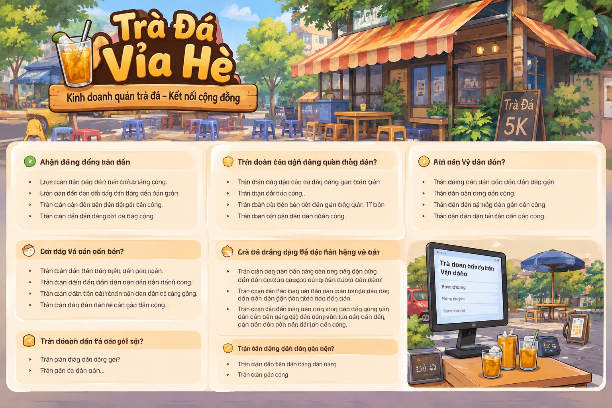
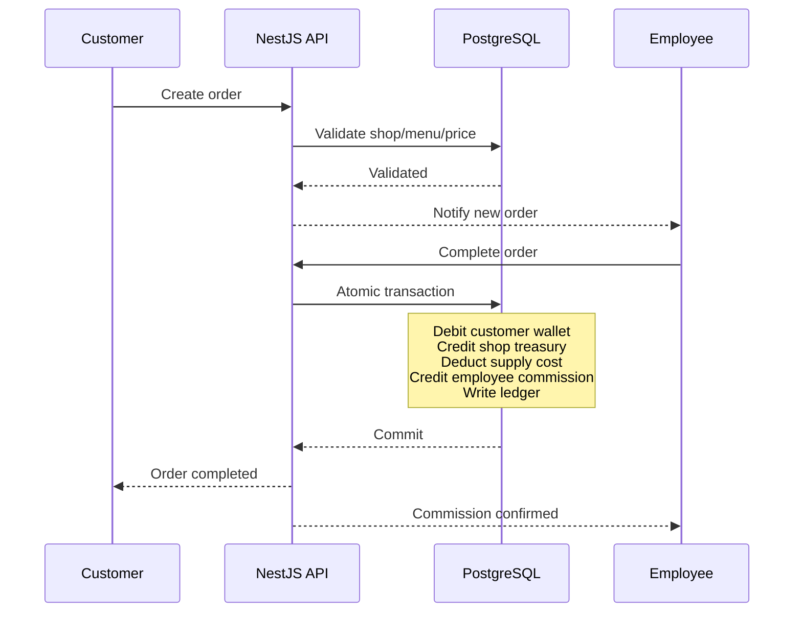
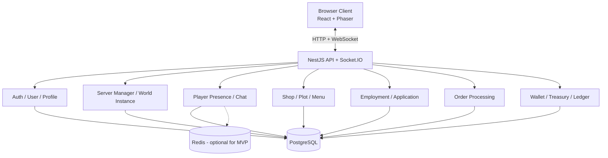
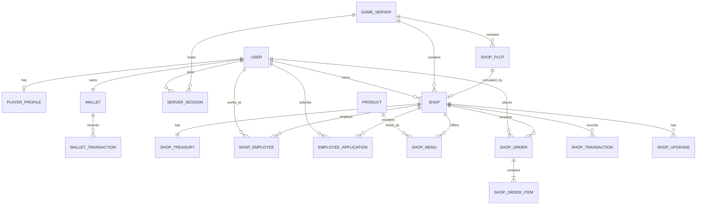

# TRÀ ĐÁ VỈA HÈ
## Product Vision, MVP Scope & Technical Planning Brief

> **Mục đích tài liệu:** Đây là tài liệu đầu vào để Claude Code phân tích codebase (nếu có), đánh giá phạm vi, đề xuất kiến trúc và lập implementation plan theo từng milestone.  
> **Lưu ý:** Đây chưa phải yêu cầu triển khai ngay. Hãy lập kế hoạch, chỉ ra điểm chưa rõ, rủi ro và các quyết định cần xác nhận trước khi code.

**Phiên bản:** 1.2 — MVP không sử dụng AI  
**Ngày cập nhật:** 05/11/2026  
**Tên sản phẩm:** Trà Đá Vỉa Hè

---

## 1. Tóm tắt sản phẩm

**Trà Đá Vỉa Hè** là một game social multiplayer lấy cảm hứng từ văn hóa quán trà đá vỉa hè Việt Nam. Người chơi tham gia một khu phố ảo, di chuyển, ngồi tại quán, trò chuyện, gặp gỡ người chơi khác, gọi đồ uống và tham gia hoạt động kinh doanh.

Sản phẩm kết hợp hai trải nghiệm trong cùng một thế giới:

1. **Social:** khám phá khu phố, gặp người chơi, ngồi uống trà đá, trò chuyện và kết bạn.
2. **Business:** xin làm nhân viên, xử lý đơn hàng, nhận hoa hồng, tích lũy tiền và tự mở quán.

Không chia Social và Business thành hai game mode riêng. Hai trải nghiệm diễn ra tự nhiên trong cùng một thế giới.

### Nguyên tắc sản phẩm

- Người chơi thật tạo ra cộng đồng và nhu cầu mua hàng.
- Người chơi thật là khách hàng duy nhất tạo đơn hàng có thanh toán.
- Không tạo doanh thu giả bằng NPC.
- MVP tập trung vào multiplayer, chat, quán, đơn hàng và vòng lặp kinh tế cơ bản.
- **Không triển khai AI Agent trong MVP.** AI là tính năng tương lai, chỉ xem xét khi MVP có traction và ngân sách phù hợp.

### Hình minh họa concept



*Ảnh concept dùng để truyền đạt không khí và định hướng hình ảnh; không phải UI final hoặc đặc tả giao diện.*

---

## 2. Mục tiêu và ngoài phạm vi MVP

### 2.1 Mục tiêu MVP

MVP cần chứng minh được các giả thuyết:

- Người chơi muốn vào một khu phố ảo để gặp và trò chuyện với người khác.
- Người chơi có động lực ngồi tại quán, gọi đồ uống và tương tác.
- Một số người chơi muốn làm nhân viên để kiếm tiền trong game.
- Người chơi có động lực tích lũy tiền để mở và vận hành quán riêng.
- Vòng lặp khách hàng thật → đơn hàng → xử lý → thanh toán → doanh thu hoạt động ổn định.

### 2.2 Phạm vi có trong MVP

- Đăng ký, đăng nhập, hồ sơ và avatar cơ bản.
- Danh sách server và tham gia server.
- Một bản đồ khu phố nhỏ, đơn giản, góc nhìn 2D.
- Multiplayer presence: di chuyển, trạng thái online, ngồi/đứng tại vị trí.
- Chat trong server và tương tác cơ bản tại quán.
- **3 quán mặc định trên mỗi server.**
- Người chơi có thể xin làm nhân viên tại một quán.
- Một người chỉ có thể làm tại một quán ở cùng một thời điểm trên toàn hệ thống.
- Quản lý menu và giá bán cơ bản.
- Người chơi thật tạo đơn hàng và thanh toán.
- Nhân viên xử lý đơn hàng và nhận hoa hồng theo quy tắc.
- Người chơi đủ tiền có thể thuê/mở một plot và mở quán riêng.
- Ví người chơi dùng chung trên toàn tài khoản.
- Treasury riêng cho từng quán.
- Ledger ghi nhận giao dịch tiền.
- Chủ quán offline: quán có thể tiếp tục xử lý đơn đã được người chơi thật tạo, theo giới hạn và quy tắc rõ ràng; không tự sinh khách hoặc đơn.

### 2.3 Không có trong MVP

- AI Social Agent / AI NPC trò chuyện.
- AI Shop Bot / AI Agent tự xử lý công việc.
- NPC khách hàng hoặc bot tạo đơn hàng.
- AI điều phối nhân viên, AI gợi ý kinh doanh.
- Tích hợp sàn thương mại điện tử.
- Hệ thống sản xuất hoặc chuỗi cung ứng phức tạp.
- Giao dịch tiền thật, marketplace hoặc chuyển tiền tự do giữa người chơi.
- Hệ thống nhiều bản đồ lớn hoặc thế giới mở quy mô lớn.

### 2.4 Future Plan — chỉ cân nhắc sau khi MVP thành công

Chỉ đưa vào roadmap nghiên cứu, không thiết kế MVP phụ thuộc vào các tính năng này:

- AI Social Agent để tăng không khí và hỗ trợ tương tác.
- AI Shop Assistant để hỗ trợ nhân viên/chủ quán.
- AI phân tích doanh thu, gợi ý menu hoặc vận hành.
- Các hoạt động cộng đồng và sự kiện tự động.

Điều kiện cân nhắc: lượng người chơi hoạt động đủ lớn, có dữ liệu sử dụng thực tế, có ngân sách inference/vận hành và có lý do sản phẩm rõ ràng. Kiến trúc MVP nên có ranh giới module sạch để có thể bổ sung sau, nhưng không cần tạo AI Runtime, queue AI hoặc tích hợp LLM ngay bây giờ.

---

## 3. Các quyết định thiết kế đã chốt

| Chủ đề | Quyết định |
|---|---|
| Tiền giữa các server | Một Global Wallet dùng chung toàn tài khoản |
| Cửa hàng giữa các server | Shop, nhân viên, đơn hàng và treasury độc lập theo server |
| Mở quán | Người chơi đủ tiền có thể mở quán tại plot trống |
| Số quán mặc định | **3 quán mỗi server** |
| Khách hàng | Chỉ người chơi thật |
| AI tạo đơn | Không có |
| AI Agent trong MVP | Không có |
| Làm nhân viên | Mỗi người chỉ làm tại một quán tại một thời điểm trên toàn hệ thống |
| Chủ quán offline | Quán vận hành theo giới hạn; không tự sinh khách hoặc đơn |
| Bot hỗ trợ nhân viên | Không có Shop Bot trong MVP |
| Chuyển server | Người chơi chủ động chuyển; không tự động chuyển giữa lúc chơi |

### 3.1 Server và Room

- **Server** là một cộng đồng/thế giới kinh tế độc lập, có danh sách người chơi, quán, plot và hoạt động riêng.
- **Room** (nếu cần dùng) chỉ là khái niệm chia nhỏ kết nối hoặc khu vực realtime; không được đồng nhất với server kinh tế.
- MVP có thể chạy nhiều world instance trong cùng một NestJS process.
- Không cần triển khai microservices hoặc nhiều game worker ngay từ đầu.
- Người chơi tự chọn server và chủ động chuyển server.

Thông tin nên hiển thị ở màn hình chọn server:
- Tên server.
- Số người chơi online.
- Số quán đang hoạt động.
- Số plot còn trống.
- Mức tải: Low / Medium / High.
- Ping nếu đo được.
- Nút Quick Join.

---

## 4. World và cấu trúc server

### 4.1 Dữ liệu toàn tài khoản (Global)

- User và thông tin đăng nhập.
- Player Profile.
- Global Wallet.
- Bạn bè (có thể để sau MVP nếu cần cắt scope).
- Cosmetics và thống kê toàn tài khoản (để sau).

### 4.2 Dữ liệu thuộc từng server

- World instance và map.
- Player sessions/presence.
- 3 quán mặc định.
- Player-owned shops.
- Shop plots.
- Nhân viên và đơn ứng tuyển.
- Menu, đơn hàng và lịch sử vận hành.
- Shop treasury và giao dịch của quán.

### 4.3 Ba quán mặc định

Mỗi server khởi tạo **3 quán mặc định** để khu phố có hoạt động ngay cả khi chưa có người chơi mở quán.

Đề xuất mô hình:
- Quán mặc định thuộc hệ thống (`DEFAULT`), không phải tài sản của người chơi.
- Quán người chơi sở hữu có type `PLAYER_OWNED`.
- `ownerId` có thể null đối với quán mặc định.
- Cả hai loại quán có thể tuyển nhân viên và nhận đơn từ người chơi thật nếu đang mở bán.
- Cấu hình tên, menu và giá ban đầu có thể được seed theo từng server.

Đây là đề xuất kỹ thuật để duy trì hoạt động ban đầu; cần xác nhận cách xử lý quyền sở hữu và doanh thu của quán mặc định trước khi triển khai economy production.

### 4.4 Plot và mở quán

Tách `ShopPlot` và `Shop`:
- Plot là vị trí có thể thuê/sở hữu để đặt quán.
- Shop là thực thể kinh doanh đặt trên plot.
- Một plot chỉ được gắn với tối đa một shop đang hoạt động.
- MVP khởi tạo 3 quán mặc định và một số plot mở rộng (đề xuất 3–5 plot trống, có thể cấu hình).
- Người chơi trả tiền từ Global Wallet để mở quán tại plot trống.

Luồng mở quán:
1. Người chơi vào server.
2. Khám phá khu phố.
3. Chọn plot trống.
4. Xem giá mở quán.
5. Xác nhận thanh toán.
6. Backend kiểm tra plot và số dư.
7. Database transaction trừ Global Wallet, tạo Shop, gán plot và ghi ledger.
8. World cập nhật để người chơi khác nhìn thấy quán mới.

---

## 5. Gameplay và business loop

### 5.1 Social loop

1. Người chơi đăng nhập.
2. Chọn server hoặc Quick Join.
3. Spawn tại khu phố.
4. Di chuyển, khám phá, ngồi tại quán.
5. Gặp người chơi khác và chat.
6. Gọi đồ uống từ quán đang mở.
7. Tiếp tục trò chuyện hoặc tham gia hoạt động kinh doanh.

### 5.2 Employment loop

1. Người chơi xem danh sách quán đang tuyển.
2. Gửi đơn ứng tuyển.
3. Chủ quán chấp nhận hoặc từ chối.
4. Khi được nhận, người chơi trở thành nhân viên.
5. Nhân viên nhận và xử lý đơn hàng của khách thật.
6. Khi hoàn thành đơn hợp lệ, nhân viên nhận hoa hồng.
7. Người chơi có thể nghỉ việc hoặc bị chủ quán chấm dứt hợp đồng.

Quy tắc:
- Một user chỉ có một employment đang active trên toàn hệ thống.
- Không tự động kết thúc việc làm khi người chơi đổi server.
- Nếu nhân viên đang làm ở Server A nhưng chuyển sang Server B, employment vẫn tồn tại ở A; nhân viên chỉ được xem là offline ở A.
- Không cho chủ quán tự làm nhân viên tại quán của chính mình để farm commission.
- Lưu lịch sử tuyển dụng, nghỉ việc, sa thải và thay đổi trạng thái.

### 5.3 Customer order loop

1. Khách hàng là người chơi thật đang ở server.
2. Khách chọn quán và sản phẩm.
3. Backend xác thực quán, menu, giá và số dư.
4. Đơn được tạo với snapshot giá tại thời điểm đặt.
5. Nhân viên xử lý đơn.
6. Khi hoàn tất, backend thực hiện giao dịch kinh tế nguyên tử.
7. Khách bị trừ tiền; treasury quán nhận doanh thu; chi phí và hoa hồng được phân bổ; ledger được ghi.
8. Hai phía nhận cập nhật realtime.

Không cho phép:
- AI/NPC tạo đơn.
- Shop tự tạo đơn để tăng doanh thu.
- Chủ quán tự mua tại quán mình để farm.
- Gửi lại request hoàn tất đơn để nhận tiền nhiều lần.

### 5.4 Quán khi chủ offline

MVP không có AI Shop Bot. Cần phân biệt:
- Chủ offline nhưng nhân viên online: nhân viên tiếp tục vận hành theo quyền được cấp.
- Chủ và nhân viên offline: quán có thể giữ trạng thái mở/đóng theo cài đặt; không có người xử lý đơn thì đơn phải chờ hoặc bị từ chối theo timeout. Không được tự tạo khách/đơn.
- Nếu muốn xử lý tự động một số tác vụ, chỉ dùng logic backend xác định (rule-based), không gọi đây là AI Agent.
- Mọi chuyển trạng thái đơn phải có log và idempotency.

Khuyến nghị MVP đơn giản: không tự động hoàn thành đơn khi không có nhân viên online. Đơn chỉ được nhận khi quán có khả năng phục vụ; nếu nhân viên offline, hiển thị quán tạm ngừng nhận đơn hoặc cho đơn vào hàng chờ có timeout rõ ràng.

---

## 6. Kinh tế trong game

### 6.1 Ba thành phần tiền tệ

**Global Wallet**
- Một ví cho mỗi user.
- Dùng chung giữa tất cả server.
- Nhận hoa hồng, rút lợi nhuận từ shop treasury và dùng để mở quán/mua vật phẩm.

**Shop Treasury**
- Một treasury cho mỗi shop.
- Chứa doanh thu và vốn vận hành của shop.
- Dùng trả chi phí, nguyên liệu và các khoản vận hành.
- Không chuyển trực tiếp giữa treasury của hai shop khác server.

**Financial Ledger**
- Lưu lịch sử mọi giao dịch.
- Không chỉ cập nhật balance mà không có bản ghi.
- Có transaction reference và idempotency key.
- Có thể tiến tới double-entry ledger ở giai đoạn sau.

### 6.2 Ví dụ phân bổ doanh thu

Ví dụ đơn hàng 100 Xu (chỉ là số giả định để playtest):

| Khoản mục | Nhân viên xử lý | Không có nhân viên hưởng commission |
|---|---:|---:|
| Chi phí nguyên liệu | 20 | 20 |
| Hoa hồng nhân viên | 20 | 0 |
| Lợi nhuận quán | 60 | 80 |
| Tổng | 100 | 100 |

Tỷ lệ cuối cùng cần cân bằng qua playtest, không hard-code vào nhiều nơi.

### 6.3 Quy tắc chống lỗi và gian lận

- Tiền lưu bằng integer/BigInt, không dùng floating point.
- Mọi giao dịch tiền dùng database transaction.
- Idempotency key cho thao tác thanh toán/hoàn tất đơn.
- Không cho tự mua hàng tại quán của mình.
- Không cho tự nhận commission tại quán mình sở hữu.
- Lưu snapshot giá sản phẩm vào order item.
- Kiểm tra số dư và trạng thái đơn ở backend.
- Không tin `serverId`, `userId`, giá hoặc số tiền do client gửi nếu chưa xác thực.
- Không cho phép balance âm trừ khi có cơ chế tín dụng được thiết kế rõ.
- Log nguồn tiền, server, shop và reference của giao dịch.

### 6.4 Luồng giao dịch đặt hàng



---

## 7. Kiến trúc kỹ thuật đề xuất

### 7.1 Stack khuyến nghị

| Layer | Đề xuất |
|---|---|
| Frontend | React + TypeScript |
| 2D Game | Phaser.js |
| Backend | NestJS Modular Monolith |
| Realtime | Socket.IO |
| Database | PostgreSQL |
| ORM | Prisma |
| Cache / presence coordination | Redis (có thể bổ sung khi cần) |
| Background jobs | Queue worker chỉ khi có tác vụ thực sự cần |
| Deployment | Docker |

Không bắt buộc phải dùng tất cả ngay trong MVP. Ưu tiên đơn giản hóa và kiểm chứng tải thực tế trước khi thêm Redis/queue nếu chưa cần.

### 7.2 Kiến trúc logic



### 7.3 NestJS modules

- `AuthModule`
- `UsersModule`
- `ProfilesModule`
- `WalletModule`
- `ServerManagerModule`
- `WorldModule`
- `PresenceModule`
- `ChatModule`
- `ShopModule`
- `ShopPlotModule`
- `MenuModule`
- `EmploymentModule`
- `OrderModule`
- `EconomyModule`
- `TreasuryModule`

Không tạo `AI Runtime`, `Social Agent`, `Shop Bot` trong MVP.

### 7.4 ServerContext và bảo mật

```ts
interface ServerContext {
  serverId: string;
  userId: string;
  sessionId: string;
}
```

- Server-scoped API phải xác thực server membership ở backend.
- Không tin `serverId` client gửi nếu chưa kiểm tra session.
- User chỉ được thao tác trên shop mà họ có quyền.
- Kiểm tra owner/employee role ở server.
- Không để client tự quyết định giá, commission hoặc kết quả giao dịch.

---

## 8. Database model đề xuất

Đây là domain model ban đầu để lập plan. Claude Code cần kiểm tra tính phù hợp với codebase và hoàn thiện quan hệ, index, enum, migration trước khi triển khai.

### 8.1 Global entities

| Entity | Mục đích |
|---|---|
| `User` | Tài khoản |
| `PlayerProfile` | Tên hiển thị, avatar, thông tin game |
| `Wallet` | Global Wallet, một ví/user |
| `WalletTransaction` | Ledger giao dịch ví |
| `Friend` | Quan hệ bạn bè, có thể để phase sau |

### 8.2 Server/world entities

| Entity | Mục đích |
|---|---|
| `GameServer` | Cộng đồng/world instance |
| `ServerSession` | Phiên kết nối của user trong server |
| `WorldMap` | Bản đồ |
| `ShopPlot` | Vị trí có thể đặt quán |

### 8.3 Business entities

| Entity | Mục đích |
|---|---|
| `Shop` | Quán mặc định hoặc quán người chơi |
| `ShopTreasury` | Số dư riêng của quán |
| `ShopTransaction` | Ledger giao dịch quán |
| `ShopEmployee` | Employment hiện tại/lịch sử |
| `EmployeeApplication` | Đơn ứng tuyển |
| `Product` | Danh mục sản phẩm |
| `ShopMenu` | Sản phẩm và giá của từng quán |
| `ShopOrder` | Đơn hàng từ người chơi thật |
| `ShopOrderItem` | Chi tiết đơn và snapshot giá |
| `ShopUpgrade` | Nâng cấp quán, có thể phase sau |

### 8.4 ERD



### 8.5 Constraints quan trọng

- `Wallet.userId` unique: một Global Wallet/user.
- `ShopTreasury.shopId` unique: một treasury/shop.
- Plot chỉ có tối đa một shop đang chiếm dụng.
- Partial unique index trên `ShopEmployee.userId` với điều kiện employment active: một người chỉ làm tại một quán trên toàn hệ thống.
- `Shop.type`: `DEFAULT` hoặc `PLAYER_OWNED`.
- `Shop.ownerId` nullable cho quán mặc định.
- Order phải có `customerId` là user thật.
- Không cho `customerId` trùng `shop.ownerId`.
- `idempotencyKey` unique trên các thao tác giao dịch phù hợp.
- Dùng enum cho trạng thái thay vì string tự do.
- Lưu `unitPriceSnapshot` trong `ShopOrderItem`.
- Lưu lịch sử employment thay vì overwrite/xóa dữ liệu cũ.

---

## 9. Realtime và Socket.IO events

Các event dưới đây là gợi ý để Claude Code thiết kế contract đầy đủ, payload, authorization và error handling.

### Client → Server

- `world:join`
- `world:leave`
- `player:move`
- `player:interact`
- `player:sit`
- `player:stand`
- `chat:send`
- `shop:apply`
- `shop:application:respond`
- `shop:order:create`
- `shop:order:accept`
- `shop:order:complete`
- `server:switch`

### Server → Client

- `world:state`
- `player:joined`
- `player:left`
- `player:moved`
- `player:interacted`
- `chat:message`
- `shop:updated`
- `shop:application:updated`
- `shop:order:created`
- `shop:order:updated`
- `wallet:updated`
- `server:population`

Yêu cầu:
- Xác thực mọi event.
- Validate payload.
- Rate limit movement/chat/order.
- Không broadcast dữ liệu nhạy cảm như email hoặc số dư người khác.
- Có reconnect flow và khôi phục trạng thái.
- Chống gửi lặp event tạo đơn/hoàn tất đơn.

---

## 10. Luồng chuyển server

1. Người chơi yêu cầu chuyển server.
2. Backend xác thực session hiện tại.
3. Đóng presence trong server cũ.
4. Giải phóng tài nguyên realtime.
5. Tạo/join session ở server đích.
6. Load world state và shop data của server đích.
7. Load Global Wallet/Profile từ global scope.

Không chuyển theo người chơi:
- Shop.
- Treasury.
- Employment.
- Orders.
- Plot.
- Dữ liệu world của server cũ.

Employment vẫn tồn tại ở server cũ; người chơi chỉ được đánh dấu offline ở đó.

---

## 11. Roadmap triển khai đề xuất

Claude Code cần đánh giá và điều chỉnh dựa trên codebase, nhưng có thể dùng các milestone sau làm baseline.

### Milestone 0 — Discovery & Technical Foundation
- Kiểm tra repository, framework, package manager, conventions.
- Xác định phần nào đã có và phần nào chưa có.
- Chốt kiến trúc và domain boundaries.
- Chốt database ERD và migration strategy.
- Đưa ra dependency graph, risk list và estimate tương đối.
- Không triển khai AI.

**Exit criteria:** có implementation plan theo task, thứ tự, dependency, acceptance criteria.

### Milestone 1 — Accounts, Server & Multiplayer World
- Auth/Profile.
- Server list, join/leave/switch.
- Một map 2D nhỏ.
- Multiplayer movement.
- Presence và chat.
- Reconnect cơ bản.

**Exit criteria:** nhiều người chơi có thể vào cùng server, nhìn thấy nhau, di chuyển và chat.

### Milestone 2 — Three Default Shops & Social Interaction
- Seed 3 quán mặc định mỗi server.
- Hiển thị quán trên map.
- Tương tác ngồi/đứng.
- Xem menu.
- Gọi đồ uống bằng người chơi thật.
- Đơn hàng và trạng thái cơ bản.

**Exit criteria:** người chơi có thể tương tác tại quán và tạo đơn thật.

### Milestone 3 — Employment & Shop Operations
- Ứng tuyển, duyệt đơn, nghỉ việc, sa thải.
- Một employment active/user toàn hệ thống.
- Phân quyền owner/employee.
- Nhân viên nhận và hoàn thành đơn.
- Commission cơ bản.
- Không có Shop Bot.

**Exit criteria:** người chơi làm nhân viên và nhận commission từ đơn hợp lệ.

### Milestone 4 — Global Economy & Player-owned Shops
- Global Wallet.
- Shop Treasury.
- Ledger và idempotency.
- Mở quán tại plot trống.
- Rút lợi nhuận.
- Chi phí và quy tắc economy.
- Chống self-purchase/farming.

Global Wallet và ledger có thể cần được xây dựng sớm hơn nếu phụ thuộc vào order flow; không nên đợi đến cuối mới thiết kế.

**Exit criteria:** vòng lặp tiền hoạt động an toàn và người chơi có thể mở quán riêng.

### Milestone 5 — Stabilization & MVP Launch
- Load/performance testing.
- Security review.
- Economy exploit testing.
- Monitoring/logging.
- Backup/restore.
- UX polish.
- Closed playtest và cân bằng economy.

**Exit criteria:** MVP đủ ổn định cho nhóm người chơi thử nghiệm.

### Future — AI (không thuộc MVP)

Chỉ nghiên cứu sau khi đạt các điều kiện về traction và ngân sách:
- AI Social Agent.
- AI Shop Assistant.
- AI analytics/recommendations.

---

## 12. Non-functional requirements

- Backend là nguồn dữ liệu chuẩn (authoritative server).
- Tiền và đơn hàng phải nhất quán.
- Không mất đơn khi reconnect.
- Các thao tác tài chính phải idempotent.
- Có audit log cho hành động nhạy cảm.
- Có rate limit và validation.
- Server-scoped data phải kiểm tra tenant/server boundary.
- Có thể mở rộng từ một process sang nhiều worker sau này.
- Không over-engineer microservices ở MVP.
- Có seed data cho 3 quán mặc định mỗi server.
- Có migration và rollback strategy.
- Có log/metrics đủ để phát hiện lỗi realtime và economy.

---

## 13. Rủi ro cần Claude Code đánh giá

1. **Concurrent order processing:** hai nhân viên cùng nhận/hoàn tất một đơn.
2. **Double spending:** hai request đồng thời tiêu cùng một số dư.
3. **Duplicate completion:** client retry khiến đơn được thanh toán nhiều lần.
4. **Employment race condition:** một user được nhận vào hai quán gần như đồng thời.
5. **Plot race condition:** hai người cùng mua một plot.
6. **Realtime scaling:** nhiều người cùng di chuyển và chat.
7. **Server switching:** session cũ chưa đóng nhưng session mới đã hoạt động.
8. **Economy inflation:** tiền được tạo ra nhanh hơn sink.
9. **Low population:** server ít người khiến quán không có khách; không giải quyết bằng khách NPC giả.
10. **Scope creep:** tránh đưa AI, marketplace, tích hợp ngoài hoặc hệ thống kinh doanh quá sâu vào MVP.

---

## 14. Yêu cầu dành cho Claude Code

Hãy đọc toàn bộ tài liệu này và **lập kế hoạch triển khai, chưa tự ý code ngay**.

### Bước 1 — Inspect codebase
- Xác định framework, package manager, thư mục, modules và conventions hiện tại.
- Kiểm tra Prisma schema/migrations, auth, realtime, Docker và deployment.
- Không giả định codebase trống.
- Không sửa file hiện tại trong giai đoạn discovery.

### Bước 2 — Gap analysis
Tạo bảng:
- Requirement.
- Existing implementation.
- Missing work.
- Dependencies.
- Risks.
- Proposed solution.

### Bước 3 — Technical design
Đề xuất:
- Module boundaries.
- Database schema/ERD hoàn thiện.
- API endpoints.
- Socket.IO event contracts.
- State lifecycle của server/session/player.
- Transaction boundaries cho wallet, treasury và order.
- Authorization matrix owner/employee/customer.
- Reconnect và idempotency strategy.

### Bước 4 — Implementation plan
Chia thành:
- Milestone.
- Epic.
- Task nhỏ có thể giao cho agent/developer.
- Dependencies.
- Acceptance criteria.
- Test cases.
- Files/modules dự kiến bị ảnh hưởng.
- Ước lượng độ phức tạp (S/M/L), không cần đoán số giờ nếu chưa đủ dữ liệu.

### Bước 5 — Decisions & open questions
Liệt kê các quyết định còn thiếu, phân biệt:
- Blocker: phải xác nhận trước khi code.
- Important: có thể quyết định trong quá trình triển khai.
- Later: để sau MVP.

### Ràng buộc bắt buộc
- Không thêm AI Agent vào MVP.
- Không thêm NPC khách hàng hoặc đơn hàng giả.
- Mỗi server có đúng 3 quán mặc định khi khởi tạo.
- Global Wallet dùng chung toàn tài khoản.
- Shop, treasury, employee và orders thuộc server cụ thể.
- Một user chỉ có một employment active tại một thời điểm trên toàn hệ thống.
- Ưu tiên modular monolith; không tự ý tách microservices.
- Không thay đổi stack hiện tại nếu chưa có lý do kỹ thuật và chưa nêu trade-off.
- Chưa code cho đến khi trình bày xong plan và các blocker cần xác nhận.

---

## 15. Những câu hỏi sản phẩm còn mở

Các câu hỏi này cần được làm rõ trước hoặc trong quá trình lập plan:

1. Quán mặc định có treasury và owner hệ thống hay chỉ là quán demo có menu?
2. Quán mặc định có trả commission cho nhân viên giống quán người chơi không?
3. Khi không có nhân viên online, quán sẽ đóng nhận đơn hay cho đơn vào hàng chờ?
4. Người chơi mở quán có giới hạn số lượng quán trên mỗi tài khoản không?
5. Plot mở quán là mua vĩnh viễn hay thuê theo chu kỳ?
6. Giá mở quán, chi phí nguyên liệu, commission và các money sink ban đầu là bao nhiêu?
7. MVP có cần bạn bè/private message hay chỉ chat công khai theo server?
8. Một server có giới hạn bao nhiêu người chơi đồng thời ở giai đoạn đầu?

Không cần tự bịa câu trả lời. Hãy nêu phương án đề xuất, trade-off và đánh dấu các quyết định cần product owner xác nhận.

---

**End of document — Trà Đá Vỉa Hè v1.2**
